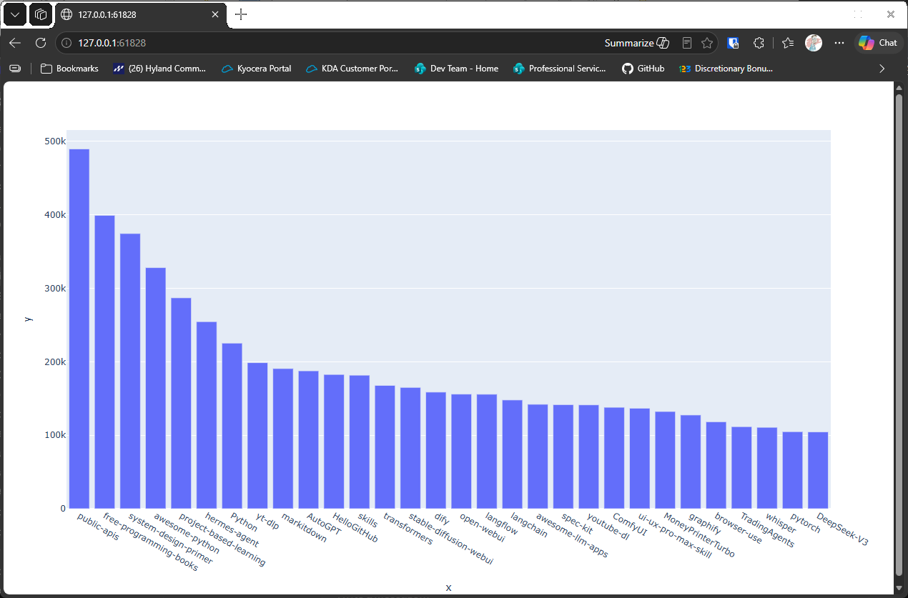

# Visualizing Results

## Introduction

A table of repositories is useful, but a chart shows at a glance which projects have the most stars. This
lesson collects the names and star counts into lists, then draws a bar chart with plotly Express.

---

## The Code

```python
"""Lesson 1.6 - Visualizing Results"""

import sys
import requests
import plotly.express as px

url = "https://api.github.com/search/repositories"
query_string = "?q=language:python+sort:stars+stars:>10000"
request_url = url + query_string
headers = {"Accept": "application/vnd.github.v3+json"}

response = requests.get(request_url, headers=headers, timeout=10)
print(f"Status code: {response.status_code}")

response_dict = response.json()

if response.status_code != 200:
    print(f"API connection to [{url}] failed\n\twith status code: {response.status_code}")
    sys.exit(-1)

print("Success:")

print(f"- Total repositories: {response_dict['total_count']}")
print(f"- Complete results: {not response_dict['incomplete_results']}")

repo_dicts = response_dict['items']

# Process the repo information
names, stars = [], []
for repo in repo_dicts:
    names.append(repo["name"])
    stars.append(repo["stargazers_count"])

# Visualize
fig = px.bar(x=names, y=stars)
fig.show()
```

---

### Walking Through the Code

**Collecting the data.** The loop builds two lists, one of names and one of star counts. Plotly Express needs
lists of values, not dictionaries.

**A bar chart.** `px.bar(x=names, y=stars)` makes one bar for each repository, labeled with its name. `fig.show()`
opens the chart in your browser.

---

### Output

Your browser opens a bar chart of the repositories, with their names along the bottom and their star counts up the
side. The labels are the plotly defaults, which the next lessons improve.



---
