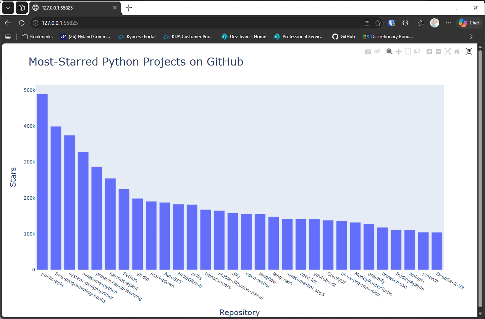

# Styling the Chart

## Introduction

The chart from the last lesson has default labels and a default title. This lesson adds a title, axis labels,
and font sizes, so the chart explains itself.

---

## The Code

```python
"""Lesson 1.7 - Styling the Chart"""

import sys
import requests
import plotly.express as px

url = "https://api.github.com/search/repositories"
query_string = "?q=language:python+sort:stars+stars:>10000"
request_url = url + query_string
headers = {"Accept": "application/vnd.github.v3+json"}

response = requests.get(request_url, headers=headers, timeout=10)
response_dict = response.json()


if response.status_code != 200:
    print(f"API connection to [{url}] failed\n\twith status code: {response.status_code}")
    sys.exit(-1)

repo_dicts = response_dict['items']

# Process the repo information
names, stars = [], []
for repo in repo_dicts:
    names.append(repo["name"])
    stars.append(repo["stargazers_count"])

# Visualize
title = "Most-Starred Python Projects on GitHub"
labels = {"x": "Repository", "y": "Stars"}
fig = px.bar(x=names, y=stars, title=title, labels=labels)
fig.update_layout(title_font_size=28, xaxis_title_font_size=20, yaxis_title_font_size=20)

fig.show()
```

---

### Walking Through the Code

**Title and labels.** `title` and `labels` are passed to `px.bar()`. The `labels` dictionary names the x and y
axes, so the chart no longer shows the raw field names.

**Font sizes.** `update_layout()` changes the chart after it's created. `title_font_size` and the two axis title
sizes are set here, so the text is large enough to read from a distance.

---

### Output

The chart now has the title "Most-Starred Python Projects on GitHub", with "Repository" along the bottom and
"Stars" up the side. The text is larger than before.



---
