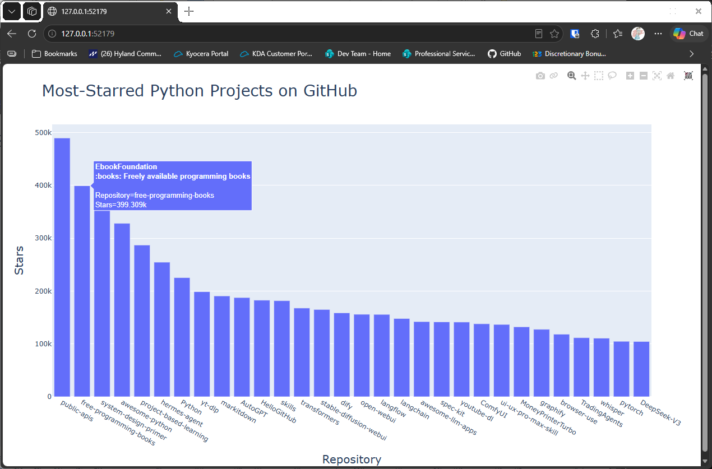

# Custom Tooltips

## Introduction

A bar's tooltip is the box that appears when you move the mouse over it. The default tooltip only shows the
values on the axes. This lesson adds the owner and description of each repository to the tooltip, so the chart
says more about each bar.

---

## The Code

```python
"""Lesson 1.8 - Custom Tooltips"""

import sys
import requests
import plotly.express as px

url = "https://api.github.com/search/repositories"
query_string = "?q=language:python+sort:stars+stars:>10000"
request_url = url + query_string
headers = {"Accept": "application/vnd.github.v3+json"}

response = requests.get(request_url, headers=headers, timeout=10)
response_dict = response.json()


if response.status_code != 200:
    print(f"API connection to [{url}] failed\n\twith status code: {response.status_code}")
    sys.exit(-1)

repo_dicts = response_dict['items']

# Process the repo information
# Add a list for the tool-tip text
names, stars, hover_texts = [], [], []
for repo in repo_dicts:
    names.append(repo["name"])
    stars.append(repo["stargazers_count"])

    # Populate the tool-tip list
    owner = repo["owner"]["login"]
    description = repo["description"]
    hover_text = f"{owner}<br>{description}"
    hover_texts.append(hover_text)

# Visualize
title = "Most-Starred Python Projects on GitHub"
labels = {"x": "Repository", "y": "Stars"}
# Add tool-tips to the figure
fig = px.bar(x=names, y=stars, title=title, labels=labels, hover_name=hover_texts)
fig.update_layout(title_font_size=28, xaxis_title_font_size=20, yaxis_title_font_size=20)

fig.show()
```

---

### Walking Through the Code

**Building the tooltip text.** Each tooltip is a string made from the owner's name and the description. The
`<br>` tag inside the string starts a new line in the tooltip.

**Passing the tooltips.** `hover_name=hover_texts` tells plotly to use each string as the tooltip for its bar.

---

### Output

Moving the mouse over a bar shows a tooltip with the owner's name on one line and the description below it.



---
