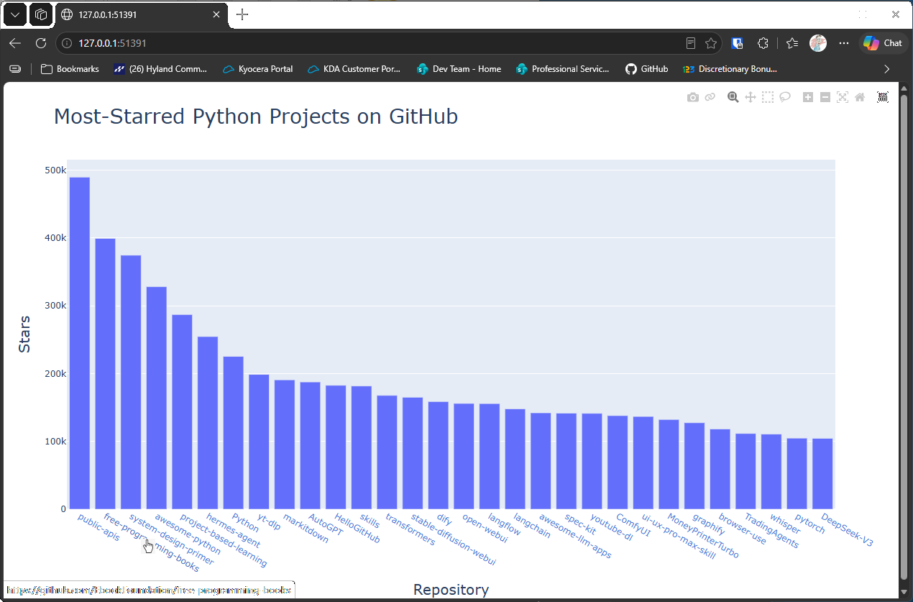

# Adding Links

## Introduction

The bars in the chart are labeled with repository names, but a reader can't click through to a repository from
the chart. This lesson turns each name into a link to the repository's page on GitHub.

---

## The Code

```python
"""Lesson 1.9 - Adding Links"""

import sys
import requests
import plotly.express as px

url = "https://api.github.com/search/repositories"
query_string = "?q=language:python+sort:stars+stars:>10000"
request_url = url + query_string
headers = {"Accept": "application/vnd.github.v3+json"}

response = requests.get(request_url, headers=headers, timeout=10)
response_dict = response.json()


if response.status_code != 200:
    print(f"API connection to [{url}] failed\n\twith status code: {response.status_code}")
    sys.exit(-1)

repo_dicts = response_dict['items']

# Process the repo information
links, stars, hover_texts = [], [], []
for repo in repo_dicts:
    # We'll use name more than once, so stash it in a variable
    name = repo["name"]
    url = repo["html_url"]
    link = f"<a href='{url}'>{name}</a>"

    # Add the link instead of the name
    links.append(link)
    stars.append(repo["stargazers_count"])

    owner = repo["owner"]["login"]
    description = repo["description"]
    hover_text = f"{owner}<br>{description}"
    hover_texts.append(hover_text)

# Visualize
title = "Most-Starred Python Projects on GitHub"
labels = {"x": "Repository", "y": "Stars"}
# Change the x-axis to use our links
fig = px.bar(x=links, y=stars, title=title, labels=labels, hover_name=hover_texts)
fig.update_layout(title_font_size=28, xaxis_title_font_size=20, yaxis_title_font_size=20)

fig.show()
```

---

### Walking Through the Code

**Building the link.** `f"<a href='{url}'>{name}</a>"` is an HTML anchor tag. The text shown is the repository's
name, and the `href` is its address on GitHub.

**Using links on the axis.** The `links` list replaces the plain names in the call to `px.bar()`, so the labels
along the bottom become clickable.

**A variable name clash.** The loop reassigns `url`, which was the API address earlier in the script. The API
address isn't used again after the requests are made, so it doesn't matter here, but a name that's used for
two different things is worth avoiding.

---

### Output

The bars are labeled with clickable repository names. Clicking a name opens that repository's page on GitHub.



---
