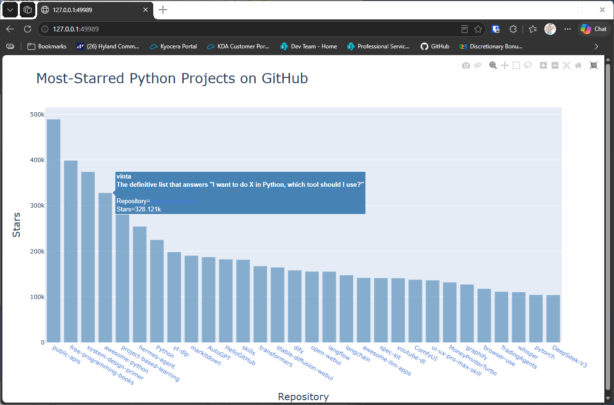

# Final Styling

## Introduction

This lesson finishes the GitHub chart. It keeps the links, tooltips, and labels from the last lesson, and it
sets the color of the bars, so the chart matches the rest of the series.

---

## The Code

```python
"""Lesson 1.10 - Final Styling"""

import sys
import requests
import plotly.express as px

url = "https://api.github.com/search/repositories"
query_string = "?q=language:python+sort:stars+stars:>10000"
request_url = url + query_string
headers = {"Accept": "application/vnd.github.v3+json"}

response = requests.get(request_url, headers=headers, timeout=10)
response_dict = response.json()


if response.status_code != 200:
    print(f"API connection to [{url}] failed\n\twith status code: {response.status_code}")
    sys.exit(-1)

repo_dicts = response_dict['items']

# Process the repo information
links, stars, hover_texts = [], [], []
for repo in repo_dicts:
    name = repo["name"]
    url = repo["html_url"]
    link = f"<a href='{url}'>{name}</a>"

    links.append(link)
    stars.append(repo["stargazers_count"])

    owner = repo["owner"]["login"]
    description = repo["description"]
    hover_text = f"{owner}<br>{description}"
    hover_texts.append(hover_text)

# Visualize
title = "Most-Starred Python Projects on GitHub"
labels = {"x": "Repository", "y": "Stars"}
fig = px.bar(x=links, y=stars, title=title, labels=labels, hover_name=hover_texts)
fig.update_layout(title_font_size=28, xaxis_title_font_size=20, yaxis_title_font_size=20)
# Style the bar color
fig.update_traces(marker_color="SteelBlue", marker_opacity=0.6)

fig.show()
```

---

### Walking Through the Code

**Bar color.** `update_traces()` changes the bars themselves, rather than the layout. `marker_color` sets the fill,
and `marker_opacity` makes the bars slightly transparent.

**Putting it together.** This version combines everything so far: the data, the links, the tooltips, the titles,
and the colors.

---

### Output

The finished chart has steel blue bars, a title, labeled axes, tooltips, and link labels.



---
