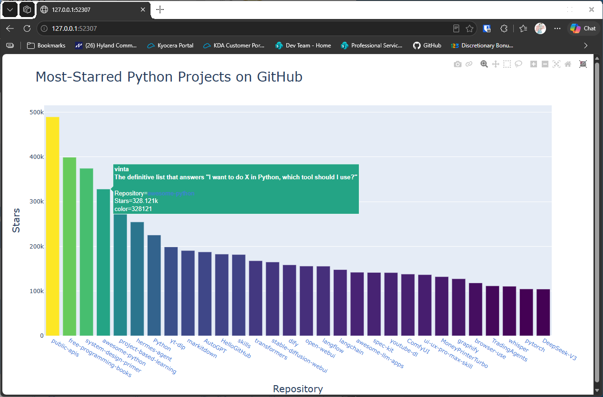

# Adding a Gradient

## Introduction

This bonus lesson colors each bar by its star count, using a gradient. Popular repositories get a different color
from less popular ones, so the scale shows the stars as well as the height of the bar.

---

## The Code

```python
"""Lesson 1.11 - Adding a Gradient"""

import sys
import requests
import plotly.express as px

url = "https://api.github.com/search/repositories"
query_string = "?q=language:python+sort:stars+stars:>10000"
request_url = url + query_string
headers = {"Accept": "application/vnd.github.v3+json"}

response = requests.get(request_url, headers=headers, timeout=10)
response_dict = response.json()


if response.status_code != 200:
    print(f"API connection to [{url}] failed\n\twith status code: {response.status_code}")
    sys.exit(-1)

repo_dicts = response_dict['items']

# Process the repo information
links, stars, hover_texts = [], [], []
for repo in repo_dicts:
    name = repo["name"]
    url = repo["html_url"]
    link = f"<a href='{url}'>{name}</a>"

    links.append(link)
    stars.append(repo["stargazers_count"])

    owner = repo["owner"]["login"]
    description = repo["description"]
    hover_text = f"{owner}<br>{description}"
    hover_texts.append(hover_text)

# Visualize
title = "Most-Starred Python Projects on GitHub"
labels = {"x": "Repository", "y": "Stars"}
fig = px.bar(
    x=links, y=stars, title=title, labels=labels, hover_name=hover_texts,
    # Here, I am assigning "stars" as the color value and using a gradient for the bar colors
    color=stars, color_continuous_scale="Viridis"
)
fig.update_layout(title_font_size=28, xaxis_title_font_size=20, yaxis_title_font_size=20)
# This line hides the scale marker on the right hand side
fig.update(layout_coloraxis_showscale=False)

fig.show()
```

---

### Walking Through the Code

**Coloring by value.** `color=stars` tells plotly to color each bar by its star count. `color_continuous_scale`
sets the gradient, here Viridis.

**Hiding the scale.** The colorbar on the right would repeat information the axes already show, so
`layout_coloraxis_showscale=False` hides it.

---

### Output

The bars now fade from dark purple for the least-starred repositories to yellow for the most-starred ones.



---
