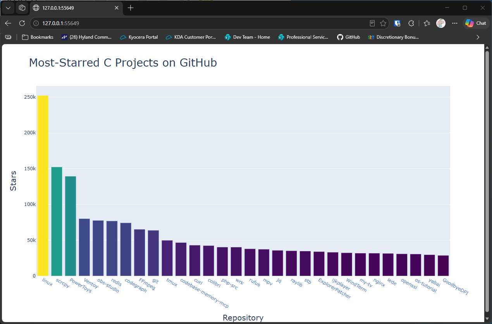
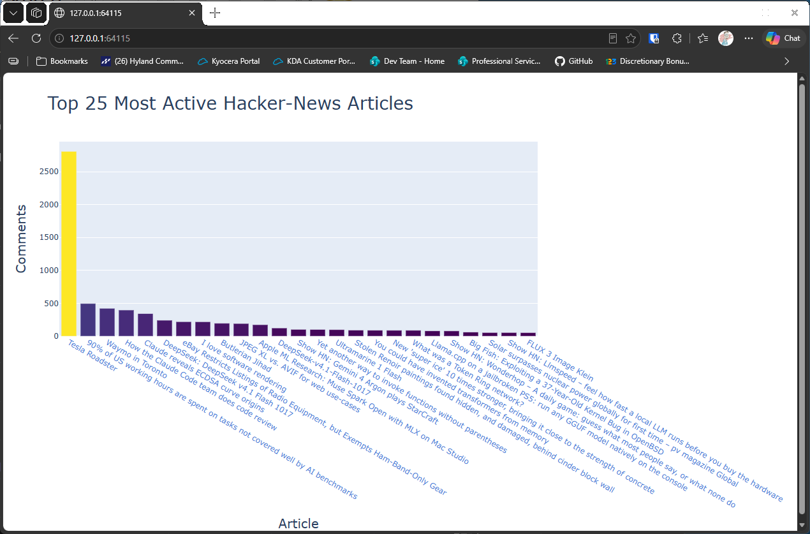
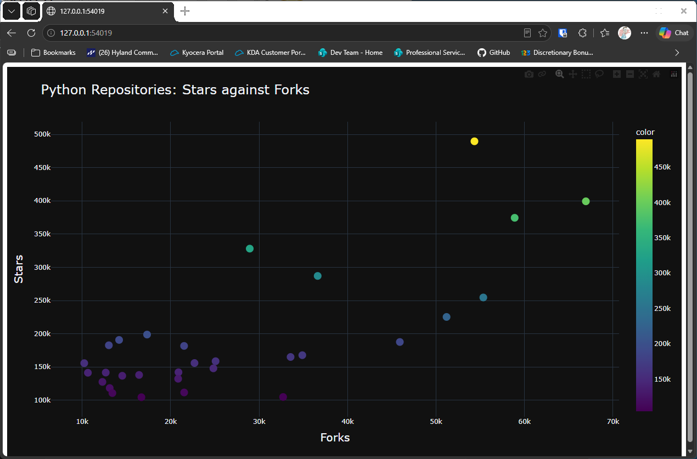

# Chapter 17 Try-it-Yourself Assignments and Solutions

## Introduction

Here are my solutions for the chapter 17 try-it-yourself exercises, from the 3rd edition of the textbook.

These exercises build on the GitHub and Hacker News examples in the chapter. The charts open in your web browser,
and the exercises call the internet APIs, so they need a connection when you run them.

Each exercise shows the full assignment, then a solution with the code and its output. The solution code is
hidden until you expand it, so you can attempt each assignment first.

---

### Assignment 17.01 - Other Languages

Other Languages: Modify the API call in python_repos.py so it generates a chart showing the most popular projects
in other languages. Try languages such as JavaScript, Ruby, C, Java, Perl, Haskell, and Go.

Solution:

<details>
<summary>Spoiler Code</summary>
<br>

```python
import sys
from random import randint
import requests
import plotly.express as px

languages = ["javascript", "ruby", "c", "java", "perl", "haskell", "go"]
sel_lang = languages[randint(0, len(languages) - 1)]

print(f"Retrieving data for [{sel_lang}]...")

url = "https://api.github.com/search/repositories"
query_string = f"?q=language:{sel_lang}+sort:stars+stars:>10000"
request_url = url + query_string
headers = {"Accept": "application/vnd.github.v3+json"}

response = requests.get(request_url, headers=headers, timeout=10)
response_dict = response.json()

if response.status_code != 200:
    print(f"API connection to [{url}] failed\n\twith status code: {response.status_code}")
    sys.exit(-1)

repo_dicts = response_dict['items']

# Process the repo information
links, stars, hover_texts = [], [], []
for repo in repo_dicts:
    name = repo["name"]
    url = repo["html_url"]
    link = f"<a href='{url}'>{name}</a>"

    links.append(link)
    stars.append(repo["stargazers_count"])

    owner = repo["owner"]["login"]
    description = repo["description"]
    hover_text = f"{owner}<br>{description}"
    hover_texts.append(hover_text)

# Visualize
title = f"Most-Starred {sel_lang.title()} Projects on GitHub"
labels = {"x": "Repository", "y": "Stars"}
fig = px.bar(
    x=links, y=stars, title=title, labels=labels, hover_name=hover_texts,
    # Here, I am assigning "stars" as the color value and using a gradient for the bar colors
    color=stars, color_continuous_scale="Viridis"
)
fig.update_layout(title_font_size=28, xaxis_title_font_size=20, yaxis_title_font_size=20)
# This line hides the scale marker on the right hand side
fig.update(layout_coloraxis_showscale=False)

fig.show()
```

</details>
<br>

<details>
<summary>Output</summary>

The terminal names the language it picked at random, then your browser opens the chart:

```
Retrieving data for [c]...
```



</details>
<br>

---

### Assignment 17.02 - Active Discussions

Active Discussions: Using the data from hn_submissions.py, make a bar chart showing the most active discussions
currently happening on Hacker News. The height of each bar should correspond to the number of comments each
submission has. The label for each bar should include the submission's title and should act as a link to the
discussion page for that submission.

**Note:** This one is slow to run. The script makes a separate request for each of the top 500 stories, one after
another, so it can take a long time before the chart opens. You can lower `MAX_RETRIEVE` for a faster run, with
less accurate results. Let it finish, and don't close the terminal while it's working.

Solution:

<details>
<summary>Spoiler Code</summary>
<br>

```python
import sys
from operator import itemgetter
import requests
import plotly.express as px

ITEM_COUNT = 25     # Number of items to display in the plot
# Can reduce this number for faster completion but with less accuracy
MAX_RETRIEVE = 500  # Number of top articles to retrieve data for

# Make an API call for a list of top articles, and store the response
url = "https://hacker-news.firebaseio.com/v0/topstories.json"

response = requests.get(url, timeout=10)

if response.status_code != 200:
    print(
        f"API connection to [{url}] failed\n\twith status code: {response.status_code}")
    sys.exit(-1)

submission_ids = response.json()
submission_dicts = []
# Get more info on each of the top submissions
for submission_id in submission_ids[:MAX_RETRIEVE]:
    # Call the API to get the specific article
    try:
        url = f"https://hacker-news.firebaseio.com/v0/item/{submission_id}.json"
        response = requests.get(url, timeout=10)
    # pylint: disable=broad-except
    except Exception as e:
        input(f"{e}\nPress <ENTER> to continue...")
        continue

    if response.status_code != 200:
        print(
            f"API connection to [{url}] failed\n\twith status code: {response.status_code}")
        continue

    print("\033c", end="")
    print("ID:", submission_id)

    response_dict = response.json()

    # Build a dictionary for each article
    try:
        submission_dict = {
            "title": response_dict["title"],
            "hn_link": f"https://news.ycombinator.com/item?id={submission_id}",
            "comments": response_dict["descendants"]
        }
        submission_dicts.append(submission_dict)
    except KeyError:
        continue

submission_dicts = sorted(
    submission_dicts, key=itemgetter("comments"), reverse=True)

# Visualize
print("\033c", end="")
print("Visualizing...")
articles = [
    f"<a href='{d['hn_link']}' target='_blank'>{d['title']}</a>" \
    for d in submission_dicts][:ITEM_COUNT]
comments = [d["comments"] for d in submission_dicts][:ITEM_COUNT]
hover_texts = [d["title"] for d in submission_dicts][:ITEM_COUNT]
title = f"Top {ITEM_COUNT} Most Active Hacker-News Articles"
labels = {"x": "Article", "y": "Comments"}
fig = px.bar(
    x=articles, y=comments, title=title, labels=labels, hover_name=hover_texts,
    # Here, I am assigning "comments" as the color value and using a gradient for the bar colors
    color=comments, color_continuous_scale="Viridis"
)
fig.update_layout(title_font_size=28, xaxis_title_font_size=20,
                  yaxis_title_font_size=20)
# This line hides the scale marker on the right hand side
fig.update(layout_coloraxis_showscale=False)

fig.show()
```

</details>
<br>

<details>
<summary>Output</summary>

The terminal clears and shows each story's ID as it's processed, then the chart opens in your browser:



</details>
<br>

---

### Assignment 17.03 - Testing python_repos.py

Testing python_repos.py: In python_repos.py, we printed the value of status_code to make sure the API call was
successful. Write a program called test_python_repos.py that uses unittest to assert that the value of status_code
is 200. Figure out some other assertions you can make - for example, that the number of items returned is expected
and that the total number of repositories is greater than a certain amount.

Solution:

<details>
<summary>Spoiler Code</summary>
<br>

```python
import requests

def query_repos() -> requests.Response:
    """Get the list of repositories from the API"""
    url = "https://api.github.com/search/repositories"
    query_string = "?q=language:python+sort:stars+stars:>10000"
    request_url = url + query_string
    headers = {"Accept": "application/vnd.github.v3+json"}
    response = requests.get(request_url, headers=headers, timeout=10)
    assert response.status_code == 200, \
        f"API connection to [{url}] failed\n\twith status code: {response.status_code}"
    return response if response.status_code == 200 else None

def get_repo_data(response: requests.Response) -> list[dict]:
    """Parse the results and return a list of repository dictionaries"""
    if response is None or response.status_code != 200:
        return None
    response_dict = response.json()
    if "items" in response_dict:
        items = response_dict["items"]
        assert len(items) > 20, f"Only received {len(items)} items!"
        return items
    return None

def display_data(repo_dicts: list[dict]) -> None:
    """Print repository information"""
    print("\nSelected information about each repository:")

    for repo_dict in repo_dicts:
        assert repo_dict['stargazers_count'] > 10000, \
            f"{repo_dict['name']}: {repo_dict['stargazers_count']} stars!"
        print(f"Name: {repo_dict['name']}")
        print(f"- Owner: {repo_dict['owner']['login']}")
        print(f"- Stars: {repo_dict['stargazers_count']}")
        print(f"- Repository: {repo_dict['html_url']}")
        print(f"- Description: {repo_dict['description']}\n")

def main():
    """Main function"""
    response = query_repos()
    data = get_repo_data(response)
    display_data(data)

if __name__ == "__main__":
    main()
```

</details>
<br>

<details>
<summary>Output</summary>

The script prints the details of each repository, and an assertion stops it with a message if a check fails:

```
Selected information about each repository:
Name: public-apis
- Owner: public-apis
- Stars: 489659
- Repository: https://github.com/public-apis/public-apis
- Description: A collective list of free APIs

Name: free-programming-books
- Owner: EbookFoundation
- Stars: 399321
- Repository: https://github.com/EbookFoundation/free-programming-books
- Description: :books: Freely available programming books

...

Name: DeepSeek-V3
- Owner: deepseek-ai
- Stars: 104503
- Repository: https://github.com/deepseek-ai/DeepSeek-V3
- Description: None
```

</details>
<br>

---

### Assignment 17.04 - Further Exploration

Further Exploration: Visit the documentation for Plotly and either the GitHub API or the Hacker News API. Use some of
the information you find there to either customize the style of the plots we've already made or pull some different
information and create your own visualizations.

Solution, which charts stars against forks for the Python repositories, using Plotly's dark template and a color
scale that shows the star count:

<details>
<summary>Spoiler Code</summary>
<br>

```python
import sys
import requests
import plotly.express as px

# Pull the same GitHub data as before, but chart two numbers against each other
url = "https://api.github.com/search/repositories"
query_string = "?q=language:python+sort:stars+stars:>10000"
request_url = url + query_string
headers = {"Accept": "application/vnd.github.v3+json"}
response = requests.get(request_url, headers=headers, timeout=10)

if response.status_code != 200:
    print(f"API connection to [{url}] failed\n\twith status code: {response.status_code}")
    sys.exit(-1)

repo_dicts = response.json()["items"]
names = [repo["name"] for repo in repo_dicts]
stars = [repo["stargazers_count"] for repo in repo_dicts]
forks = [repo["forks_count"] for repo in repo_dicts]

# The dark template restyles the whole chart, and the colors show the star count
title = "Python Repositories: Stars against Forks"
labels = {"x": "Forks", "y": "Stars"}
fig = px.scatter(
    x=forks, y=stars, title=title, labels=labels, hover_name=names,
    color=stars, color_continuous_scale="Viridis", template="plotly_dark"
)
fig.update_traces(marker_size=14)
fig.update_layout(title_font_size=24, xaxis_title_font_size=20, yaxis_title_font_size=20)
fig.update(layout_coloraxis_showscale=True)

fig.show()
```

</details>
<br>

<details>
<summary>Output</summary>



</details>
<br>

---
