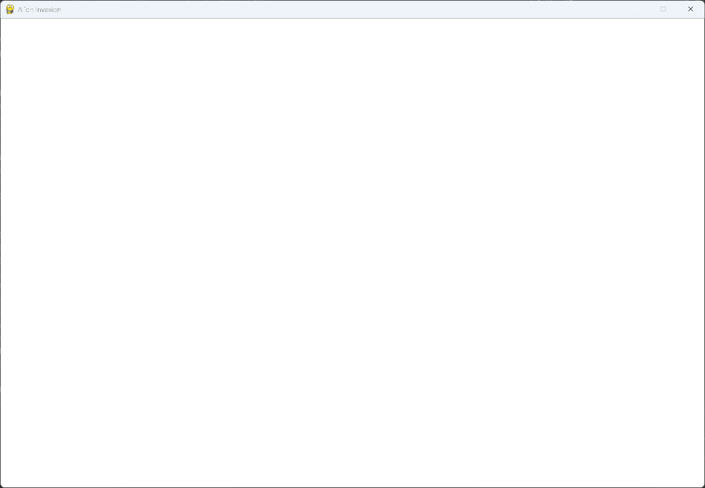

---
files:
  - alien_invasion.py: full
---

# Creating a Pygame Window and Responding to User Input

## What this step does

Alien Invasion starts as a class called `AlienInvasion`. When the game starts, it sets up
Pygame and opens a window 1200 pixels wide and 800 pixels high.

The game runs in a loop. On each pass the loop checks for keyboard and mouse events, and
then makes the newest screen visible. When the player closes the window, a `pygame.QUIT`
event is detected and the program exits.

## The code

`alien_invasion.py`:

```python
"""
Alien Invasion Game - Chapter 12: A Ship That Fires Bullets

This module contains the main game class and handles window creation
and event management.
"""

import sys
import pygame

class AlienInvasion:
    """Overall class to manage game assets and behavior."""

    def __init__(self) -> None:
        """Initialize the game, and create game resources."""
        pygame.init()
        self.screen = pygame.display.set_mode((1200, 800))
        pygame.display.set_caption("Alien Invasion")

    def run_game(self) -> None:
        """Start the main loop for the game."""
        while True:
            # Watch for keyboard and mouse events.
            for event in pygame.event.get():
                if event.type == pygame.QUIT:
                    sys.exit()

            # Make the most recently drawn screen visible.
            pygame.display.flip()


if __name__ == "__main__":
    # Make a game instance, and run the game.
    ai = AlienInvasion()
    ai.run_game()
```

## Walkthrough

**The module docstring.** The string at the top says which chapter the file belongs to, and
what the module does. Python keeps it as the module's documentation.

**Imports.** `sys` lets us exit the program. `pygame` provides everything the game needs.

**The class.** `AlienInvasion` holds the whole game. Keeping it in one class means every
method can reach the same screen and settings.

**`__init__()`.** `pygame.init()` prepares Pygame's internal systems, so call it first.
`pygame.display.set_mode()` creates the window, and returns a surface that represents the
whole window. We store it in `self.screen`, so every method can draw on it. The
`set_caption()` call sets the title bar text.

**`run_game()`.** This method holds the main loop. `while True` keeps the loop going until
the program exits. The `-> None` after the parentheses says the method returns nothing.

**The event loop.** `pygame.event.get()` returns every event since the last call, such as a
key press or a mouse click. The `if` statement looks for `pygame.QUIT`, which is sent when
the player closes the window, and calls `sys.exit()`.

**`pygame.display.flip()`.** This makes the most recently drawn screen visible. At the
moment nothing is drawn, so the window stays empty.

**The `__main__` block.** It runs only when this file is started directly. It creates the
game and starts the loop.

## Running this step

From the `alien-invasion` folder, run:

```pwsh
python build_stage.py ch12 1 --run
```

## Output

Run `alien_invasion.py`. You should see an empty window, which is black by default.



## Changed files

- `alien_invasion.py` (new)
