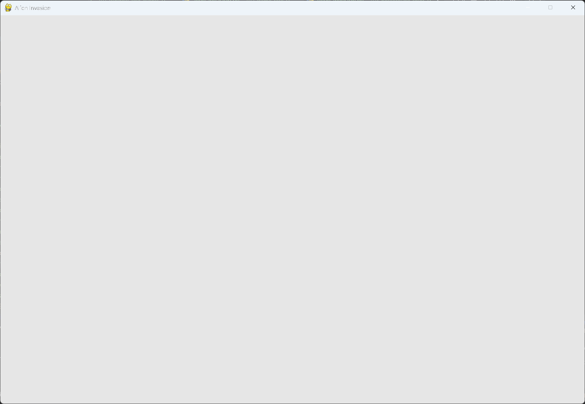

---
files:
  - alien_invasion.py: snipped
---

# Setting the Background Color

## What this step does

Pygame creates a black window by default. This step fills it with a light gray instead.

The color is stored in `self.bg_color` at the end of `__init__()`. Each pass through the loop
then paints the whole window with it, before the screen is made visible.

## The code

The code from the last step is unchanged except where shown below. `--snip--` marks code that
stays the same. The full file is in this step's folder, as `alien_invasion.py`.

```python
class AlienInvasion:
    --snip--

    def __init__(self) -> None:
        """Initialize the game, and create game resources."""
        --snip--
        pygame.display.set_caption("Alien Invasion")

        # Set the background color.
        self.bg_color = (230, 230, 230)

    def run_game(self) -> None:
        --snip--
            # Redraw the screen during each pass through the loop.
            self.screen.fill(self.bg_color)

            # Make the most recently drawn screen visible.
            pygame.display.flip()
            self.clock.tick(60)
```

What changed:

- `__init__()` sets `self.bg_color` to `(230, 230, 230)`, a light gray.
- `run_game()` fills the screen with `self.bg_color` at the start of each pass through the
  loop, before the screen is made visible.
- The module docstring now also mentions the background color.

## Walkthrough

**`self.bg_color`.** This attribute holds the color as a tuple of three numbers. Colors in
Pygame are RGB: red, green, and blue, each from 0 to 255. `(230, 230, 230)` mixes equal
amounts of all three, which gives a light gray.

**Setting it in `__init__()`.** We set the color once, when the game starts. The loop then
reads it on every pass.

**`self.screen.fill(self.bg_color)`.** This paints the whole screen with the color. It takes
a single color argument, and it acts on the window surface created in `__init__()`.

**Why fill each pass?** Without the fill, the previous frame would stay on the screen. Once
the game has moving parts, filling the screen first clears away the old positions.

**Order matters.** The fill comes before the flip. Anything drawn after the fill appears on
top of the gray background, and anything drawn before it would be covered.

## Running this step

From the `alien-invasion` folder, run:

```pwsh
python build_stage.py ch12 3 --run
```

## Output

The window is now light gray rather than black.


