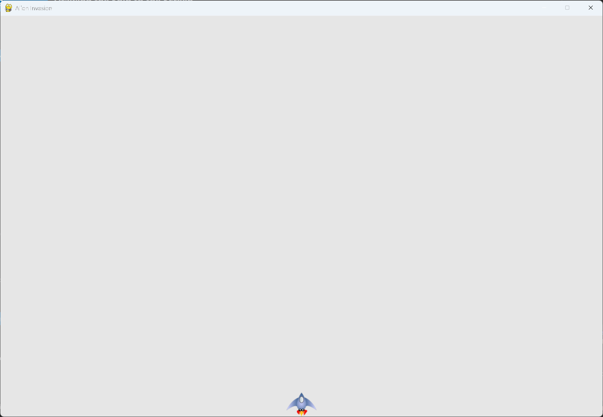

---
files:
  - alien_invasion.py: snipped
---

# Drawing the Ship to the Screen

## What this step does

The main program now creates a ship and draws it on every pass through the loop. When the game
runs, the ship sits at the bottom center of the screen.

## The code

The code from the last step is unchanged except where shown below. `--snip--` marks code that
stays the same. The full file is in this step's folder, as `alien_invasion.py`.

```python
import sys
import pygame

from settings import Settings
from ship import Ship


class AlienInvasion:
    --snip--

    def __init__(self) -> None:
        """Initialize the game, and create game resources."""
        --snip--
        pygame.display.set_caption("Alien Invasion")

        self.ship = Ship(self)

    def run_game(self) -> None:
        --snip--
            # Redraw the screen during each pass through the loop.
            self.screen.fill(self.settings.bg_color)
            self.ship.blitme()

            # Make the most recently drawn screen visible.
            pygame.display.flip()
            self.clock.tick(60)
```

What changed:

- `alien_invasion.py` imports `Ship` with `from ship import Ship`.
- `__init__()` creates `self.ship = Ship(self)` after the screen has been created, and passes
  the game object, so the ship can use the screen.
- `run_game()` calls `self.ship.blitme()` after filling the background and before the screen
  is made visible, so the ship is drawn on top of the background.

## Walkthrough

**The import.** `from ship import Ship` brings the class in from `ship.py`, the same way the
settings import works.

**Creating the ship.** The `Ship` object is made after the screen exists, because the ship
needs the screen to draw on. Passing `self` gives the ship access to the screen and the
settings.

**Drawing order.** The background is filled first, then the ship is drawn. Anything drawn later
appears on top, so the order matters.

**Once per pass.** `blitme()` runs on every pass through the loop. The ship is redrawn each time
on the cleared background, so it stays visible when the screen is flipped.

## Running this step

From the `alien-invasion` folder, run:

```pwsh
python build_stage.py ch12 6 --run
```

## Output

When you run the game, the ship sits at the bottom center of the gray window.



## Changed files

- `alien_invasion.py`: imports `Ship`, creates it in `__init__()`, and draws it in the loop

---
