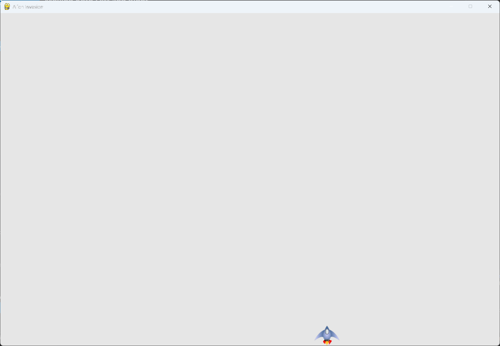

# Responding to a Keypress

## What this step does

The player can now move the ship with the right arrow key. Each time Pygame reports that the
key went down, the ship moves one pixel to the right.

This is a first version. It works, but holding the key does nothing extra, which the next
steps fix.

## Running this step

From the `alien-invasion` folder, run:

```pwsh
python build_stage.py ch12 8 --run
```

## The code

The code from the last step is unchanged except where shown below. `--snip--` marks code that
stays the same. The full file is in this step's folder, as `alien_invasion.py`.

```python
class AlienInvasion:
    --snip--

    def _check_events(self) -> None:
        """Respond to keypresses and mouse events."""
        for event in pygame.event.get():
            if event.type == pygame.QUIT:
                sys.exit()
            elif event.type == pygame.KEYDOWN:
                if event.key == pygame.K_RIGHT:
                    # Move the ship to the right.
                    self.ship.rect.x += 1
    --snip--
```

What changed:

- `_check_events()` has a new `elif` block. It responds to `pygame.KEYDOWN` events, which are
  sent when a key is pressed.
- If the key is the right arrow, `pygame.K_RIGHT`, the ship's `rect.x` increases by 1.

## Walkthrough

**Events.** `pygame.event.get()` returns every event since the last call. A key press is one
of those events, with type `pygame.KEYDOWN`.

**Checking the event type.** The `elif` block runs only for key presses. The QUIT check comes
first, and the key check follows it.

**Checking the key.** `event.key` holds the key that was pressed. `pygame.K_RIGHT` is the
right arrow key.

**Moving the ship.** `self.ship.rect.x += 1` moves the ship's rectangle one pixel to the right.
The next call to `blitme()` draws the ship at its new position.

## Output

Press the right arrow key. The ship moves one pixel to the right each time.



## Changed files

- `alien_invasion.py`: `_check_events()` responds to the right arrow key

---
