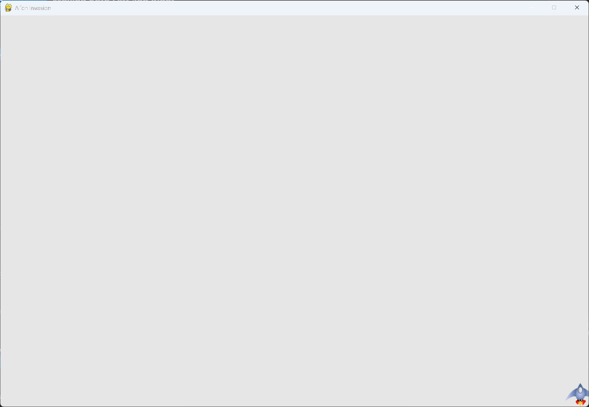

# Allowing Continuous Movement

## What this step does

Holding the right arrow key moves the ship continuously, and it stops when the key is released.

The step uses a flag, `moving_right`. Pressing the key sets the flag to `True`, and releasing
the key sets it to `False`. The `Ship` class checks the flag on every pass through the loop and
moves the ship while it's set.

## Running this step

From the `alien-invasion` folder, run:

```pwsh
python build_stage.py ch12 9 --run
```

## The code

`ship.py` changes only where shown below. `--snip--` marks code that stays the same.

```python
class Ship: #pylint: disable=too-few-public-methods
    --snip--

    def __init__(self, ai_game):
        """Initialize the ship and set its starting position."""
        --snip--
        self.rect.midbottom = self.screen_rect.midbottom

        # Movement flag; start with a ship that's not moving.
        self.moving_right = False

    def update(self) -> None:
        """Update the ship's position based on the movement flag."""
        if self.moving_right:
            self.rect.x += 1

    --snip--
```

`alien_invasion.py` changes only where shown below.

```python
class AlienInvasion:
    --snip--

    def run_game(self) -> None:
        """Start the main loop for the game."""
        while True:
            self._check_events()
            self.ship.update()
            self._update_screen()
            self.clock.tick(60)

    def _check_events(self) -> None:
        """Respond to keypresses and mouse events."""
        for event in pygame.event.get():
            if event.type == pygame.QUIT:
                sys.exit()
            elif event.type == pygame.KEYDOWN:
                if event.key == pygame.K_RIGHT:
                    self.ship.moving_right = True
            elif event.type == pygame.KEYUP:
                if event.key == pygame.K_RIGHT:
                    self.ship.moving_right = False
    --snip--
```

What changed:

- `Ship.__init__()` adds `self.moving_right`, set to `False` so the ship starts still.
- `Ship.update()` is new. It moves the ship one pixel right while `moving_right` is `True`.
- `_check_events()` sets `moving_right` to `True` on a right arrow key press, and to `False`
  when the key is released. The step 8 movement is removed.
- `run_game()` calls `self.ship.update()` once per pass through the loop, after checking events
  and before drawing the screen.

## Walkthrough

**The flag.** `moving_right` records whether the key is held. Input changes the flag, and the
ship's update reads it.

**Why `update()`.** Input and movement are kept apart. `_check_events()` only records what the
player did. `update()` moves the ship, once per frame.

**The order in the loop.** Checking events comes first, so the flag is current. Then the ship is
moved, and then the screen is drawn, so the ship appears where it should on that frame.

**`KEYUP`.** Pygame sends a `KEYUP` event when a key is released. Responding to it is what stops
the ship.

## Output

Hold the right arrow key. The ship moves steadily to the right, and stops when you let go.



## Changed files

- `ship.py`: adds the `moving_right` flag and `update()`
- `alien_invasion.py`: sets the flag from key events, and calls `ship.update()` in the loop
