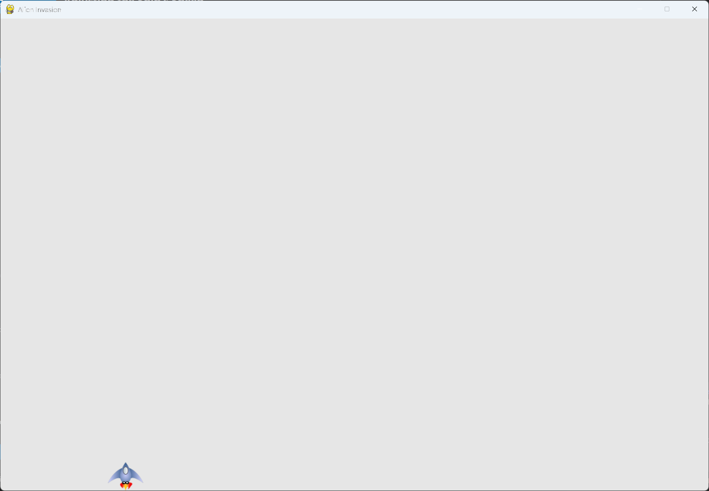

# Moving Both Left and Right

## What this step does

The left arrow key now moves the ship left, using the same pattern as the right arrow. Each
direction has its own flag, so holding both keys at once leaves the ship still.

## Running this step

From the `alien-invasion` folder, run:

```pwsh
python build_stage.py ch12 10 --run
```

## The code

`ship.py` changes only where shown below. `--snip--` marks code that stays the same.

```python
class Ship: #pylint: disable=too-few-public-methods
    --snip--

    def __init__(self, ai_game):
        """Initialize the ship and set its starting position."""
        --snip--
        self.rect.midbottom = self.screen_rect.midbottom

        # Movement flags; start with a ship that's not moving.
        self.moving_right = False
        self.moving_left = False

    def update(self) -> None:
        """Update the ship's position based on the movement flags."""
        if self.moving_right:
            self.rect.x += 1
        if self.moving_left:
            self.rect.x -= 1

    --snip--
```

`alien_invasion.py` changes only where shown below.

```python
class AlienInvasion:
    --snip--

    def _check_events(self) -> None:
        """Respond to keypresses and mouse events."""
        for event in pygame.event.get():
            if event.type == pygame.QUIT:
                sys.exit()
            elif event.type == pygame.KEYDOWN:
                if event.key == pygame.K_RIGHT:
                    self.ship.moving_right = True
                elif event.key == pygame.K_LEFT:
                    self.ship.moving_left = True
            elif event.type == pygame.KEYUP:
                if event.key == pygame.K_RIGHT:
                    self.ship.moving_right = False
                elif event.key == pygame.K_LEFT:
                    self.ship.moving_left = False
    --snip--
```

What changed:

- `Ship.__init__()` adds `self.moving_left`, set to `False`.
- `Ship.update()` moves the ship left while `moving_left` is `True`, as well as right.
- `_check_events()` sets and clears `moving_left` for the left arrow key, the same way it does
  for the right arrow key.

## Walkthrough

**Separate flags.** Each arrow key has its own flag. That's why both keys can be tracked at the
same time.

**Both keys held.** If both flags are `True`, `update()` adds 1 and then subtracts 1 in the same
frame, so the ship stays where it is.

**The same pattern.** Adding a direction means adding one flag, one `elif` for the key down, one
for the key up, and one `if` in `update()`.

## Output

Hold the left arrow key, and the ship moves left. Hold both keys, and the ship stays still.



## Changed files

- `ship.py`: adds the `moving_left` flag, and moves the ship left in `update()`
- `alien_invasion.py`: sets the left flag from key events

---
