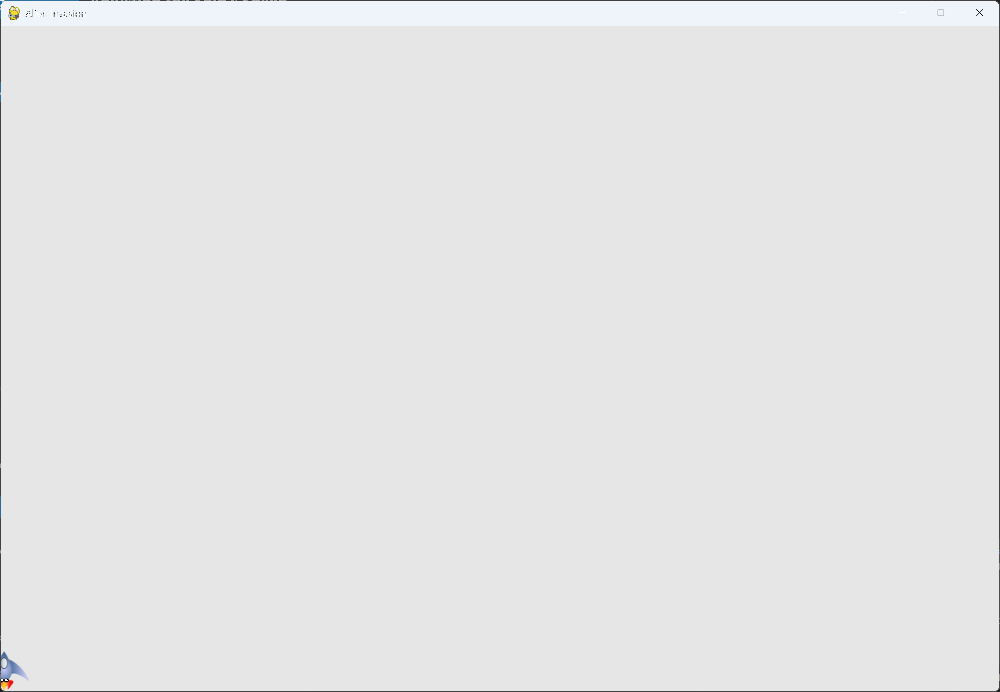

# Adjusting the Ship's Speed

## What this step does

The ship's speed is now a setting, `ship_speed`, in `settings.py`. Before this step the ship moved
one whole pixel per pass through the loop. Now it moves 1.5 pixels.

The ship also keeps its position as a decimal number. A `rect` stores only whole pixels, so
fractions of a pixel would be lost if the position were stored there. The ship keeps its exact
position in `self.x` and copies it into the rect each frame.

## Running this step

From the `alien-invasion` folder, run:

```pwsh
python build_stage.py ch12 11 --run
```

## The code

`settings.py` changes only where shown below. `--snip--` marks code that stays the same.

```python
class Settings: #pylint: disable=too-few-public-methods
    --snip--

    def __init__(self) -> None:
        """Initialize the game's settings."""
        --snip--

        # Ship settings
        self.ship_speed = 1.5
```

`ship.py` changes only where shown below.

```python
class Ship:
    --snip--

    def __init__(self, ai_game) -> None:
        """Initialize the ship and set its starting position."""
        self.screen = ai_game.screen
        self.settings = ai_game.settings
        --snip--
        self.rect.midbottom = self.screen_rect.midbottom

        # Store a float for the ship's exact horizontal position.
        self.x = float(self.rect.x)

        # Movement flags; start with a ship that's not moving.
        self.moving_right = False
        self.moving_left = False

    def update(self) -> None:
        """Update the ship's position based on movement flags."""
        # Update the ship's x value, not the rect.
        if self.moving_right:
            self.x += self.settings.ship_speed
        if self.moving_left:
            self.x -= self.settings.ship_speed

        # Update rect object from self.x.
        self.rect.x = self.x

    --snip--
```

What changed:

- `settings.py` adds `ship_speed`, set to 1.5.
- `Ship.__init__()` keeps a reference to the settings, and stores the ship's position in `self.x`
  as a float.
- `Ship.update()` changes `self.x` by `ship_speed`, then copies the value into `self.rect.x`.
- `alien_invasion.py` is unchanged.

## Walkthrough

**Why a setting.** Speed is one of the values you'll want to tune as the game gets harder. Keeping
it in `settings.py` means you change it in one place.

**Why a float.** Moving by 1.5 pixels can't be stored in a whole-number rect. Keeping the exact
position in `self.x` means the fractions add up, so the ship moves at the right average speed.

**Why copy to the rect.** The rect is what Pygame uses to draw the ship, so it has to be updated
from `self.x` each frame. The assignment truncates to a whole pixel, so the drawn position may
differ from `self.x` by under one pixel.

## Output

The ship moves a little faster than in the last step. Its speed is set by `ship_speed`.



## Changed files

- `settings.py`: adds `ship_speed`
- `ship.py`: stores the position as a float, and moves by `ship_speed`
