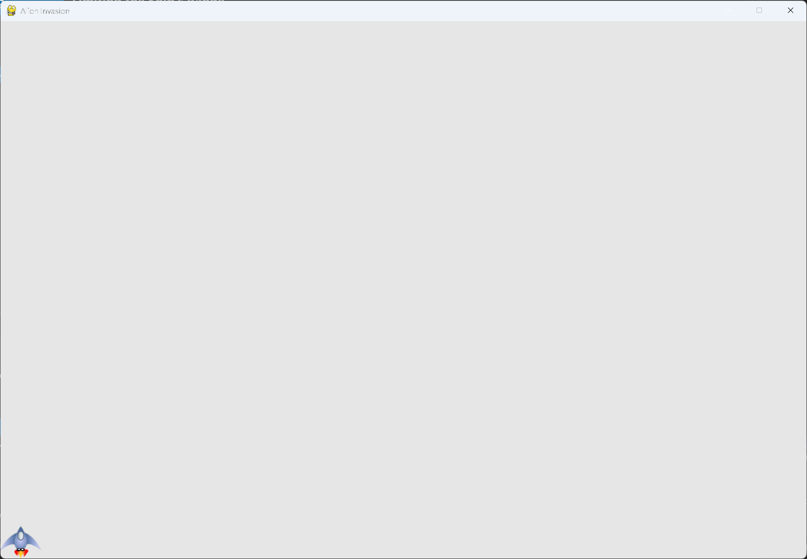

# Limiting the Ship's Range

## What this step does

Holding an arrow key used to carry the ship off the edge of the screen. Now the ship stops when
its edge reaches the edge of the window.

## Running this step

From the `alien-invasion` folder, run:

```pwsh
python build_stage.py ch12 12 --run
```

## The code

`ship.py` changes only where shown below. `--snip--` marks code that stays the same.

```python
class Ship: #pylint: disable=too-few-public-methods
    --snip--

    def update(self) -> None:
        """Update the ship's position based on movement flags."""
        # Update the ship's x value, not the rect.
        if self.moving_right and self.rect.right < self.screen_rect.right:
            self.x += self.settings.ship_speed
        if self.moving_left and self.rect.left > 0:
            self.x -= self.settings.ship_speed

        # Update rect object from self.x.
        self.rect.x = self.x

    --snip--
```

What changed:

- `update()` moves the ship right only while its right edge is inside the screen.
- `update()` moves the ship left only while its left edge is inside the screen.
- `alien_invasion.py` is unchanged.

## Walkthrough

**The right edge.** `self.rect.right` is the x-coordinate of the ship's right edge.
`self.screen_rect.right` is the right edge of the window. While the first is smaller, the ship
has room to move.

**The left edge.** `self.rect.left` is the x-coordinate of the ship's left edge. The window's
left edge is 0, so while the ship's left edge is greater than 0, it can still move left.

**The check comes first.** The condition is tested before `self.x` changes. A ship at the edge
doesn't move, so it can't go past it.

## Output

Hold an arrow key. The ship stops at the edge of the window.



## Changed files

- `ship.py`: `update()` checks the screen edges before it moves the ship
