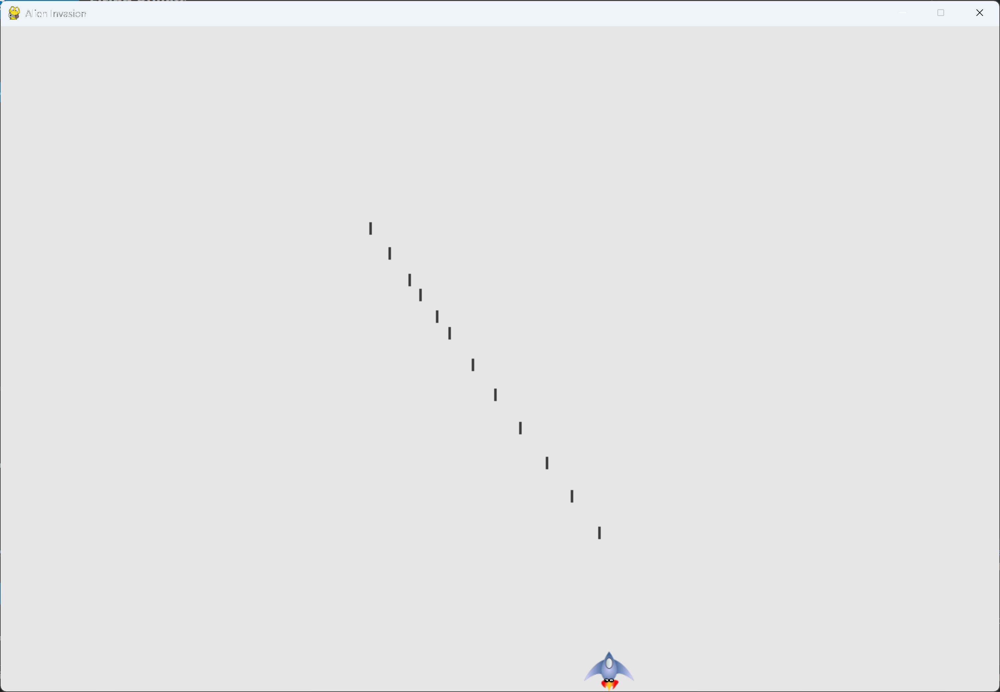

# Firing Bullets

## What this step does

Pressing the space bar fires a bullet. The bullets are kept in a group, so the game can move and
draw all of them in one call. Each bullet travels up the screen. The bullets are not yet removed
when they reach the top, which the next step fixes.

## Running this step

From the `alien-invasion` folder, run:

```pwsh
python build_stage.py ch12 15 --run
```

## The code

`alien_invasion.py` changes only where shown below. `--snip--` marks code that stays the same.

```python
from settings import Settings
from ship import Ship
from bullet import Bullet


class AlienInvasion:
    --snip--

    def __init__(self):
        """Initialize the game, and create game resources."""
        --snip--
        self.ship = Ship(self)
        self.bullets = pygame.sprite.Group()

    def run_game(self) -> None:
        """Start the main loop for the game."""
        while True:
            self._check_events()
            self.ship.update()
            self.bullets.update()
            self._update_screen()
            self.clock.tick(60)

    def _check_keydown_events(self, event: pygame.event.Event) -> None:
        """Respond to keypresses."""
        --snip--
        elif event.key == pygame.K_q:
            sys.exit()
        elif event.key == pygame.K_SPACE:
            self._fire_bullet()

    def _fire_bullet(self) -> None:
        """Create a new bullet and add it to the bullets group."""
        new_bullet = Bullet(self)
        self.bullets.add(new_bullet)

    def _update_screen(self) -> None:
        """Update images on the screen, and flip to the new screen."""
        self.screen.fill(self.settings.bg_color)
        for bullet in self.bullets.sprites():
            bullet.draw_bullet()
        self.ship.blitme()
        pygame.display.flip()
```

What changed:

- The file imports `Bullet`.
- `__init__()` creates `self.bullets`, a `pygame.sprite.Group`.
- `run_game()` calls `self.bullets.update()` once per pass through the loop. The group calls
  `update()` on each bullet in it.
- Pressing the space bar calls `_fire_bullet()`, which creates a bullet and adds it to the group.
- `_update_screen()` draws each bullet before the ship, so the bullets don't start out on top of
  the ship.
- `settings.py`, `ship.py` and `bullet.py` are unchanged.

## Walkthrough

**The group.** A `Group` behaves like a list, with extra methods for games. `add()` puts a sprite
in the group, and `sprites()` returns the list of sprites.

**Updating the group.** `self.bullets.update()` calls `update()` on every bullet in the group,
so each bullet moves up the screen. No loop is needed.

**Firing.** The space bar is a key press, so it's handled in `_check_keydown_events()`. Key
releases don't change anything, so `_check_keyup_events()` is unchanged.

**Drawing order.** The bullets are drawn before the ship. That way the ship sits on top of any
bullet that overlaps it.

## Output

Press the space bar. Bullets fire from the top of the ship and travel up the screen.



## Changed files

- `alien_invasion.py`: creates the bullet group, fires bullets on the space bar, and draws them
