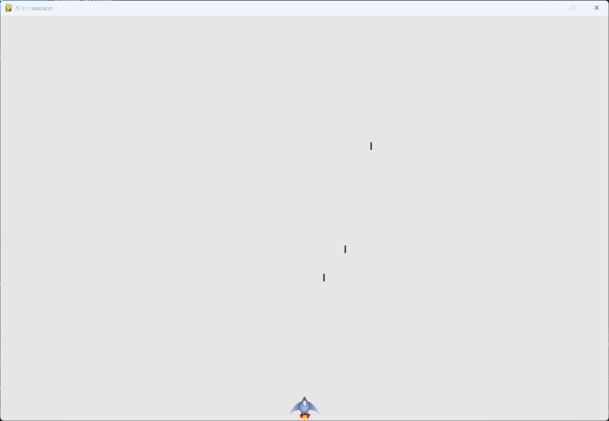

# Limiting the Number of Bullets, and Updating Bullets

## What this step does

The player can have three bullets on screen at once. Pressing the space bar while three are
flying does nothing. This encourages the player to aim.

The bullet code that was in `run_game()` also moves into a method, `_update_bullets()`. The main
loop now reads as a short list of steps.

## Running this step

From the `alien-invasion` folder, run:

```pwsh
python build_stage.py ch12 17 --run
```

Fire quickly. You can only have three bullets in flight at a time.

## The code

`settings.py` changes only where shown below. `--snip--` marks code that stays the same.

```python
class Settings: #pylint: disable=too-few-public-methods
    --snip--

    def __init__(self) -> None:
        """Initialize the game's settings."""
        --snip--

        # Bullet settings
        --snip--
        self.bullet_color = (60, 60, 60)
        self.bullets_allowed = 3
```

`alien_invasion.py` changes only where shown below.

```python
class AlienInvasion:
    --snip--

    def run_game(self) -> None:
        """Start the main loop for the game."""
        while True:
            self._check_events()
            self.ship.update()
            self._update_bullets()
            self._update_screen()
            self.clock.tick(60)

    def _fire_bullet(self) -> None:
        """Create a new bullet and add it to the bullets group."""
        if len(self.bullets) < self.settings.bullets_allowed:
            new_bullet = Bullet(self)
            self.bullets.add(new_bullet)

    def _update_bullets(self) -> None:
        """Update position of bullets and get rid of old bullets."""
        # Update bullet positions.
        self.bullets.update()

        # Get rid of bullets that have disappeared.
        for bullet in self.bullets.copy():
            if bullet.rect.bottom <= 0:
                self.bullets.remove(bullet)

    --snip--
```

What changed:

- `settings.py` adds `bullets_allowed`, set to 3.
- `_fire_bullet()` checks how many bullets exist before it creates one.
- `_update_bullets()` is a new method. It holds the update and removal code from the last step.
- `run_game()` calls `_update_bullets()` in place of the code it held before.

## Walkthrough

**The limit.** `len(self.bullets)` is the number of bullets in the group. The new bullet is only
made when that number is less than `bullets_allowed`. Otherwise the space bar press is ignored.

**Changing the limit.** The number lives in `settings.py`, so you can change it without touching
the game code.

**A method for the bullets.** `_update_bullets()` does the same work as the code in the last
step, moved out of the main loop. The loop calls it once per frame, and the bullet logic stays
in one place.

**The main loop.** It now lists the order of each frame: check events, move the ship, update the
bullets, draw the screen, and tick the clock.

## Output

Fire bullets. Only three can be on screen at once, and a fourth press does nothing until one
leaves the top.



## Changed files

- `settings.py`: adds `bullets_allowed`
- `alien_invasion.py`: limits `_fire_bullet()`, and moves the bullet updates into
  `_update_bullets()`

---
