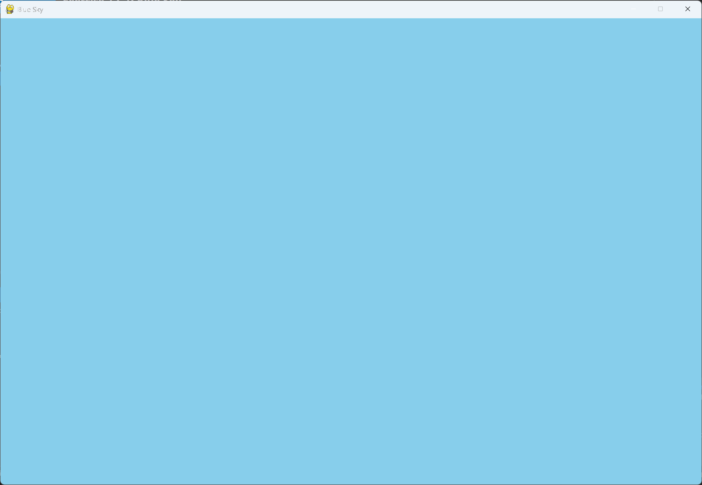

# Exercise 12-1: Blue Sky

## The exercise

Make a Pygame window with a blue background.

## Running this exercise

From this folder, run:

```pwsh
python blue_sky.py
```

## Solution

`settings.py` holds the window size and the color. The sky blue is `(135, 206, 235)`.

`blue_sky.py`:

```python
"""
Chapter 12, exercise 12-1: Blue Sky.

Make a Pygame window with a blue background.
"""

import sys
import pygame

from settings import Settings


class BlueSky:
    """Overall class to manage the window and its main loop."""

    def __init__(self) -> None:
        """Initialize the game, and create game resources."""
        pygame.init()
        self.settings = Settings()

        self.screen = pygame.display.set_mode(
            (self.settings.screen_width, self.settings.screen_height))
        pygame.display.set_caption("Blue Sky")

    def run_game(self) -> None:
        """Start the main loop for the game."""
        while True:
            for event in pygame.event.get():
                if event.type == pygame.QUIT:
                    sys.exit()

            self.screen.fill(self.settings.bg_color)
            pygame.display.flip()


if __name__ == "__main__":
    # Make a game instance, and run the game.
    blue_sky = BlueSky()
    blue_sky.run_game()
```

## Walkthrough

The program is the same structure as Alien Invasion's first step. The color is the only new
idea: `fill()` paints the whole window with the color in `settings.py`, once per pass through
the loop.

## Output

The window is filled with sky blue.



---
