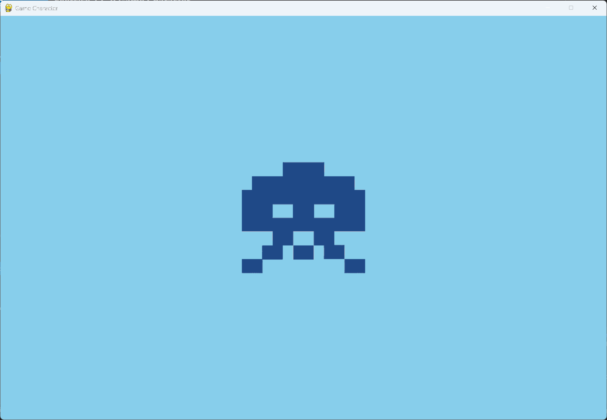

# Exercise 12-2: Game Character

## The exercise

Find a bitmap image of a game character you like, or convert an image to a bitmap. Make a class
that draws the character at the center of the screen. Then match the background color of the
image to the background color of the screen, or the other way around.

## Setup

Copy `character.bmp` into this exercise's `images` folder. The image's background is already the
sky blue used in `settings.py`, so the edges of the picture blend into the window. The solution
uses this character in place of the rocket from exercise 12-4.
Pygame loads bitmaps by default, so a `.bmp` file is the easiest choice.

## Running this exercise

From this folder, run:

```pwsh
python game_character.py
```

## Solution

`character.py` finds the image in the `images` folder next to the file, then places it at the
center of the screen:

```python
"""A class to draw the game character at the center of the screen."""

import os

import pygame


class Character:
    """A class to manage the game character."""

    def __init__(self, game) -> None:
        """Load the character's image and place it at the center of the screen."""
        self.screen = game.screen
        self.screen_rect = game.screen.get_rect()

        # Load the image from the images folder next to this file.
        folder = os.path.join(os.path.dirname(os.path.abspath(__file__)), "images")
        self.image = pygame.image.load(os.path.join(folder, "character.bmp"))
        self.rect = self.image.get_rect()

        # Start the character at the center of the screen.
        self.rect.center = self.screen_rect.center

    def blitme(self) -> None:
        """Draw the character at its current location."""
        self.screen.blit(self.image, self.rect)
```

`settings.py` holds the background color. Set it to the color of your image's background, so the
edges of the image don't show.

## Walkthrough

`os.path.abspath(__file__)` gives the path of `character.py`, so the image is found whichever
folder you start the program from. `rect.center` places the middle of the image at the middle of
the screen.

## Output

The character appears at the center of the sky blue window. Its background blends into the
window, so only the character is visible.


