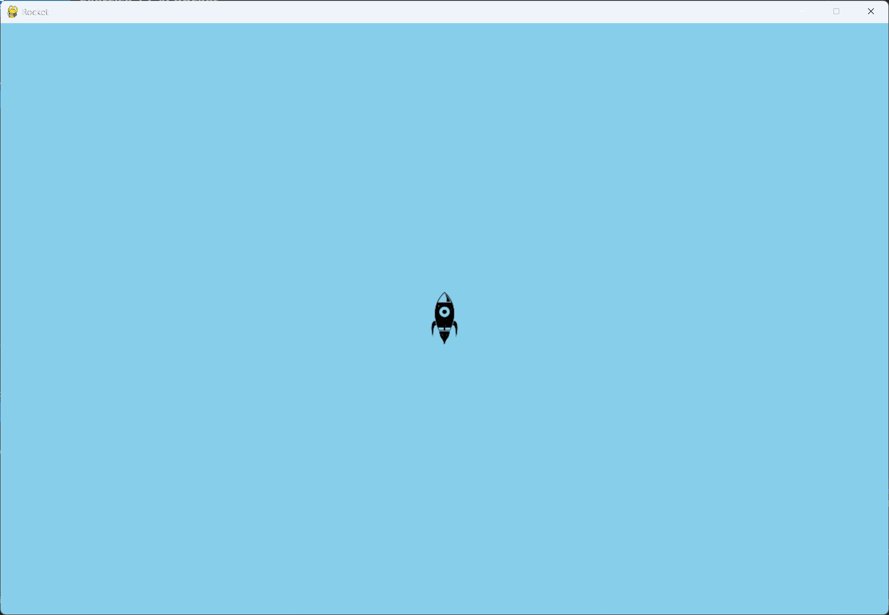

# Exercise 12-4: Rocket

## The exercise

Make a game that begins with a rocket in the center of the screen. Allow the player to move the
rocket up, down, left, or right using the four arrow keys. Make sure the rocket never moves
beyond any edge of the screen.

## Running this exercise

From this folder, run:

```pwsh
python rocket_game.py
```

Use the four arrow keys to move the rocket. Press Q to quit.

## Setup

This exercise uses `rocket.bmp` in its `images` folder as the rocket. See the setup steps in the
chapter's Try It Yourself overview for copying the image.

## Solution

`settings.py` holds the window size, the background color, and the rocket's speed.

`rocket.py` moves the rocket in four directions, and stops it at each edge of the screen:

```python
class Rocket:
    --snip--

    def __init__(self, game) -> None:
        """Initialize the rocket and set its starting position."""
        --snip--
        # Start the rocket at the center of the screen.
        self.rect.center = self.screen_rect.center
        --snip--

    def update(self) -> None:
        """Move the rocket, and keep it inside the edges of the screen."""
        if self.moving_right and self.rect.right < self.screen_rect.right:
            self.x += self.settings.rocket_speed
        if self.moving_left and self.rect.left > 0:
            self.x -= self.settings.rocket_speed
        if self.moving_down and self.rect.bottom < self.screen_rect.bottom:
            self.y += self.settings.rocket_speed
        if self.moving_up and self.rect.top > 0:
            self.y -= self.settings.rocket_speed

        # Update the rect from the decimal position.
        self.rect.x = self.x
        self.rect.y = self.y
```

`rocket_game.py` turns the movement flags on and off with the arrow keys:

```python
class RocketGame:
    --snip--

    def _check_keydown_events(self, event: pygame.event.Event) -> None:
        """Start the rocket moving when an arrow key goes down."""
        if event.key == pygame.K_RIGHT:
            self.rocket.moving_right = True
        elif event.key == pygame.K_LEFT:
            self.rocket.moving_left = True
        elif event.key == pygame.K_UP:
            self.rocket.moving_up = True
        elif event.key == pygame.K_DOWN:
            self.rocket.moving_down = True
        elif event.key == pygame.K_q:
            sys.exit()

    def _check_keyup_events(self, event: pygame.event.Event) -> None:
        """Stop the rocket when an arrow key is released."""
        if event.key == pygame.K_RIGHT:
            self.rocket.moving_right = False
        elif event.key == pygame.K_LEFT:
            self.rocket.moving_left = False
        elif event.key == pygame.K_UP:
            self.rocket.moving_up = False
        elif event.key == pygame.K_DOWN:
            self.rocket.moving_down = False
```

## Walkthrough

**Four directions.** Each arrow key has its own flag, so the rocket can move diagonally by holding
two keys at once.

**The edges.** Each direction is checked before the rocket moves. A rocket touching an edge
doesn't move any further toward it, so it stays on the screen.

**Decimal positions.** The rocket's position is kept as decimal values in `x` and `y`, and copied
to the rect each frame. This makes the speed setting finer-grained, as with the ship in
Alien Invasion.

## Output

The rocket starts in the center of the window. Use the arrow keys to move it, and try to
reach each edge.


