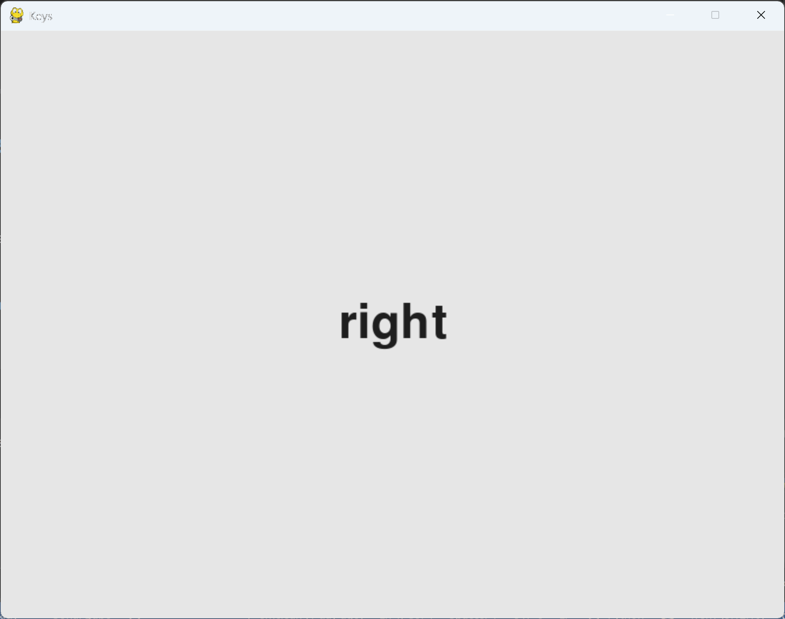

# Exercise 12-5: Keys

## The exercise

Make a Pygame file that creates an empty screen. In the event loop, print the `event.key`
attribute whenever a `pygame.KEYDOWN` event is detected. Run the program and press various keys
to see how Pygame responds.

## Running this exercise

From this folder, run:

```pwsh
python keys.py
```

Click in the window, then press keys. Each key's number is printed in the terminal. The window
also shows the name of the last key you pressed. Close the window to stop.

## Solution

`keys.py`:

```python
"""
Chapter 12, exercise 12-5: Keys.

Make a Pygame file that creates an empty screen. In the event loop, print the event.key attribute
whenever a pygame.KEYDOWN event is detected. Run the program and press various keys to see how
Pygame responds.

Extension: also show the name of the last key pressed in the window.
"""

import sys
import pygame


def run_keys() -> None:
    """Open an empty window, print the key code of each key press, and show the last key's name."""
    pygame.init()
    screen = pygame.display.set_mode((800, 600))
    pygame.display.set_caption("Keys")
    font = pygame.font.Font(None, 72)
    last_key = ""

    while True:
        for event in pygame.event.get():
            if event.type == pygame.QUIT:
                sys.exit()
            elif event.type == pygame.KEYDOWN:
                print(event.key)
                last_key = pygame.key.name(event.key)

        screen.fill((230, 230, 230))
        if last_key:
            text = font.render(last_key, True, (30, 30, 30))
            screen.blit(text, text.get_rect(center=screen.get_rect().center))
        pygame.display.flip()


if __name__ == "__main__":
    run_keys()
```

## Walkthrough

**Each key has a number.** Pygame identifies each key by a number, and `pygame.K_RIGHT` is one of
these numbers. That's why the arrow keys in Alien Invasion are checked with `pygame.K_RIGHT`.
Printing `event.key` shows the number for the key you pressed. Letters print their lowercase
code, while keys like the arrows print large numbers.

**Names instead of numbers.** `pygame.key.name()` turns the number into a readable name, such as
`"a"` or `"right"`. The window shows that name, so you can see what each key is called without
reading the terminal.

**Drawing the name.** `font.render()` makes an image of the text. It's drawn in the middle of the
window, after the background is filled, and before the screen is made visible.

**The extension is optional.** The printed numbers are what the exercise asks for. The on-screen
name is an extra, and the program works the same without it.

## Output

Pressing the right arrow, then the left, the up, and the right arrow again prints this in the
terminal:

```
1073741903
1073741904
1073741906
1073741903
```

The numbers are `pygame.K_RIGHT`, `pygame.K_LEFT`, `pygame.K_UP` and `pygame.K_RIGHT` in turn.
The window shows the last key's name, so you can see the same key as text.



---
