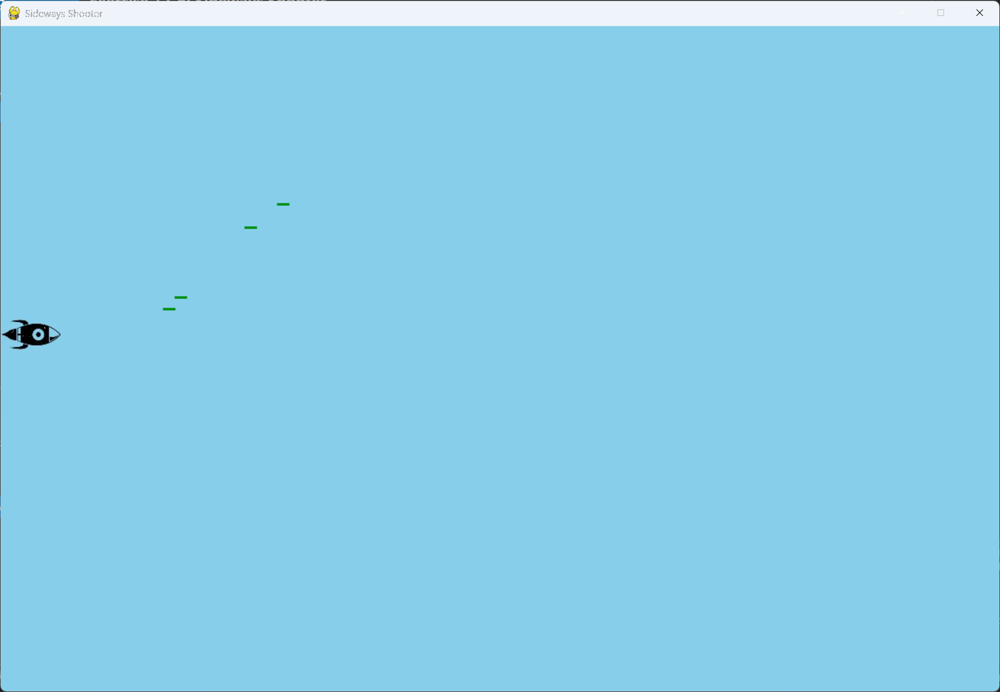

# Exercise 12-6: Sideways Shooter

## The exercise

Write a game that places a ship on the left side of the screen and allows the player to move the
ship up and down. Make the ship fire a bullet that travels right across the screen when the
player presses the spacebar. Make sure bullets are deleted once they disappear off the screen.

## Running this exercise

From this folder, run:

```pwsh
python sideways_shooter.py
```

Use the up and down arrow keys to move the rocket. Press the space bar to fire. Press Q to quit.

## Setup

This exercise uses the rocket image in its `images` folder, `rocket.bmp`, as the ship. See the
setup steps in the exercise folder for copying it.

## Solution

`settings.py` holds the screen, rocket and missile values. The missile values are the same as in
the book's bullet settings, with a limit of five missiles on screen at once.

`rocket.py` places the rocket on the left edge, and moves it only up and down:

```python
class Rocket:
    --snip--

    def __init__(self, game) -> None:
        """Initialize the rocket and place it on the left side of the screen."""
        --snip--
        self.image = pygame.image.load(os.path.join(folder, "rocket.bmp"))
        # Turn the rocket to face right, so it fires across the screen.
        self.image = pygame.transform.rotate(self.image, -90)
        --snip--
        # Start the rocket at the middle of the left edge.
        self.rect.midleft = self.screen_rect.midleft
        --snip--

    def update(self) -> None:
        """Move the rocket up or down, and keep it inside the screen."""
        if self.moving_down and self.rect.bottom < self.screen_rect.bottom:
            self.y += self.settings.rocket_speed
        if self.moving_up and self.rect.top > 0:
            self.y -= self.settings.rocket_speed

        # Update the rect from the decimal position.
        self.rect.y = self.y
```

`missile.py` starts each missile at the rocket's right edge, and moves it right:

```python
class Missile(Sprite):
    --snip--

    def __init__(self, game) -> None:
        """Create a missile at the rocket's current position."""
        --snip--
        self.rect.midleft = game.rocket.rect.midright
        --snip--

    def update(self) -> None:
        """Move the missile to the right."""
        self.x += self.settings.missile_speed
        self.rect.x = self.x
```

`sideways_shooter.py` fires a missile on the space bar, moves the missiles, and deletes any that
have left the right edge:

```python
    def _fire_missile(self) -> None:
        """Create a new missile, if the limit allows one."""
        if len(self.missiles) < self.settings.missiles_allowed:
            new_missile = Missile(self)
            self.missiles.add(new_missile)

    def _update_missiles(self) -> None:
        """Move the missiles, and delete any that have left the screen."""
        self.missiles.update()

        # Loop over a copy, so the group can change inside the loop.
        for missile in self.missiles.copy():
            if missile.rect.left >= self.settings.screen_width:
                self.missiles.remove(missile)
```

## Walkthrough

**The rocket.** `midleft` places the rocket at the left edge, halfway up the screen. Only the
vertical movement is handled, so the rocket stays on that edge.

**The missile.** A missile starts at the rocket's `midright`, so it appears in front of the
rocket. Its `x` is a decimal value, the same as the bullets in Alien Invasion.

**Deleting missiles.** A missile is removed once its left edge reaches the right side of the
screen. The loop runs over a copy of the group, so removing a missile during the loop is safe.

**The window size.** This solution uses a fixed window, the same as the other exercises.

## Output

The ship fires missiles across the screen from its position on the left edge, and each missile
disappears at the right edge.


