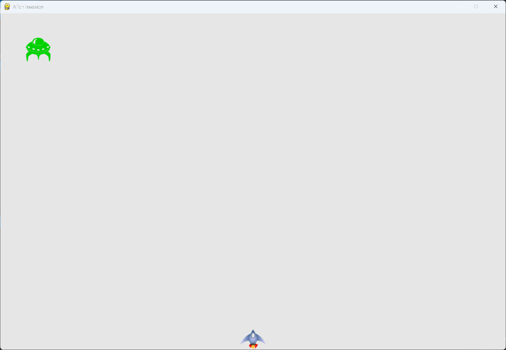

# Creating the First Alien

## What this step does

The fleet starts with one alien. The alien gets its own class, `Alien`, in `alien.py`. It's
built the same way as the `Ship` class, with a bitmap image and a rect that sets its position.

The alien is placed near the top left of the screen, and it's drawn with a group's `draw()`
method, rather than with a method of its own.

## Running this step

From the `alien-invasion` folder, run:

```pwsh
python build_stage.py ch13 1 --run
```

Press Q to quit.

## The code

`alien.py` is new, so it's shown in full:

```python
"""
Alien Invasion Game - Chapter 13: Aliens!

This module defines the Alien class, one alien in the fleet.
"""

import os

import pygame
from pygame.sprite import Sprite


class Alien(Sprite):
    """A class to represent a single alien in the fleet."""

    def __init__(self, ai_game) -> None:
        """Initialize the alien and set its starting position."""
        super().__init__()
        self.screen = ai_game.screen

        # Load the alien image from the images folder next to this file.
        folder = os.path.dirname(os.path.abspath(__file__))
        self.image = pygame.image.load(os.path.join(folder, "images", "alien.bmp"))
        self.rect = self.image.get_rect()

        # Start each new alien near the top left of the screen.
        self.rect.x = self.rect.width
        self.rect.y = self.rect.height

        # Store the alien's exact horizontal position.
        self.x = float(self.rect.x)
```

`alien_invasion.py` changes only where shown below. `--snip--` marks code that stays the same.

```python
from bullet import Bullet
from alien import Alien


class AlienInvasion:
    --snip--

    def __init__(self) -> None:
        """Initialize the game, and create game resources."""
        --snip--
        self.ship = Ship(self)
        self.bullets = pygame.sprite.Group()
        self.aliens = pygame.sprite.Group()
        self._create_fleet()

    --snip--

    def _create_fleet(self) -> None:
        """Create the fleet of aliens."""
        # Make an alien.
        alien = Alien(self)
        self.aliens.add(alien)

    def _update_screen(self) -> None:
        """Update images on the screen, and flip to the new screen."""
        --snip--
        self.ship.blitme()
        self.aliens.draw(self.screen)
        pygame.display.flip()
```

What changed:

- `alien.py` is new. It defines the `Alien` class.
- `alien_invasion.py` imports `Alien`.
- `__init__()` creates a group for the aliens, and calls `_create_fleet()`.
- `_create_fleet()` is a new method. It makes one alien and adds it to the group.
- `_update_screen()` draws the aliens group, after the ship.
- `settings.py` and `ship.py` are unchanged.

## Walkthrough

**The class.** `Alien` follows the same pattern as `Ship`. It loads an image, gets its rect, and
sets a starting position. The difference is where the alien starts: at the top left, with a space
the width of the alien to its left, and a space the height of the alien above it. That spacing
makes the alien easy to see.

**The image path.** The image is found from the alien file's own location, the same way the ship's
image is. The game can be started from any folder.

**Decimal horizontal position.** `self.x` holds the alien's exact horizontal position. The fleet
will move sideways in later steps, and a decimal position lets it move at fractional speeds.

**No draw method.** `Alien` doesn't need a `blitme()` method. A group can draw all its members in
one call, so `self.aliens.draw(self.screen)` draws every alien at its rect's position.

**Where the group is drawn.** The aliens are drawn after the ship, so they appear on top of the
background. The bullets are drawn before the ship, so the ship covers any bullet that overlaps it.

## Output

The alien appears at the top left of the window, near the corner, with a gap above and to the left.



## Changed files

- `alien.py` (new): the `Alien` class
- `alien_invasion.py`: imports `Alien`, creates the fleet, and draws the aliens
