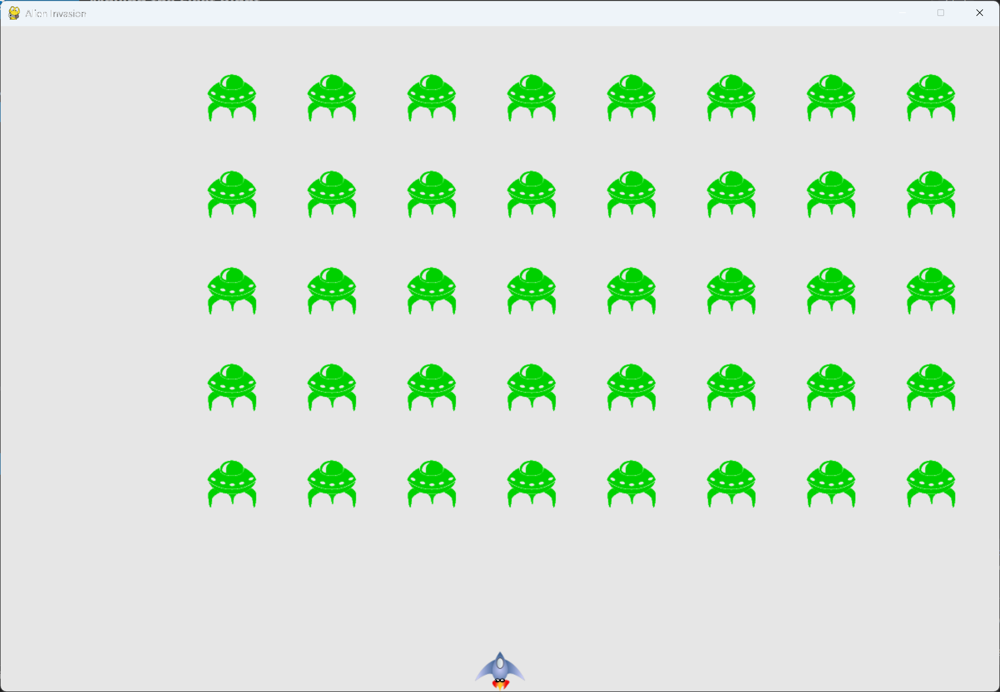

# Moving the Fleet Right

## What this step does

The fleet now moves. Each alien moves to the right by a set amount on every pass through the loop.
Nothing stops the fleet yet, so it moves off the right side of the screen. The next step makes it
change direction.

## Running this step

From the `alien-invasion` folder, run:

```pwsh
python build_stage.py ch13 3 --run
```

Press Q to quit.

## The code

`settings.py` changes only where shown below. `--snip--` marks code that stays the same.

```python
class Settings: #pylint: disable=too-few-public-methods
    --snip--

    def __init__(self) -> None:
        """Initialize the game's settings."""
        --snip--

        # Alien settings
        self.alien_speed = 1.0
```

`alien.py` changes only where shown below.

```python
class Alien(Sprite):
    --snip--

    def __init__(self, ai_game) -> None:
        """Initialize the alien and set its starting position."""
        super().__init__()
        self.screen = ai_game.screen
        self.settings = ai_game.settings
        --snip--

    def update(self) -> None:
        """Move the alien to the right."""
        self.x += self.settings.alien_speed
        self.rect.x = self.x
```

`alien_invasion.py` changes only where shown below.

```python
class AlienInvasion:
    --snip--

    def run_game(self) -> None:
        """Start the main loop for the game."""
        while True:
            self._check_events()
            self.ship.update()
            self._update_bullets()
            self._update_aliens()
            self._update_screen()
            self.clock.tick(60)

    --snip--

    def _update_aliens(self) -> None:
        """Update the positions of all aliens in the fleet."""
        self.aliens.update()

    --snip--
```

What changed:

- `settings.py` adds `alien_speed`, set to 1.0.
- `Alien.__init__()` keeps a reference to the settings, so `update()` can read the speed.
- `Alien.update()` is new. It moves the alien right by `alien_speed`, and updates its rect from the
  exact position, the same way the ship and bullets do.
- `_update_aliens()` is new. It calls `update()` on every alien in the group.
- `run_game()` calls `_update_aliens()` once per frame. It comes after the bullets are updated, and
  before the screen is drawn. Later, bullets will need to hit aliens, so the bullets move first.

## Walkthrough

**The group's update.** `self.aliens.update()` calls `update()` on each alien in the group. The
fleet moves as one, because every alien moves by the same amount on each frame.

**Exact positions.** `self.x` holds the alien's position as a decimal number, so a speed of 1.0
moves the fleet smoothly. The rect is then set from `self.x`, which is what Pygame uses to draw.

**The order in the loop.** The bullets are updated before the aliens. Later steps will check for
collisions between them, and that check needs both sets of positions to be current.

## Output

The fleet moves to the right, and the aliens leave the right side of the window.



## Changed files

- `settings.py`: adds `alien_speed`
- `alien.py`: keeps the settings, and adds `update()`
- `alien_invasion.py`: adds `_update_aliens()` and calls it in the loop

---
