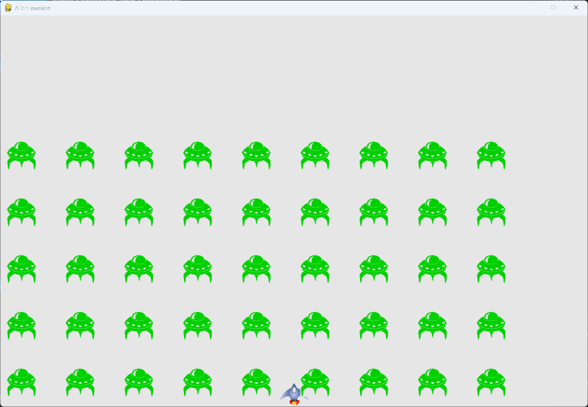

# Fleet Direction and Dropping

## What this step does

The fleet now moves back and forth. When any alien reaches the left or right edge of the screen, the
whole fleet drops down a set amount and reverses direction.

The direction is a number: 1 for right and -1 for left. Each alien multiplies its speed by that
number, so reversing the direction only means changing the sign.

## Running this step

From the `alien-invasion` folder, run:

```pwsh
python build_stage.py ch13 4 --run
```

Press Q to quit.

## The code

`settings.py` changes only where shown below. `--snip--` marks code that stays the same.

```python
class Settings: #pylint: disable=too-few-public-methods
    --snip--

    def __init__(self) -> None:
        """Initialize the game's settings."""
        --snip--

        # Alien settings
        self.alien_speed = 1.0
        self.fleet_drop_speed = 10

        # fleet_direction of 1 represents right; -1 represents left.
        self.fleet_direction = 1
```

`alien.py` changes only where shown below.

```python
class Alien(Sprite):
    --snip--

    def check_edges(self) -> bool:
        """Return True if the alien is at the edge of the screen."""
        screen_rect = self.screen.get_rect()
        return (self.rect.right >= screen_rect.right) or (self.rect.left <= 0)

    def update(self) -> None:
        """Move the alien right or left, depending on the fleet's direction."""
        self.x += self.settings.alien_speed * self.settings.fleet_direction
        self.rect.x = self.x
```

`alien_invasion.py` changes only where shown below.

```python
class AlienInvasion:
    --snip--

    def _update_aliens(self) -> None:
        """Check if the fleet is at an edge, then update the positions of all aliens."""
        self._check_fleet_edges()
        self.aliens.update()

    --snip--

    def _check_fleet_edges(self) -> None:
        """Respond appropriately if any aliens have reached an edge."""
        for alien in self.aliens.sprites():
            if alien.check_edges():
                self._change_fleet_direction()
                break

    def _change_fleet_direction(self) -> None:
        """Drop the entire fleet, and change the fleet's direction."""
        for alien in self.aliens.sprites():
            alien.rect.y += self.settings.fleet_drop_speed
        self.settings.fleet_direction *= -1
```

What changed:

- `settings.py` adds `fleet_drop_speed`, the distance the fleet drops each time, and
  `fleet_direction`, which starts at 1 for right.
- `Alien.check_edges()` is new. It returns `True` when the alien touches the right or left edge.
- `Alien.update()` multiplies the speed by `fleet_direction`, so the alien moves right or left.
- `_update_aliens()` checks the edges before it moves the aliens.
- `_check_fleet_edges()` and `_change_fleet_direction()` are new. Together they drop the fleet and
  reverse its direction.

## Walkthrough

**Why 1 and -1.** Moving right adds to each alien's x-position, and moving left subtracts from it.
Multiplying the speed by 1 or -1 does both with one line of code, and avoids a test for each
direction.

**Checking the edges.** `check_edges()` compares the alien's rect with the screen's rect. An alien
at the right edge has its right side at or past the screen's right side. An alien at the left edge
has its left side at or before 0.

**Only one check per edge.** `_check_fleet_edges()` stops after the first alien that's at an edge.
One alien is enough to turn the whole fleet, so the loop breaks out early.

**Changing direction once.** `_change_fleet_direction()` drops every alien, but it reverses the
direction once, after the loop. Putting the reversal inside the loop would reverse it once for every
alien in the fleet.

**The order of the checks.** The edges are checked before the aliens move. An alien that has just
reached an edge turns the fleet on the same frame, before it moves past the edge.

## Output

The fleet moves to the right until it reaches the edge of the window. It drops down, then moves to
the left, and repeats.



## Changed files

- `settings.py`: adds `fleet_drop_speed` and `fleet_direction`
- `alien.py`: adds `check_edges()`, and moves the alien in the fleet's direction
- `alien_invasion.py`: checks the edges before moving the fleet, and adds the direction change

---
