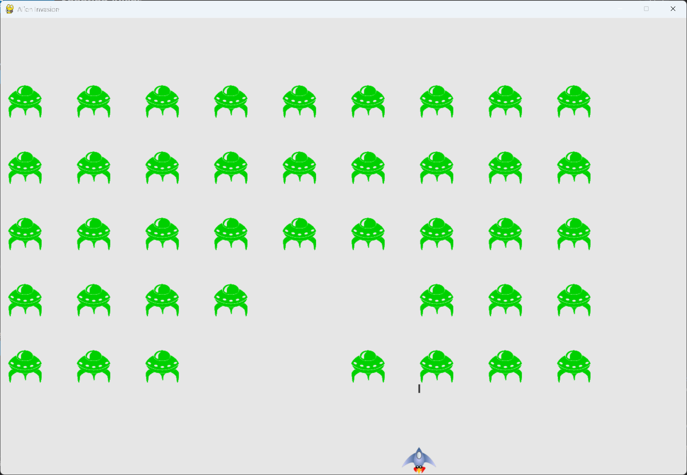

# Shooting Aliens

## What this step does

Bullets can now hit aliens. When a bullet overlaps an alien, both disappear. Before this step, bullets
passed straight through the fleet.

The check is made right after the bullets move, so an alien disappears on the same frame it's hit.

## Running this step

From the `alien-invasion` folder, run:

```pwsh
python build_stage.py ch13 5 --run
```

Press Q to quit.

## The code

`alien_invasion.py` changes only where shown below. `--snip--` marks code that stays the same.

```python
class AlienInvasion:
    --snip--

    def _update_bullets(self) -> None:
        """Update position of bullets, get rid of old bullets, and handle bullets that hit aliens."""
        --snip--
        # Get rid of bullets that have disappeared.
        for bullet in self.bullets.copy():
            if bullet.rect.bottom <= 0:
                self.bullets.remove(bullet)

        # Check for any bullets that have hit aliens.
        #   If so, get rid of the bullet and the alien.
        collisions = pygame.sprite.groupcollide(
            self.bullets, self.aliens, True, True)

    --snip--
```

What changed:

- `_update_bullets()` checks for collisions after it removes the bullets that have left the screen.
- `pygame.sprite.groupcollide()` compares every bullet with every alien. It returns a dictionary of
  the collisions it found.
- The two `True` arguments remove the bullets and the aliens that collided.
- The rest of the file is unchanged.

## Walkthrough

**Collisions.** A collision happens when two game elements overlap. Pygame checks this with the rects,
so a bullet touches an alien when their rects overlap.

**What `groupcollide()` does.** The first group is the bullets, and the second is the aliens. For each
pair that overlaps, the function adds an entry to the dictionary. Each key is a bullet, and each value
is the alien it hit.

**Removing both sprites.** The two `True` arguments tell Pygame to remove any bullet and any alien that
collided. Setting the first one to `False` would keep the bullet alive, so it could hit more aliens in
its path. The chapter 14 scoring step uses the dictionary to count the hits.

**Why the check happens here.** Checking right after the bullets move means a hit is removed on the
frame it happens. If the check ran later, the alien would appear to survive for another frame.

## Output

Aliens disappear when a bullet hits them. The fleet loses aliens from the bottom and middle as you shoot.



## Changed files

- `alien_invasion.py`: `_update_bullets()` removes bullets and aliens that collide

---
