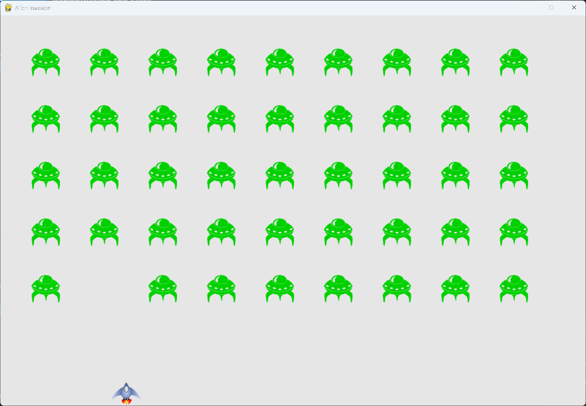

# Repopulating the Fleet

## What this step does

The game doesn't end when the fleet is destroyed. As soon as the last alien is shot, a new fleet
appears. Any bullets still in the air are cleared first, so the new fleet starts clean.

The bullets are also a little faster in this step, to make the game more fun to play.

The collision code has moved into its own method, `_check_bullet_alien_collisions()`, which keeps
`_update_bullets()` short.

## Running this step

From the `alien-invasion` folder, run:

```pwsh
python build_stage.py ch13 6 --run
```

Press Q to quit.

## The code

`settings.py` changes only where shown below. `--snip--` marks code that stays the same.

```python
class Settings: #pylint: disable=too-few-public-methods
    --snip--

    def __init__(self) -> None:
        """Initialize the game's settings."""
        --snip--

        # Bullet settings
        self.bullet_speed = 2.5
        --snip--
```

`alien_invasion.py` changes only where shown below.

```python
class AlienInvasion:
    --snip--

    def _update_bullets(self) -> None:
        """Update position of bullets and get rid of old bullets."""
        --snip--
        # Get rid of bullets that have disappeared.
        for bullet in self.bullets.copy():
            if bullet.rect.bottom <= 0:
                self.bullets.remove(bullet)

        self._check_bullet_alien_collisions()

    def _check_bullet_alien_collisions(self) -> None:
        """Respond to bullet-alien collisions, and create a new fleet when the fleet is destroyed."""
        # Remove any bullets and aliens that have collided.
        pygame.sprite.groupcollide(self.bullets, self.aliens, True, True)

        if not self.aliens:
            # Destroy existing bullets and create new fleet.
            self.bullets.empty()
            self._create_fleet()

    --snip--
```

What changed:

- `settings.py` sets `bullet_speed` to 2.5, up from 2.0.
- `_update_bullets()` now calls `_check_bullet_alien_collisions()`, instead of doing the collision
  work itself.
- `_check_bullet_alien_collisions()` is new. It removes any bullet and alien that collided. If no
  aliens are left, it empties the bullet group and creates a new fleet.
- The collision result is no longer stored in a variable. Chapter 14 adds scoring, which will use it.

## Walkthrough

**An empty group is false.** `if not self.aliens` is true when the group has no sprites. That's a
simple way to test whether the fleet has been destroyed.

**Clearing bullets.** `self.bullets.empty()` removes every bullet still in the air. Without this, a
bullet fired just before the last alien was hit would still be flying when the new fleet appears.

**The new fleet.** `_create_fleet()` builds the same full fleet as at the start of the game. Because
of the first check in `_update_bullets()`, the fleet is rebuilt on the same frame it's cleared.

**Bullet speed.** The best speed depends on how the game feels to you. Try a few values and see which
one suits you. Speed is one of the settings that's easiest to change.

**A smaller method.** `_update_bullets()` now handles only the bullets' movement and removal. The
collision rules are in their own method, so they're easier to read and change later.

## Output

When you clear the fleet, a new one appears at the top of the window straight away.



## Changed files

- `settings.py`: sets `bullet_speed` to 2.5
- `alien_invasion.py`: adds `_check_bullet_alien_collisions()`, which also creates new fleets

---
