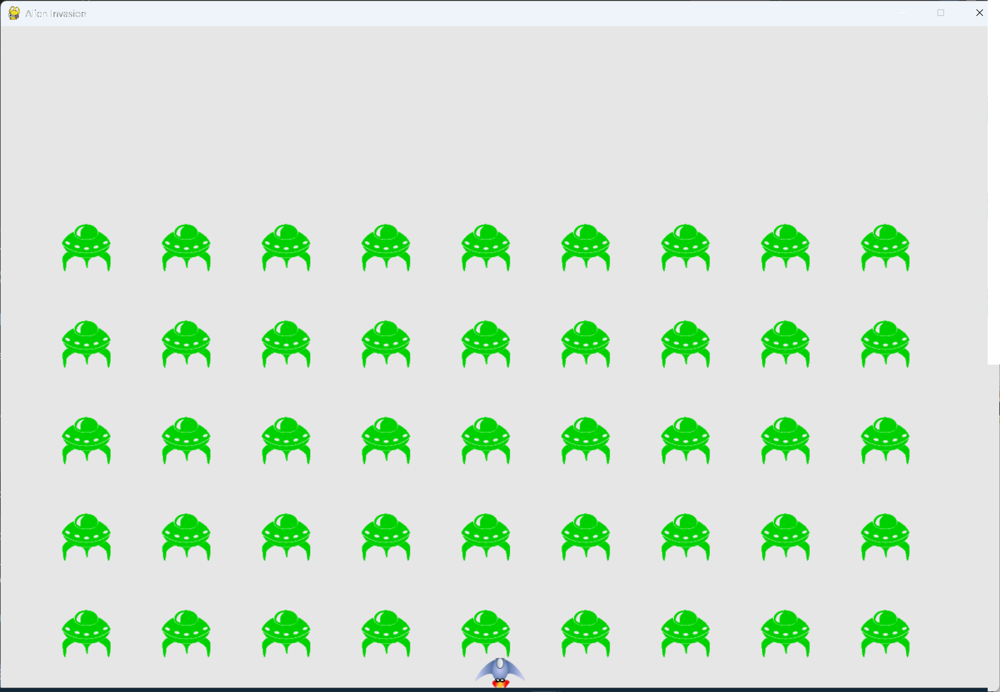

# Detecting Alien-Ship Collisions

## What this step does

The game can now tell when an alien runs into the ship. For now, it only prints a message. The
next step decides what happens after a collision.

Checking the detection first makes sure the collision test works before any game logic depends on
it.

## Running this step

From the `alien-invasion` folder, run:

```pwsh
python build_stage.py ch13 7 --run
```

Press Q to quit.

When you test this step, the aliens are slow to reach the ship. Set `fleet_drop_speed` in
`settings.py` to a larger value, such as 50 or 100, so the fleet comes down faster. Put it back
before you move on.

## The code

`alien_invasion.py` changes only where shown below. `--snip--` marks code that stays the same.

```python
class AlienInvasion:
    --snip--

    def _update_aliens(self) -> None:
        """Check if the fleet is at an edge, then update the positions of all aliens."""
        self._check_fleet_edges()
        self.aliens.update()

        # Look for alien-ship collisions.
        if pygame.sprite.spritecollideany(self.ship, self.aliens):
            print("Ship hit!!!")

    --snip--
```

What changed:

- `_update_aliens()` checks for collisions between the ship and the aliens, after the aliens have moved.
- `pygame.sprite.spritecollideany()` takes a sprite and a group. It returns the first alien that
  overlaps the ship, or `None` if there isn't one.
- When there's a collision, the program prints `Ship hit!!!`.

## Walkthrough

**Checking after the move.** The collision test runs after the aliens move, so it sees their
positions for the current frame.

**Stopping at the first hit.** `spritecollideany()` stops searching as soon as it finds one alien that
overlaps the ship. The game only needs to know that a hit happened, not how many aliens hit it.

**A temporary print.** The message is only there to check the detection. When the test works, the
next step replaces the `print()` call with the real response.

## Output

The terminal prints `Ship hit!!!` each time an alien touches the ship. The window keeps running.



## Changed files

- `alien_invasion.py`: `_update_aliens()` checks for alien-ship collisions and prints a message
