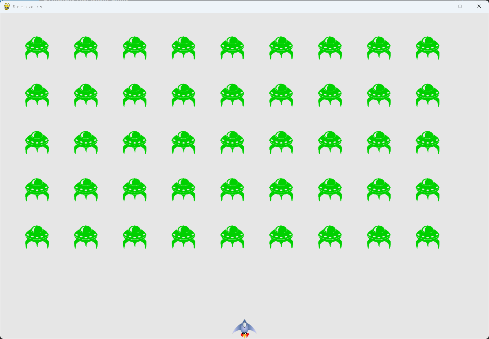

# Responding to Alien-Ship Collisions

## What this step does

When an alien hits the ship, the player loses one ship. All the remaining aliens and bullets are
removed, a new fleet appears, and the ship returns to the bottom center of the screen. The game
pauses for half a second, so the player can see what happened.

The number of ships left is kept in a new class, `GameStats`, in its own file. The same class will
hold scores in chapter 14.

## Running this step

From the `alien-invasion` folder, run:

```pwsh
python build_stage.py ch13 8 --run
```

Press Q to quit.

## The code

`game_stats.py` is new, so it's shown in full:

```python
"""
Alien Invasion Game - Chapter 13: Aliens!

This module tracks statistics for the game, such as the number of ships the player has left.
"""


class GameStats:
    """Track statistics for Alien Invasion."""

    def __init__(self, ai_game) -> None:
        """Initialize statistics."""
        self.settings = ai_game.settings
        self.reset_stats()

    def reset_stats(self) -> None:
        """Initialize statistics that can change during the game."""
        self.ships_left = self.settings.ship_limit
```

`settings.py` adds one setting, shown below. `--snip--` marks code that stays the same.

```python
class Settings:
    --snip--

    def __init__(self) -> None:
        """Initialize the game's settings."""
        --snip--

        # Ship settings
        self.ship_speed = 1.5
        self.ship_limit = 3
        --snip--
```

`ship.py` adds `center_ship()`, shown below.

```python
class Ship:
    --snip--

    def center_ship(self) -> None:
        """Center the ship on the screen."""
        self.rect.midbottom = self.screen_rect.midbottom
        self.x = float(self.rect.x)

    --snip--
```

`alien_invasion.py` changes only where shown below.

```python
import sys
from time import sleep

import pygame

from settings import Settings
from game_stats import GameStats
from ship import Ship
--snip--


class AlienInvasion:
    --snip--

    def __init__(self) -> None:
        """Initialize the game, and create game resources."""
        --snip--
        pygame.display.set_caption("Alien Invasion")

        # Create an instance to store game statistics.
        self.stats = GameStats(self)
        self.ship = Ship(self)
        --snip--

    def _update_aliens(self) -> None:
        """Check if the fleet is at an edge, then update the positions of all aliens."""
        self._check_fleet_edges()
        self.aliens.update()

        # Look for alien-ship collisions.
        if pygame.sprite.spritecollideany(self.ship, self.aliens):
            self._ship_hit()

    def _ship_hit(self) -> None:
        """Respond to the ship being hit by an alien."""
        # Decrement ships_left.
        self.stats.ships_left -= 1

        # Get rid of any remaining bullets and aliens.
        self.bullets.empty()
        self.aliens.empty()

        # Create a new fleet and center the ship.
        self._create_fleet()
        self.ship.center_ship()

        # Pause.
        sleep(0.5)

    --snip--
```

What changed:

- `game_stats.py` is new. It defines `GameStats`, which holds `ships_left`.
- `settings.py` adds `ship_limit`, set to 3.
- `ship.py` adds `center_ship()`, which puts the ship back at the bottom center.
- `alien_invasion.py` creates the stats object before the ship. It also replaces the `print()` from
  the last step with a call to `_ship_hit()`.

## Walkthrough

**One ship object.** The game makes one `Ship` for the whole run. After a hit, the ship is moved back
to the center, rather than destroyed and made again. The `ships_left` statistic tells the game when
the player has run out.

**Resetting statistics.** `reset_stats()` sets the statistics that change during a game. It's called
from `__init__()`, and it can be called again when a new game starts.

**Order in `_ship_hit()`.** The count goes down first, then the bullets and aliens are cleared, then
the new fleet is made. The ship is centered after the fleet, so the new fleet doesn't cover it.

**The pause.** `sleep(0.5)` runs after the updates but before the screen is drawn. The player sees the
new fleet and the centered ship together, after the hit.

**The stats object.** It's created before the ship, so the statistics exist before anything uses them.

## Output

When an alien touches the ship, the game pauses briefly. A new fleet appears, and the ship returns to
the bottom center of the window.



## Changed files

- `game_stats.py` (new): the `GameStats` class
- `settings.py`: adds `ship_limit`
- `ship.py`: adds `center_ship()`
- `alien_invasion.py`: adds `_ship_hit()`, and calls it on an alien-ship collision

---
