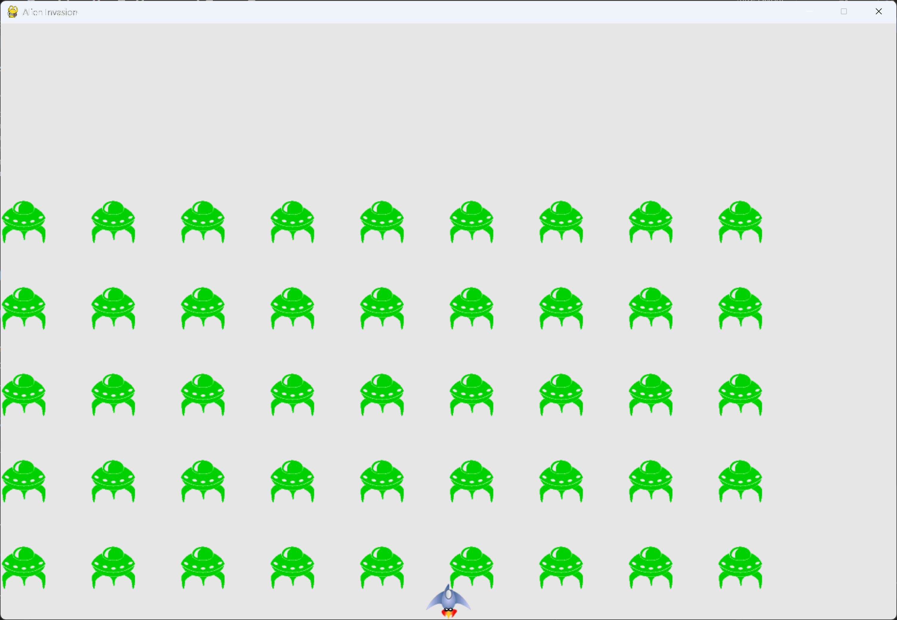

# Aliens Reaching the Bottom, and Game Over

## What this step does

An alien that reaches the bottom of the screen counts as a hit on the ship. The player loses a ship,
and the fleet starts again. When the player has no ships left, the game ends: the aliens and the ship
stop moving, but the window still runs, so the player can see the final screen and quit.

This step finishes the chapter's core game. The chapter summary is at the end of this page.

## Running this step

From the `alien-invasion` folder, run:

```pwsh
python build_stage.py ch13 9 --run
```

Press Q to quit. Let the aliens reach the bottom, or hit the ship, three times to see the game over.

## The code

`alien_invasion.py` changes only where shown below. `--snip--` marks code that stays the same.

```python
class AlienInvasion:
    --snip--

    def __init__(self) -> None:
        """Initialize the game, and create game resources."""
        --snip--
        self._create_fleet()

        # Start Alien Invasion in an active state.
        self.game_active = True

    def run_game(self) -> None:
        """Start the main loop for the game."""
        while True:
            self._check_events()

            if self.game_active:
                self.ship.update()
                self._update_bullets()
                self._update_aliens()

            self._update_screen()
            self.clock.tick(60)

    def _update_aliens(self) -> None:
        """Check if the fleet is at an edge, then update the positions of all aliens."""
        self._check_fleet_edges()
        self.aliens.update()

        # Look for alien-ship collisions.
        if pygame.sprite.spritecollideany(self.ship, self.aliens):
            self._ship_hit()

        # Look for aliens hitting the bottom of the screen.
        self._check_aliens_bottom()

    def _ship_hit(self) -> None:
        """Respond to the ship being hit by an alien."""
        if self.stats.ships_left > 0:
            # Decrement ships_left.
            self.stats.ships_left -= 1

            # Get rid of any remaining bullets and aliens.
            self.bullets.empty()
            self.aliens.empty()

            # Create a new fleet and center the ship.
            self._create_fleet()
            self.ship.center_ship()

            # Pause.
            sleep(0.5)
        else:
            self.game_active = False

    def _check_aliens_bottom(self) -> None:
        """Check if any aliens have reached the bottom of the screen."""
        for alien in self.aliens.sprites():
            if alien.rect.bottom >= self.settings.screen_height:
                # Treat this the same as if the ship got hit.
                self._ship_hit()
                break

    --snip--
```

What changed:

- `__init__()` sets `game_active` to `True` at the end.
- `run_game()` only moves the ship, bullets and aliens while the game is active. Events are still
  checked, and the screen is still drawn, so the window keeps working after the game ends.
- `_update_aliens()` checks for aliens at the bottom, after the ship collision check.
- `_check_aliens_bottom()` is new. An alien that reaches the bottom is treated as a ship hit.
- `_ship_hit()` now checks how many ships are left. With ships left, it works as before. With none
  left, it sets `game_active` to `False`.

## Walkthrough

**Two ways to lose a ship.** An alien touching the ship and an alien reaching the bottom both call
`_ship_hit()`. The same response covers both, so the code doesn't repeat itself.

**Stopping early.** `_check_aliens_bottom()` breaks out of its loop after the first alien at the bottom.
One alien is enough to cost a ship, so there's no need to check the rest.

**The game-active flag.** `game_active` is a switch. When it's `False`, the ship, bullets and aliens
stop updating, which freezes the game.

**Why events still run.** The main loop still checks events and draws the screen when the game is over.
This is how the player can still press Q, and how the window keeps showing the final frame.

**The order of checks.** The ship collision is tested before the bottom check. In both cases the same
response runs, so the order doesn't change the result.

## Output

When the last ship is lost, the aliens and the ship freeze on the screen. Press Q to close the window.



## Chapter summary

This chapter turned Alien Invasion from a ship and some bullets into a game with a fleet of aliens.
Here is what the finished version does, and the ideas behind it.

**Nested loops for a grid.** The fleet is built with two loops, one inside the other. The inner loop
fills a row, and the outer loop moves down to the next row. Spacing comes from the alien's own width
and height, so the fleet fits the screen whatever the image size.

**Movement for a group.** Every alien has an `update()` method, and the fleet calls it through a
group. The fleet moves by changing one number, its direction, which is `1` for right and `-1` for left.

**Edges and direction.** Each alien can say whether it has reached an edge. When any alien does, the
whole fleet drops and reverses. The direction changes once per drop, not once per alien.

**Collisions with groups.** `groupcollide()` finds the bullets that hit aliens, and removes both. A
single call covers the whole group. `spritecollideany()` finds whether any alien has touched the ship.

**Statistics in their own class.** `GameStats` holds the number of ships left. Keeping statistics apart
from the game's objects makes them easy to reset and easy to extend, which chapter 14 needs for scoring.

**Responding to a hit in one place.** `_ship_hit()` handles both a collision and an alien reaching the
bottom. It empties the groups, rebuilds the fleet, re-centers the ship, and ends the game when no ships are left.

**A game that can stop.** The `game_active` flag freezes the game without closing the window, so the
player can see the result and still quit.

**Testing with a large setting.** Some features are quicker to check with a setting turned up, such as a
faster `fleet_drop_speed` or wider bullets. Put the settings back once you're done.

Next, in chapter 14, the game gets scoring, a Play button, and high scores. The aliens and the
statistics from this chapter are the base for that work.

## Changed files

- `alien_invasion.py`: adds `game_active`, `_check_aliens_bottom()`, and the ship-count check in `_ship_hit()`

---
