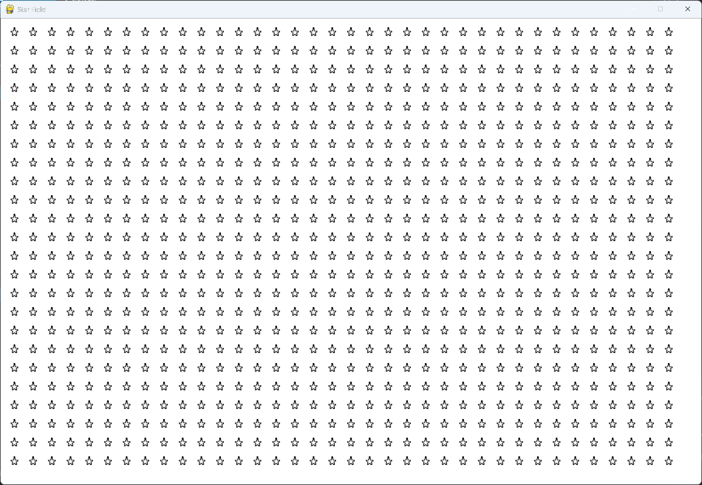

# Exercise 13-1: Stars

## The exercise

Find an image of a star. Make a grid of stars appear on the screen.

## Setup

The star image is `star.bmp`, in this exercise's `images` folder. To use a different star, copy
your own bitmap into that folder with the same name, or change `file_name` in `settings.py`.

## Running this exercise

From this folder, run:

```pwsh
python star_field.py
```

Press Q or Escape to quit.

## Solution

`settings.py` holds the window size, the background color, and the path to the star image. The
path is built from the settings file's own location, so the program finds the image whichever
folder you start it from.

`star.py` defines one star. It loads the image, and places the star at a position that's
measured from its own size:

```python
class Star(Sprite):
    --snip--

    def __init__(self, sf_game) -> None:
        """Initialize the star and set its starting position."""
        --snip--
        self.image = pygame.image.load(sf_game.settings.star_file_path)
        self.rect = self.image.get_rect()
        self.rect.x = self.rect.width
        self.rect.y = self.rect.height
        --snip--
```

`star_field.py` works out how many stars fit on the screen, with a space the width of a star
between each one, and creates them row by row:

```python
class StarField:
    --snip--

    def _create_star_field(self) -> None:
        """Create the field of stars."""
        star = Star(self)
        star_width, star_height = star.rect.size
        max_width_x = self.settings.screen_width - (2 * star_width)
        max_height_y = self.settings.screen_height - (2 * star_height)
        num_cols = max_width_x // (2 * star_width)
        num_rows = max_height_y // (2 * star_height)
        for row_num in range(num_rows):
            for col_num in range(num_cols):
                self._create_star(row_num, col_num)

    def _create_star(self, row_num: int, col_num: int) -> None:
        """Create a star and place it in its row and column."""
        star = Star(self)
        star_width, star_height = star.rect.size
        star.x = star_width + 2 * star_width * col_num
        star.rect.x = star.x
        star.rect.y = star.rect.height + 2 * star.rect.height * row_num
        self.stars.add(star)
```

## Walkthrough

**The grid.** Each star takes up one star-width of space, and there's a gap of one star-width
between stars. The number of columns and rows comes from dividing the screen's size by the space
each star needs.

**Drawing.** `self.stars.draw(self.screen)` draws every star in the group at its rect's position,
so the stars don't need a draw method of their own.

## Output

A grid of stars fills the window.



---
