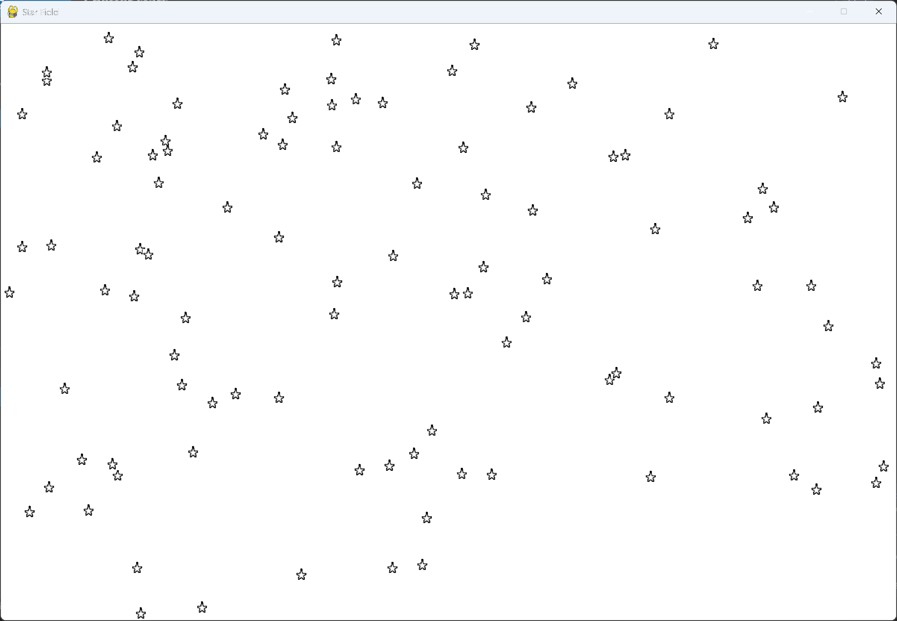

# Exercise 13-2: Better Stars

## The exercise

Make a more realistic star pattern by adding randomness when each star is placed. Use
`randint(-10, 10)` to adjust each star's position by a random amount, as in exercise 13-1.

## Setup

The star image is `star.bmp`, in this exercise's `images` folder, the same as in exercise 13-1.

## Running this exercise

From this folder, run:

```pwsh
python star_field.py
```

Press Q or Escape to quit.

## Solution

The solution keeps the star and settings modules from exercise 13-1. The settings also hold the
number of stars, `num_stars`, which is set to 100.

`star_field.py` places each star at a random position instead of in a grid. It picks the position
with `randint()`, so every star lands in a different place on the screen:

```python
class StarField:
    --snip--

    def _create_star_field(self) -> None:
        """Create the field of stars, one at a time, at random positions."""
        star_num = 0
        while star_num < self.settings.num_stars:
            self._create_star()
            star_num += 1

    def _create_star(self) -> None:
        """Create a star and place it at a random position on the screen."""
        star = Star(self)
        star_width, star_height = star.rect.size
        star.x = randint(0, self.settings.screen_width - star_width)
        star.rect.x = star.x
        star.y = randint(0, self.settings.screen_height - star_height)
        star.rect.y = star.y

        self.stars.add(star)
```

## Walkthrough

**Random positions.** `randint(0, screen_width - star_width)` gives a horizontal position where
the whole star still fits on the screen. The vertical position uses the same idea with the screen's
height.

**Why it looks more natural.** A grid of identical gaps looks mechanical. Random positions give the
pattern an uneven, more natural look, like a real night sky.

## Output

The stars are scattered across the window, with no grid pattern.


