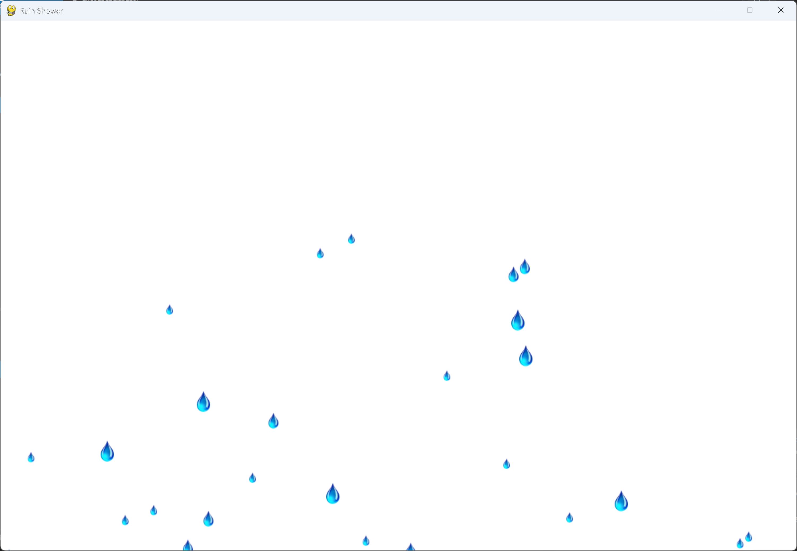

# Exercise 13-3: Raindrops

## The exercise

Find an image of a raindrop, and create a grid of raindrops. Make the raindrops fall toward the
bottom of the screen until they disappear.

## Note on the placement

The exercise asks for a grid of raindrops. This version places them at random positions instead. A grid
is boring to look at, so the raindrops were placed at random on purpose, against the instructions.

## Setup

The raindrop images are `rain_l.png`, `rain_m.png` and `rain_s.png`, in this exercise's `images`
folder. Each raindrop picks one of the three sizes at random.

## Running this exercise

From this folder, run:

```pwsh
python rain_shower.py
```

Press Q or Escape to quit. The rain falls until every drop has left the bottom of the screen, and
then the window stays empty. Exercise 13-4 is the version where the rain keeps going.

## Solution

`settings.py` holds the window size, the background color, the three image names, and the number
of raindrops, 200.

`raindrop.py` defines one raindrop. Each raindrop picks a size and a falling speed at random. Its
speed is at least 1, so every drop moves:

```python
class Raindrop(Sprite):
    --snip--

    def __init__(self, rs_game, at_top: bool = False) -> None:
        """Initialize a raindrop, and set its size and starting position."""
        --snip--
        self.speed = randint(1, 6)
        --snip--

    def update(self) -> None:
        """Move the raindrop down the screen."""
        self.y += self.speed
        self.rect.y = self.y
```

`rain_shower.py` moves the raindrops every frame, and removes any that have left the bottom of the
screen:

```python
class RainShower:
    --snip--

    def run_game(self) -> None:
        """Start the main loop for the game."""
        while True:
            self._check_events()
            self._update_raindrops()
            self._update_screen()

    def _update_raindrops(self) -> None:
        """Move the raindrops down, and remove any that have left the bottom of the screen."""
        self.raindrops.update()
        for drop in self.raindrops.copy():
            if drop.rect.top >= self.settings.screen_height:
                self.raindrops.remove(drop)
```

## Walkthrough

**Why the speed starts at 1.** A speed of 0 would leave a drop in place forever, so the random
speed is taken from 1 to 6.

**Removing drops.** A drop is removed once its top edge reaches the bottom of the screen. Without
this, the game would keep moving drops that nobody can see.

**Starting positions.** Each drop starts at a random position on the screen, so the first frame
already has rain spread across the window.

## Output

Raindrops are spread across the window, falling. Over time they leave the bottom of the screen.



---
