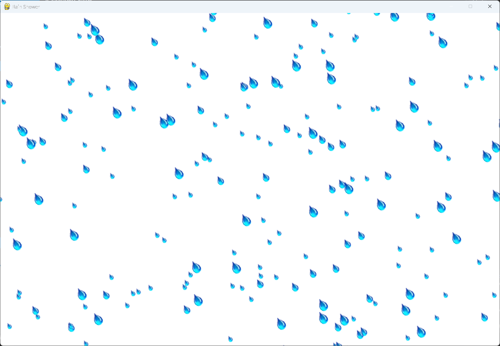

# Exercise 13-4: Steady Rain

## The exercise

Modify the code in exercise 13-3 so that when a row of raindrops disappears off the bottom of the
screen, a new row appears at the top of the screen and begins to fall.

## Setup

The raindrop images are the same as in exercise 13-3, and are in this exercise's `images` folder.

## Running this exercise

From this folder, run:

```pwsh
python rain_shower.py
```

Press Q or Escape to quit. The rain keeps falling, because each drop that leaves the screen is
replaced by a new one at the top.

## Solution

`settings.py` adds a wind speed. The wind is picked at random when the program starts, and it
makes the rain slant to one side.

`raindrop.py` moves each drop down and sideways each frame. A drop that leaves the screen is
replaced with a new one, which starts just outside the screen:

```python
class Raindrop(Sprite):
    --snip--

    def __init__(self, rs_game, new_drop: bool = False) -> None:
        """Initialize a raindrop, and set its size and starting position."""
        --snip--
        if new_drop:
            # Start the drop just outside the screen: on the side the wind blows from, or above it.
            screen_rect = self.screen.get_rect()
            if randint(0, 2) == 0:
                if self.settings.wind_speed < 0:
                    self.x = float(screen_rect.width)
                else:
                    self.x = float(-self.rect.width)
            else:
                self.y = float(-self.rect.height)
        --snip--

    def check_edge(self) -> bool:
        """Return True if the raindrop has passed the edge of the screen."""
        screen_rect = self.screen.get_rect()
        return (self.rect.top >= screen_rect.bottom or self.rect.right <= 0
                or self.rect.left >= screen_rect.right)
```

`rain_shower.py` replaces each drop that has left the screen:

```python
class RainShower:
    --snip--

    def _check_rain_bottom(self) -> None:
        """Replace any raindrop that has left the screen with a new one at the top."""
        for drop in self.raindrops.sprites():
            if drop.check_edge():
                self.raindrops.remove(drop)
                self._create_raindrop(True)
```

## Walkthrough

**Keeping the rain going.** The number of drops stays the same. When one leaves the screen, a new
one takes its place, so the rain never runs out.

**Starting outside the screen.** A new drop starts just off the screen, so it appears to fall into
view rather than popping up in the middle of the window.

**The wind.** A wind speed that's negative pushes the rain to the left, and a positive one pushes
it to the right. A new drop starts on the side the wind blows from, so the slant looks natural.

## Output

The rain fills the window and keeps falling, with the drops slanted by the wind.


