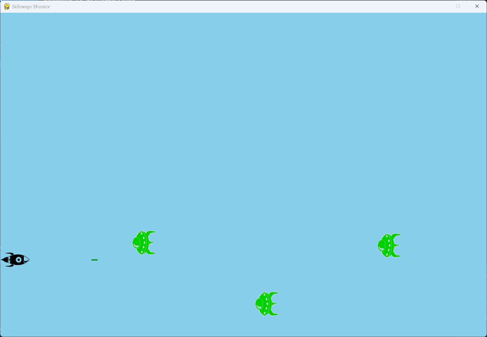

# Exercise 13-5: Sideways Shooter, Part 2

## The exercise

We've come a long way since exercise 12-6, Sideways Shooter. For this exercise, develop Sideways
Shooter to the same point we've brought Alien Invasion to. Add a fleet of aliens, and make them move
sideways toward the ship. Or write code that places aliens at random positions along the right side
of the screen and then sends them toward the ship. Also write code that makes the aliens disappear
when they're hit.

For this version, every five seconds a new alien appears at a random height on the right side of the
screen. The alien is rotated to face the rocket, and it moves toward the rocket. It bounces up or
down off the top and bottom edges of the screen, and the direction it moves in after each bounce is
the opposite of the edge it hit. A missile destroys any alien it hits.

## Setup

The images are in this exercise's `images` folder:

- `rocket.bmp`, the rocket from exercise 12-6
- `alien.bmp`, the alien from Alien Invasion

## Running this exercise

From this folder, run:

```pwsh
python sideways_shooter.py
```

Use the up and down arrow keys to move the rocket. Press the space bar to fire. Press Q or Escape
to quit.

## Solution

`settings.py` holds the screen size, the rocket and missile values, and the alien values. The
spawn time is in milliseconds, so 5000 means five seconds:

```python
class Settings:
    --snip--

        # Alien settings
        self.alien_speed = 1.0
        self.alien_vertical_speed = 1.0
        self.alien_spawn_interval = 5000  # milliseconds between new aliens
```

`alien.py` defines one alien. It's rotated 90 degrees when it's loaded, and it starts just off the
right edge at a random height:

```python
class Alien(Sprite):
    --snip--

    def __init__(self, ss_game) -> None:
        """Create an alien just off the right edge, at a random height."""
        --snip--
        image = pygame.image.load(os.path.join(folder, "images", "alien.bmp"))
        self.image = pygame.transform.rotate(image, 90)
        self.rect = self.image.get_rect()

        self.rect.left = self.screen_rect.right
        self.rect.y = randint(0, self.screen_rect.height - self.rect.height)
        --snip--
        self.vertical_direction = choice([1, -1])

    def update(self) -> None:
        """Move the alien left, and bounce it off the top and bottom edges of the screen."""
        self.x -= self.settings.alien_speed
        self.y += self.settings.alien_vertical_speed * self.vertical_direction
        self.rect.x = int(self.x)
        self.rect.y = int(self.y)

        # Bounce off the top edge, and move down from now on.
        if self.rect.top <= 0:
            self.vertical_direction = 1
            self.rect.top = 0
        # Bounce off the bottom edge, and move up from now on.
        elif self.rect.bottom >= self.screen_rect.bottom:
            self.vertical_direction = -1
            self.rect.bottom = self.screen_rect.bottom

        self.y = float(self.rect.y)
```

`sideways_shooter.py` spawns the aliens on a timer, moves them, and removes any that leave the left
side or are hit by a missile:

```python
class SidewaysShooter:
    --snip--

    def run_game(self) -> None:
        """Start the main loop for the game."""
        while True:
            self._check_events()
            self.rocket.update()
            self._update_missiles()
            self._update_aliens()
            self._spawn_alien()
            self._update_screen()
            self.clock.tick(60)

    def _spawn_alien(self) -> None:
        """Add a new alien once the spawn interval has passed."""
        now = pygame.time.get_ticks()
        if now - self.last_alien_time >= self.settings.alien_spawn_interval:
            self.aliens.add(Alien(self))
            self.last_alien_time = now

    def _update_aliens(self) -> None:
        """Move the aliens, and remove any that leave the screen or collide with the rocket."""
        self.aliens.update()

        for alien in self.aliens.copy():
            if alien.has_left_screen():
                self.aliens.remove(alien)
            elif alien.rect.colliderect(self.rocket.rect):
                # The alien hits the rocket, and is removed.
                self.aliens.remove(alien)

    def _update_missiles(self) -> None:
        """Update missiles, remove those that leave the screen, and destroy any aliens they hit."""
        self.missiles.update()
        --snip--
        # Remove any missiles and aliens that have collided.
        pygame.sprite.groupcollide(self.missiles, self.aliens, True, True)
```

## Walkthrough

**Spawning on a timer.** `pygame.time.get_ticks()` returns the time since Pygame started, in
milliseconds. The game compares it with the time of the last alien, and adds a new one once five
seconds have passed.

**Rotation.** `pygame.transform.rotate()` turns the image 90 degrees. The alien's rect is taken from
the rotated image, so its edges match what the player sees.

**Bouncing.** The direction changes at the edge the alien touches. Touching the top edge sends it
down, and touching the bottom edge sends it up. The rect is placed exactly on the edge, so the alien
can't go past it.

**Hits and misses.** A missile that touches an alien removes both. An alien that touches the rocket is
removed as well. An alien that reaches the left edge is removed, because the player has missed it.

## Output

Aliens appear on the right side of the window, at random heights, and move toward the rocket. Missiles
destroy the aliens they hit.



## Changed files

- `settings.py`: adds the alien speeds and spawn interval
- `alien.py` (new): the `Alien` class
- `sideways_shooter.py`: replaces `blue_sky.py`, with the spawning and the alien handling
