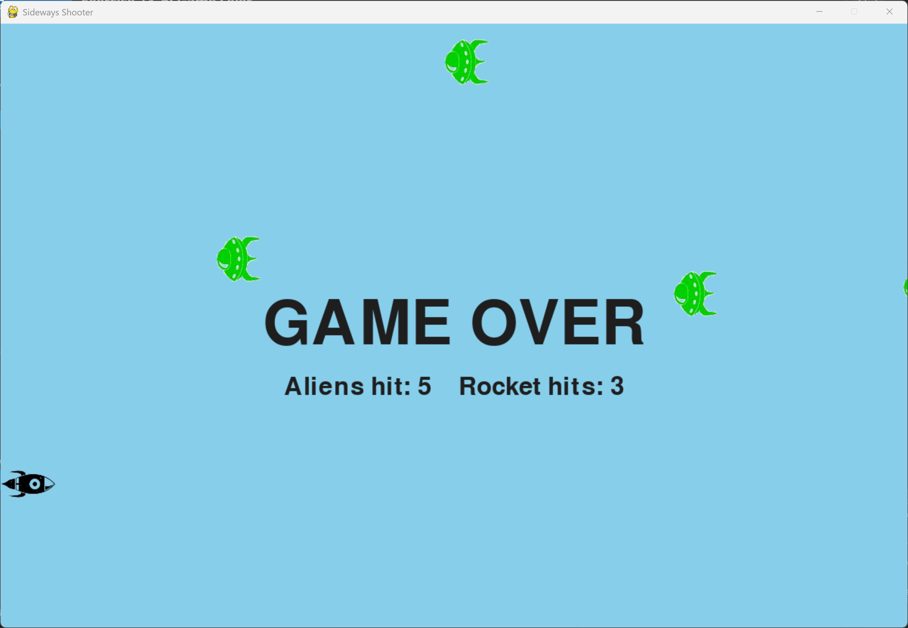

# Exercise 13-6: Game Over

## The exercise

In the Sideways Shooter, keep track of the number of times the ship is hit and the number of times an
alien is hit by the ship. Decide on an appropriate condition for ending the game, and stop the game
when this situation occurs.

For this version, the rocket is the ship. Aliens appear every five seconds, as in exercise 13-5. The
game ends when an alien has hit the rocket three times. The game then stops, shows a "GAME OVER"
message, and shows the final counts of alien hits and rocket hits.

## Setup

The images are in this exercise's `images` folder, the same as in exercise 13-5:

- `rocket.bmp`, the rocket from exercise 12-6
- `alien.bmp`, the alien from Alien Invasion

## Running this exercise

From this folder, run:

```pwsh
python sideways_shooter.py
```

Use the up and down arrow keys to move the rocket. Press the space bar to fire. Press Q or Escape
to quit. When the game is over, the aliens and missiles stop, and the message stays on the screen.

## Solution

`game_stats.py` is new. It counts the two kinds of hit, and says whether the game is active:

```python
class GameStats:
    --snip--

    def reset_stats(self) -> None:
        """Initialize statistics that can change during the game."""
        self.rocket_hits = 0
        self.alien_hits = 0
        self.game_active = True
```

`settings.py` adds the number of rocket hits that ends the game:

```python
class Settings:
    --snip--

        # Rocket settings
        self.rocket_speed = 1.0
        # The game ends when an alien hits the rocket this many times.
        self.rocket_limit = 3
```

`sideways_shooter.py` counts each hit. An alien that touches the rocket is removed and counted as a
rocket hit. When the count reaches the limit, the game ends:

```python
class SidewaysShooter:
    --snip--

    def _update_missiles(self) -> None:
        """Update missiles, remove those that leave the screen, and count the aliens they hit."""
        --snip--
        # Remove any missiles and aliens that have collided, and count the alien hits.
        hits = pygame.sprite.groupcollide(self.missiles, self.aliens, True, True)
        self.stats.alien_hits += len(hits)

    def _update_aliens(self) -> None:
        """Move the aliens, and handle aliens that leave the screen or hit the rocket."""
        self.aliens.update()

        for alien in self.aliens.copy():
            if alien.has_left_screen():
                self.aliens.remove(alien)
            elif alien.rect.colliderect(self.rocket.rect):
                # The alien hits the rocket, and is removed.
                self.aliens.remove(alien)
                self.stats.rocket_hits += 1
                if self.stats.rocket_hits >= self.settings.rocket_limit:
                    self._end_game()
                    return

    def _end_game(self) -> None:
        """Stop the game and print the final counts."""
        self.stats.game_active = False
        print(f"Game over. Aliens hit: {self.stats.alien_hits}. "
              f"Rocket hits: {self.stats.rocket_hits}.")
```

The main loop only moves things while the game is active. The message is drawn every frame after the
game ends:

```python
    def run_game(self) -> None:
        """Start the main loop for the game."""
        while True:
            self._check_events()

            if self.stats.game_active:
                self.rocket.update()
                self._update_missiles()
                self._update_aliens()
                self._spawn_alien()

            self._update_screen()
            self.clock.tick(60)
```

## Walkthrough

**Two counts.** `alien_hits` goes up each time a missile destroys an alien. `rocket_hits` goes up each
time an alien touches the rocket. Keeping them separate lets the player see both results at the end.

**Choosing the end condition.** Three rocket hits was chosen, to match the three ships in Alien
Invasion. The limit is in `settings.py`, so it's easy to change.

**Stopping the game.** When the limit is reached, `_end_game()` sets `game_active` to `False`. The
main loop then skips the movement steps, so the rocket, missiles and aliens all freeze.

**Stopping early.** `return` leaves `_update_aliens()` straight away, so no more aliens are checked once
the game has ended.

**The message.** `_draw_game_over()` draws the title in the middle of the screen, and the counts under
it, so the result is clear to the player.

## Output

When an alien hits the rocket for the third time, the game freezes and the message appears.



## Changed files

- `settings.py`: adds `rocket_limit` and the alien values
- `game_stats.py` (new): the `GameStats` class
- `alien.py` (new): the `Alien` class
- `sideways_shooter.py`: replaces `blue_sky.py`, with the hit counts, the game-over check and the message

---
