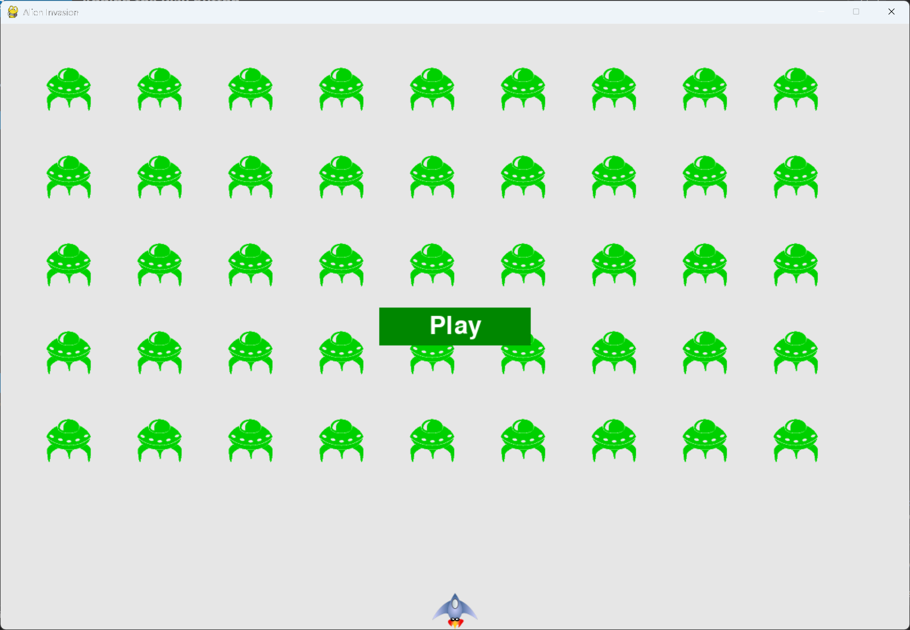

# Adding the Play Button

## What this step does

The game no longer starts on its own. It opens in an inactive state, and a green Play button
appears in the center of the screen.

Pygame doesn't have a built-in button, so this step adds a `Button` class in its own file. A button
is a filled rectangle with a label, and the class can be reused for any button in a game.

This step only draws the button. Clicking it is added in the next step.

## Running this step

From the `alien-invasion` folder, run:

```pwsh
python build_stage.py ch14 1 --run
```

Press Q to quit.

## The code

`button.py` is new, so it's shown in full:

```python
"""
Alien Invasion Game - Chapter 14: Scoring

This module defines the Button class, which draws a labeled rectangle the player can click.
"""

import pygame.font


class Button:
    """A class to build buttons for the game."""

    def __init__(self, ai_game, msg: str) -> None:
        """Initialize button attributes."""
        self.screen = ai_game.screen
        self.screen_rect = self.screen.get_rect()

        # Set the dimensions and properties of the button.
        self.width, self.height = 200, 50
        self.button_color = (0, 135, 0)
        self.text_color = (255, 255, 255)
        self.font = pygame.font.SysFont(None, 48)

        # Build the button's rect object and center it.
        self.rect = pygame.Rect(0, 0, self.width, self.height)
        self.rect.center = self.screen_rect.center

        # The button message needs to be prepped only once.
        self._prep_msg(msg)

    def _prep_msg(self, msg: str) -> None:
        """Turn msg into a rendered image and center text on the button."""
        self.msg_image = self.font.render(msg, True, self.text_color, self.button_color)
        self.msg_image_rect = self.msg_image.get_rect()
        self.msg_image_rect.center = self.rect.center

    def draw_button(self) -> None:
        """Draw blank button and then draw message."""
        self.screen.fill(self.button_color, self.rect)
        self.screen.blit(self.msg_image, self.msg_image_rect)
```

`alien_invasion.py` changes only where shown below. `--snip--` marks code that stays the same.

```python
from settings import Settings
from game_stats import GameStats
from button import Button
--snip--


class AlienInvasion:
    --snip--

    def __init__(self) -> None:
        """Initialize the game, and create game resources."""
        --snip--
        self._create_fleet()

        # Start Alien Invasion in an inactive state.
        self.game_active = False

        # Make the Play button.
        self.play_button = Button(self, "Play")

    --snip--

    def _update_screen(self) -> None:
        """Update images on the screen, and flip to the new screen."""
        --snip--
        self.aliens.draw(self.screen)

        # Draw the play button if the game is inactive.
        if not self.game_active:
            self.play_button.draw_button()

        pygame.display.flip()
```

What changed:

- `button.py` is new. It defines the `Button` class.
- `alien_invasion.py` imports `Button`.
- The game starts with `game_active` set to `False`, so the aliens and the ship don't move yet.
- The Play button is created at the end of `__init__()`.
- `_update_screen()` draws the button, after everything else and before the screen is shown. The
  button is only drawn while the game is inactive.

## Walkthrough

**The button's shape.** `pygame.Rect` gives the button its area. Its `center` is set to the screen's
center, which places the button in the middle of the window.

**The text.** `font.render()` turns the label into an image. The text and the button share the same
background color, so the text sits cleanly on the button. Antialiasing smooths the edges of the letters.

**Preparing the label once.** The label is rendered in `_prep_msg()`, when the button is made. It
doesn't change, so there's no need to render it every frame.

**Drawing order.** The button is drawn last, so it sits above the fleet and the ship. The check on
`game_active` means the button disappears once the game starts.

**Reusing the class.** `Button` takes the label as a parameter. A game can have as many buttons as it
needs, each with a different label.

## Output

The game opens with the fleet in place, the ship at the bottom, and a green Play button in the center.



## Changed files

- `button.py` (new): the `Button` class
- `alien_invasion.py`: imports `Button`, starts inactive, and draws the Play button

---
