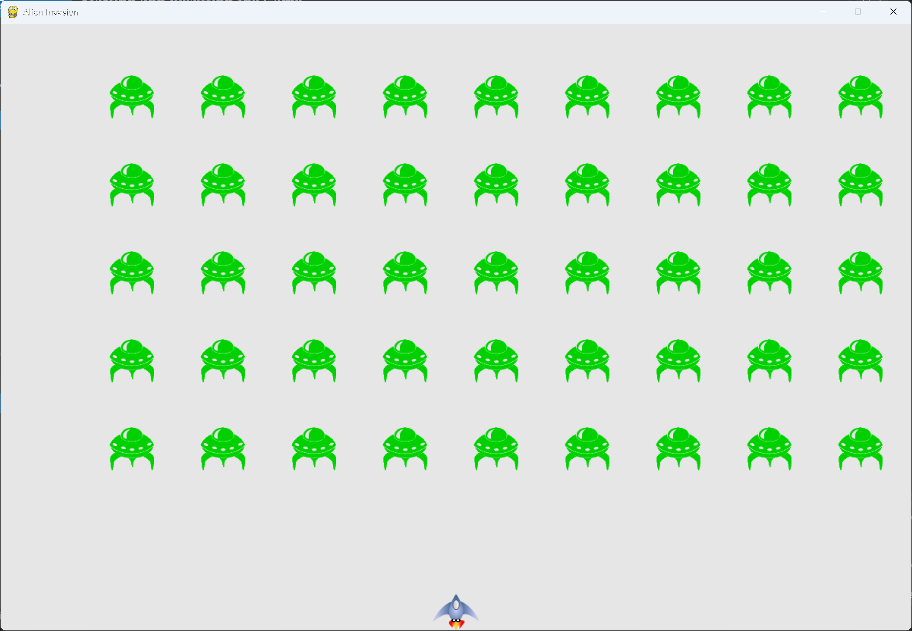

# Starting and Resetting the Game

## What this step does

The Play button works. Clicking it starts a game, and the game can be played again after each game
ends. Each new game starts with a fresh set of ships, an empty bullet list, a new fleet, and the ship
at the bottom center.

The mouse cursor is hidden while you play, and shown again when the game ends.

## Running this step

From the `alien-invasion` folder, run:

```pwsh
python build_stage.py ch14 2 --run
```

Click Play to start. Press Q to quit.

## The code

`alien_invasion.py` changes only where shown below. `--snip--` marks code that stays the same.

```python
class AlienInvasion:
    --snip--

    def _check_events(self) -> None:
        """Respond to keypresses and mouse events."""
        for event in pygame.event.get():
            if event.type == pygame.QUIT:
                sys.exit()
            elif event.type == pygame.KEYDOWN:
                self._check_keydown_events(event)
            elif event.type == pygame.KEYUP:
                self._check_keyup_events(event)
            elif event.type == pygame.MOUSEBUTTONDOWN:
                mouse_pos = pygame.mouse.get_pos()
                self._check_play_button(mouse_pos)

    def _check_play_button(self, mouse_pos: tuple[int, int]) -> None:
        """Start a new game when the player clicks Play."""
        button_clicked = self.play_button.rect.collidepoint(mouse_pos)
        if button_clicked and not self.game_active:
            # Reset the game statistics.
            self.stats.reset_stats()
            self.game_active = True

            # Get rid of any remaining bullets and aliens.
            self.bullets.empty()
            self.aliens.empty()

            # Create a new fleet and center the ship.
            self._create_fleet()
            self.ship.center_ship()

            # Hide the mouse cursor.
            pygame.mouse.set_visible(False)

    --snip--

    def _ship_hit(self) -> None:
        """Respond to the ship being hit by an alien."""
        if self.stats.ships_left > 0:
            --snip--
        else:
            self.game_active = False
            pygame.mouse.set_visible(True)
```

What changed:

- `_check_events()` handles `pygame.MOUSEBUTTONDOWN`, and passes the mouse position to
  `_check_play_button()`.
- `_check_play_button()` is new. It starts a game only when the click is on the Play button and no game
  is running.
- Starting a game resets the statistics, clears the old aliens and bullets, builds a new fleet, centers
  the ship, and hides the cursor.
- `_ship_hit()` shows the cursor again when the game ends, so the player can click Play.

## Walkthrough

**Two checks on a click.** Pygame reports every click on the window. `collidepoint()` checks whether
the click is inside the Play button's rect. The `not self.game_active` check stops the button from
restarting a game in progress, so clicking the same spot during play does nothing.

**Resetting the game.** A finished game leaves behind ships used up, aliens and bullets, and a ship in
the wrong place. Each of these is reset when a new game starts, so the game plays the same way every
time.

**Hiding the cursor.** `set_visible(False)` hides the cursor while the ship is being moved. The cursor
is shown again in `_ship_hit()`, so it's there when the player needs to click Play.

**Where the reset lives.** The reset is in `_check_play_button()`, not in `__init__()`, so the same code
runs for the first game and for every game after it.

## Output

Click Play. The button disappears, the fleet starts moving, and the cursor is hidden. When the last ship
is lost, the Play button returns and the cursor reappears.



## Changed files

- `alien_invasion.py`: handles clicks on the Play button, resets the game, and shows or hides the cursor

---
