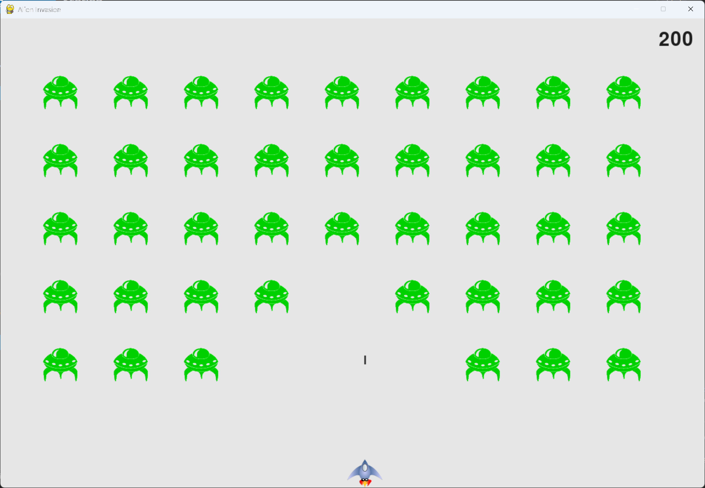

# Scoring

## What this step does

The game now keeps score. Each alien the player shoots down adds points, and the score shows in the top
right corner of the window. The score is rounded to the nearest 10 and has commas in large numbers.

Each time the game speeds up, the points for each alien go up too, so later fleets are worth more.

The score is reset when a new game starts, so the scoreboard always shows 0 at the beginning.

## Running this step

From the `alien-invasion` folder, run:

```pwsh
python build_stage.py ch14 4 --run
```

Click Play and shoot some aliens. Press Q to quit.

## The code

`game_stats.py` keeps the score. It's reset with the other statistics at the start of each game:

```python
class GameStats:
    --snip--

    def reset_stats(self) -> None:
        """Initialize statistics that can change during the game."""
        self.ships_left = self.settings.ship_limit
        self.score = 0
```

`scoreboard.py` is new, so it's shown in full:

```python
"""
Alien Invasion Game - Chapter 14: Scoring

This module defines the Scoreboard class, which shows the player's score.
"""

import pygame.font


class Scoreboard:
    """A class to report scoring information."""

    def __init__(self, ai_game) -> None:
        """Initialize scorekeeping attributes."""
        self.screen = ai_game.screen
        self.screen_rect = self.screen.get_rect()
        self.settings = ai_game.settings
        self.stats = ai_game.stats

        # Font settings for scoring information.
        self.text_color = (30, 30, 30)
        self.font = pygame.font.SysFont(None, 48)

        # Prepare the initial score image.
        self.prep_score()

    def prep_score(self) -> None:
        """Turn the score into a rendered image."""
        rounded_score = round(self.stats.score, -1)
        score_str = f"{rounded_score:,}"
        self.score_image = self.font.render(score_str, True,
                                            self.text_color, self.settings.bg_color)

        # Display the score at the top right of the screen.
        self.score_rect = self.score_image.get_rect()
        self.score_rect.right = self.screen_rect.right - 20
        self.score_rect.top = 20

    def show_score(self) -> None:
        """Draw the score to the screen."""
        self.screen.blit(self.score_image, self.score_rect)
```

`settings.py` adds the points for each alien. The points are set in `initialize_dynamic_settings()`, so
they go back to 50 at the start of each game, and they grow in `increase_speed()`:

```python
class Settings:
    --snip--

        # How quickly the alien point values increase
        self.score_scale = 1.5

    def initialize_dynamic_settings(self) -> None:
        """Initialize settings that change throughout the game."""
        --snip--
        # Scoring settings
        self.alien_points = 50

    def increase_speed(self) -> None:
        """Increase speed settings and alien point values."""
        --snip--
        self.alien_points = int(self.alien_points * self.score_scale)
```

`alien_invasion.py` changes only where shown below. `--snip--` marks code that stays the same.

```python
from game_stats import GameStats
from scoreboard import Scoreboard
--snip--


class AlienInvasion:
    --snip--

    def __init__(self) -> None:
        """Initialize the game, and create game resources."""
        --snip--
        # Create an instance to store game statistics, and create a scoreboard.
        self.stats = GameStats(self)
        self.sb = Scoreboard(self)
        --snip--

    def _check_play_button(self, mouse_pos: tuple[int, int]) -> None:
        """Start a new game when the player clicks Play."""
        --snip--
            # Reset the game statistics, and prep a score of 0.
            self.stats.reset_stats()
            self.sb.prep_score()
            --snip--

    def _check_bullet_alien_collisions(self) -> None:
        """Respond to bullet-alien collisions, and create a new fleet when the fleet is destroyed."""
        # Remove any bullets and aliens that have collided.
        collisions = pygame.sprite.groupcollide(self.bullets, self.aliens, True, True)

        if collisions:
            # Each bullet can hit more than one alien, so score every alien that was hit.
            for aliens in collisions.values():
                self.stats.score += self.settings.alien_points * len(aliens)
            self.sb.prep_score()

        if not self.aliens:
            --snip--

    def _update_screen(self) -> None:
        """Update images on the screen, and flip to the new screen."""
        --snip--
        self.aliens.draw(self.screen)

        # Draw the score information.
        self.sb.show_score()
        --snip--
```

What changed:

- `game_stats.py` sets the score to 0 in `reset_stats()`.
- `scoreboard.py` is new. It renders the score as an image, and draws it in the top right corner.
- `settings.py` sets `alien_points` to 50, and raises it by `score_scale` each time the game speeds up.
- `alien_invasion.py` creates the scoreboard, adds points for each alien hit, and draws the score.

## Walkthrough

**Rendering the score.** The score is a number, but Pygame draws text as an image. `prep_score()` turns
the number into text, renders it, and stores the image. The image is only rebuilt when the score changes,
which saves redrawing it every frame.

**Rounding and commas.** `round(self.stats.score, -1)` rounds to the nearest 10. The `:,` format adds
commas, so 1000000 shows as 1,000,000.

**Anchoring the score.** The score's right edge is placed 20 pixels from the screen's right edge. The
number grows to the left as it gets longer, so it always lines up with the edge of the window.

**Every alien is scored.** A single bullet can hit more than one alien, and `groupcollide()` gives each
bullet the list of aliens it hit. Looping over the lists scores every alien, not just one per bullet.

**Scores after a restart.** `prep_score()` is called right after the reset, so the old score is replaced
by 0 at once.

**Harder aliens, bigger scores.** Each speed-up raises `alien_points` by `score_scale`, so later fleets
are worth more. `int()` keeps the points as whole numbers.

## Output

The score appears in the top right corner. It goes up as you shoot aliens, and it's rounded to the nearest
10 with commas.



## Changed files

- `game_stats.py`: resets the score
- `scoreboard.py` (new): the `Scoreboard` class
- `settings.py`: adds the points for each alien, and the point increase
- `alien_invasion.py`: creates the scoreboard, scores each hit, and draws the score

---
