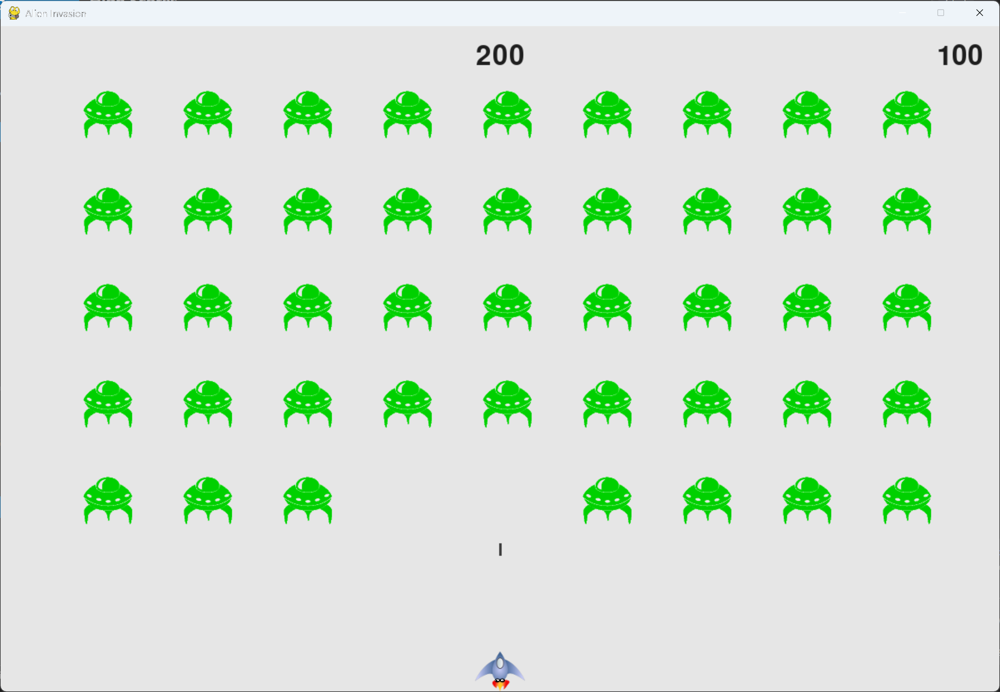

# High Scores

## What this step does

The game now keeps a high score, the best score reached since the game was started. It's shown in the
top centre of the window, next to the current score in the top right.

Unlike the score, the high score is never reset when a new game starts. It only goes up, and it's
updated after every hit, when the current score beats it.

The high score lasts only while the game is running. It's lost when the game closes. Exercise 14-5 saves
it to a file, so it's kept between runs.

## Running this step

From the `alien-invasion` folder, run:

```pwsh
python build_stage.py ch14 5 --run
```

Play a game, then start a second game. The best score stays at the top centre of the window.
Press Q to quit.

## The code

`game_stats.py` sets the high score in `__init__()`, not in `reset_stats()`. That way it isn't reset with
the rest of the statistics:

```python
class GameStats:
    --snip--

    def __init__(self, ai_game) -> None:
        """Initialize statistics."""
        --snip--
        self.reset_stats()

        # The high score should never be reset.
        self.high_score = 0
```

`scoreboard.py` adds the high score image, the check for a new high score, and the drawing of the high
score. Only the new parts are shown here, because the rest of the file is unchanged:

```python
class Scoreboard:
    --snip--

    def __init__(self, ai_game) -> None:
        """Initialize scorekeeping attributes."""
        --snip--
        # Prepare the initial score images.
        self.prep_score()
        self.prep_high_score()

    def prep_high_score(self) -> None:
        """Turn the high score into a rendered image."""
        high_score = round(self.stats.high_score, -1)
        high_score_str = f"{high_score:,}"
        self.high_score_image = self.font.render(high_score_str, True,
                                                 self.text_color, self.settings.bg_color)

        # Center the high score at the top of the screen.
        self.high_score_rect = self.high_score_image.get_rect()
        self.high_score_rect.centerx = self.screen_rect.centerx
        self.high_score_rect.top = self.score_rect.top

    def check_high_score(self) -> None:
        """Check to see if there's a new high score."""
        if self.stats.score > self.stats.high_score:
            self.stats.high_score = self.stats.score
            self.prep_high_score()

    def show_score(self) -> None:
        """Draw the score and the high score to the screen."""
        self.screen.blit(self.score_image, self.score_rect)
        self.screen.blit(self.high_score_image, self.high_score_rect)
```

`alien_invasion.py` checks for a new high score after each hit. Only the changed method is shown:

```python
class AlienInvasion:
    --snip--

    def _check_bullet_alien_collisions(self) -> None:
        """Respond to bullet-alien collisions, and create a new fleet when the fleet is destroyed."""
        --snip--
        if collisions:
            for aliens in collisions.values():
                self.stats.score += self.settings.alien_points * len(aliens)
            self.sb.prep_score()
            self.sb.check_high_score()
        --snip--
```

What changed:

- `game_stats.py` sets `high_score` to 0 once, in `__init__()`.
- `scoreboard.py` creates the high score image, centres it at the top, and draws it. It also gets
  `check_high_score()`.
- `alien_invasion.py` calls `check_high_score()` after the score has been updated for each hit.

## Walkthrough

**Why the high score isn't reset.** `reset_stats()` runs at the start of each game, so anything set there
goes back to its starting value. The high score is set in `__init__()`, which runs once when the game
starts, so it survives from one game to the next.

**Checking after the score.** The score is updated for every alien hit first, and then the check runs. If
the check ran before the score was updated, the high score would always lag one hit behind.

**The image is only rebuilt when it changes.** `prep_high_score()` runs only when a new high score is set,
so the image isn't rendered every frame.

**Centring the high score.** The high score's `centerx` is set to the screen's centre, and its `top` is
lined up with the score's top, so the two numbers sit level with each other.

**Saving the high score.** This step doesn't save the high score anywhere. It's lost when the game closes.
Exercise 14-5 writes it to a file before the game exits, and reads it back when the game starts.

## Output

The current score is in the top right corner, and the high score is in the top centre. The high score stays
the same when a new game starts, and only changes when the score beats it.



## Changed files

- `game_stats.py`: sets the high score once, in `__init__()`
- `scoreboard.py`: shows the high score, and checks for a new one
- `alien_invasion.py`: checks for a new high score after each hit

---
