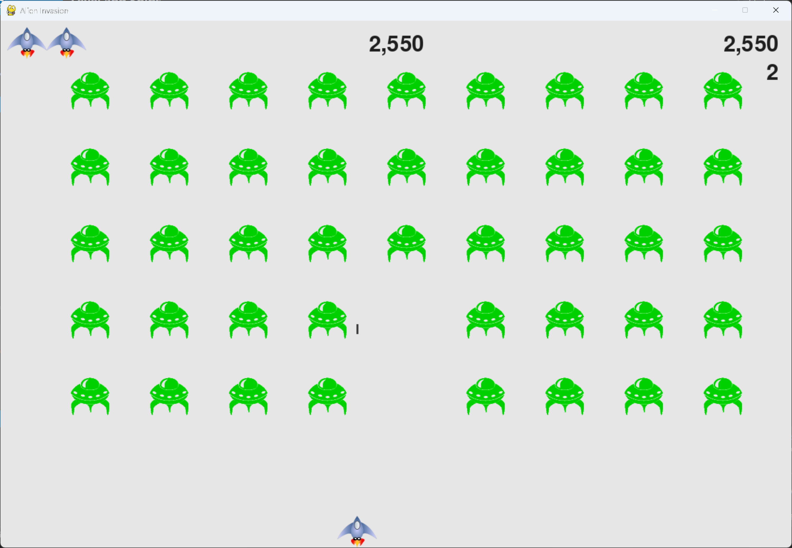

# Level and Ships

## What this step does

The scoreboard now shows the full set of information: the score in the top right, the high score in the top
centre, the level under the score, and the ships left as small ship images in the top left corner.

The level goes up each time a fleet is cleared, and it's reset to 1 when a new game starts. Losing a ship
removes one of the small ship images.

This is the last step of the main chapter sequence, so the summary for chapter 14 is at the end of this page.

## Running this step

From the `alien-invasion` folder, run:

```pwsh
python build_stage.py ch14 6 --run
```

Play a game. Clear a fleet to see the level change, and lose a ship to see an image disappear. Press Q to
quit.

## The code

`ship.py` inherits from `Sprite`, so ships can be kept in a group and drawn all at once:

```python
from pygame.sprite import Sprite


class Ship(Sprite):
    """A class to manage the ship."""

    def __init__(self, ai_game) -> None:
        """Initialize the ship and set its starting position."""
        super().__init__()
        --snip--
```

`game_stats.py` adds the level, which is reset with the other statistics:

```python
class GameStats:
    --snip--

    def reset_stats(self) -> None:
        """Initialize statistics that can change during the game."""
        self.ships_left = self.settings.ship_limit
        self.score = 0
        self.level = 1
```

`scoreboard.py` adds the level and the ships. The new methods are shown below, and `show_score()` now draws
them:

```python
import pygame.font
from pygame.sprite import Group

from ship import Ship


class Scoreboard:
    --snip--

    def __init__(self, ai_game) -> None:
        """Initialize scorekeeping attributes."""
        self.ai_game = ai_game
        --snip--
        self.prep_score()
        self.prep_high_score()
        self.prep_level()
        self.prep_ships()

    def prep_level(self) -> None:
        """Turn the level into a rendered image."""
        level_str = str(self.stats.level)
        self.level_image = self.font.render(level_str, True,
                                            self.text_color, self.settings.bg_color)

        # Position the level below the score.
        self.level_rect = self.level_image.get_rect()
        self.level_rect.right = self.score_rect.right
        self.level_rect.top = self.score_rect.bottom + 10

    def prep_ships(self) -> None:
        """Show how many ships are left, as small ship images in the top left corner."""
        self.ships = Group()
        for ship_number in range(self.stats.ships_left):
            ship = Ship(self.ai_game)
            ship.rect.x = 10 + ship_number * ship.rect.width
            ship.rect.y = 10
            self.ships.add(ship)

    def show_score(self) -> None:
        """Draw the score, high score, level, and ships to the screen."""
        self.screen.blit(self.score_image, self.score_rect)
        self.screen.blit(self.high_score_image, self.high_score_rect)
        self.screen.blit(self.level_image, self.level_rect)
        self.ships.draw(self.screen)
```

`alien_invasion.py` updates the scoreboard in three places. Only the changed code is shown:

```python
class AlienInvasion:
    --snip--

    def _check_play_button(self, mouse_pos: tuple[int, int]) -> None:
        """Start a new game when the player clicks Play."""
        --snip--
            self.stats.reset_stats()
            self.sb.prep_score()
            self.sb.prep_level()
            self.sb.prep_ships()
            --snip--

    def _check_bullet_alien_collisions(self) -> None:
        """Respond to bullet-alien collisions, and create a new fleet when the fleet is destroyed."""
        --snip--
        if not self.aliens:
            --snip--
            # Increase the level, and show it on the scoreboard.
            self.stats.level += 1
            self.sb.prep_level()

    def _ship_hit(self) -> None:
        """Respond to the ship being hit by an alien."""
        if self.stats.ships_left > 0:
            # Decrement ships_left, and update the scoreboard.
            self.stats.ships_left -= 1
            self.sb.prep_ships()
            --snip--
```

What changed:

- `ship.py` inherits from `Sprite`, so the ships can be held in a group.
- `game_stats.py` sets the level to 1 in `reset_stats()`.
- `scoreboard.py` adds `prep_level()` and `prep_ships()`, and draws them in `show_score()`.
- `alien_invasion.py` resets the level display when a game starts, raises the level when a fleet is cleared,
  and redraws the ship images when a ship is lost.

## Walkthrough

**Why ships are a group.** Each ship image is a `Ship` object, so the scoreboard can make one per remaining
ship and put them in a group. The group draws them all with one call, the same as the aliens.

**Positioning the ships.** Each ship is placed 10 pixels from the left edge, and each one after that is one
ship-width to the right. The ships sit in a row in the top left corner, with a small gap between them.

**The level under the score.** `prep_level()` lines the level up with the right edge of the score, and puts it
10 pixels below the score's bottom edge. It looks like part of the score panel.

**Updating the display.** The scoreboard is only redrawn when something changes. The level changes in
`_check_bullet_alien_collisions()`, and the ships change in `_ship_hit()` and `_check_play_button()`.

## Output

The level sits under the score in the top right, and the ships are in the top left. The level goes up each
time a fleet is cleared, and a ship image disappears each time you lose a ship.



## Summary

In this chapter, the game became a complete arcade game. Alien Invasion now has a Play button, a
speed-up for each new fleet, and a scoreboard.

**Buttons and mouse events.** The `Button` class draws a labelled rectangle, and the game listens for mouse
clicks. `collidepoint()` checks whether the click is inside the button, and the `game_active` flag stops the
button from restarting a game in progress. The cursor is hidden during play, and shown again between games.

**Resetting for a new game.** Every game starts from the same place. The statistics, the speed settings, the
fleet, and the ship are reset, so each game plays the same way. Static settings are kept apart from dynamic
ones, so the game knows what to reset.

**Speeding up.** `speedup_scale` multiplies the ship, bullet and alien speeds each time a fleet is cleared.
Points for each alien go up at the same time, using `score_scale`. A small scale makes the game harder
gradually, and the settings control how fast that happens.

**Scoring.** The score is a statistic, so it's kept in `GameStats`. `groupcollide()` returns every bullet and the
aliens it hit, so every alien is scored, even when one bullet hits more than one. The score is rounded and
formatted with commas before it's drawn.

**Images for text.** Pygame draws text as an image. Each value is turned into an image only when it changes,
then drawn each frame. That keeps the game smooth.

**Scoreboard layout.** The score is anchored to the top right, the high score to the top centre, the level under
the score, and the ships in the top left. Each part is placed with a rect, so it stays in the right place as the
numbers change size.

Chapter 15 is not written yet. The exercises in this chapter, from 14-1 to 14-8, build on what you've made, and
they're the next place to explore.

## Changed files

- `ship.py`: inherits from `Sprite`
- `game_stats.py`: resets the level
- `scoreboard.py`: adds the level and the ships
- `alien_invasion.py`: updates the level and the ships display
