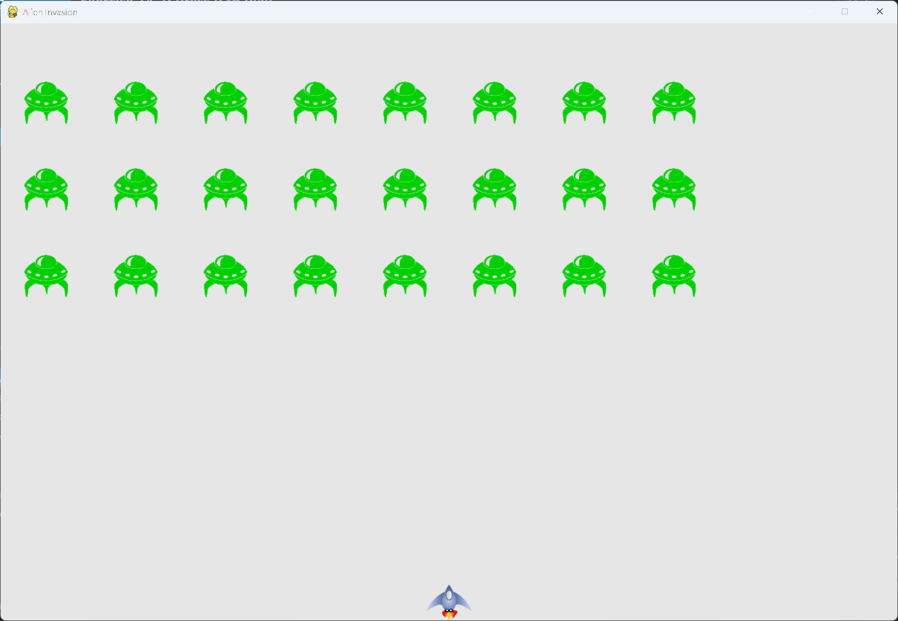

# Exercise 14-1: Press P to Play

## The exercise

Because Alien Invasion uses keyboard input to control the ship, it would be useful to start the game with
a keypress. Add code that lets the player press P to start. It might help to move some code from
`_check_play_button()` to a `_start_game()` method that can be called from `_check_play_button()` and
`_check_keydown_events()`.

## Running this exercise

From this folder, run:

```pwsh
python alien_invasion.py
```

Press P to start, or click the Play button. Press Q or Escape to quit.

## Solution

The starting code from `_check_play_button()` moves into `_start_game()`. Both the button and the P key
call it, so the game starts the same way from either:

```python
class AlienInvasion:
    --snip--

    def _check_play_button(self, mouse_pos: tuple[int, int]) -> None:
        """Start a new game when the player clicks Play."""
        button_clicked = self.play_button.rect.collidepoint(mouse_pos)
        if button_clicked and not self.stats.game_active:
            self._start_game()

    def _start_game(self) -> None:
        """Reset the game and start a new one."""
        # Reset the game statistics.
        self.stats.reset_stats()
        self.stats.game_active = True

        # Get rid of any remaining aliens and bullets.
        self.aliens.empty()
        self.bullets.empty()

        # Create a new fleet and center the ship.
        self._create_fleet()
        self.ship.center_ship()

        # Hide the mouse cursor.
        pygame.mouse.set_visible(False)

    def _check_keydown_events(self, event: pygame.event.Event) -> None:
        """Respond to keypresses."""
        --snip--
        elif event.key == pygame.K_p and not self.stats.game_active:
            self._start_game()
```

The ship's movement is also fixed in this exercise. The ship stored whole pixels in `rect.x`, so a speed
of 1.5 moved it by 1 pixel per frame. Keeping the decimal position in `self.x` and copying it to the rect
keeps the speed exact:

```python
class Ship:
    --snip--

    def update(self) -> None:
        """Update the ship's position based on movement flags."""
        # Update the decimal x value, so fractional speeds are kept.
        if self.moving_right and self.rect.right < self.screen_rect.right:
            self.x += self.settings.ship_speed

        if self.moving_left and self.rect.left > 0:
            self.x -= self.settings.ship_speed

        # Update the rect from the decimal position.
        self.rect.x = self.x
```

## Walkthrough

**One way to start.** `_start_game()` holds everything a new game needs. Both the button and the P key call
it, so they can't drift apart. P only works while no game is running, so pressing it during play does nothing.

**Why the ship changed.** Pygame stores the rect in whole pixels. Adding 1.5 to `rect.x` loses the fraction, so
the ship moved at a speed of 1 instead. The decimal position keeps the full speed.

## Output

Press P, and the game starts with the fleet and the ship at the bottom centre. The Play button disappears,
and the cursor is hidden.



## Changed files

- `alien_invasion.py`: adds `_start_game()`, and the P key handler
- `ship.py`: keeps the decimal position for smooth movement

---
