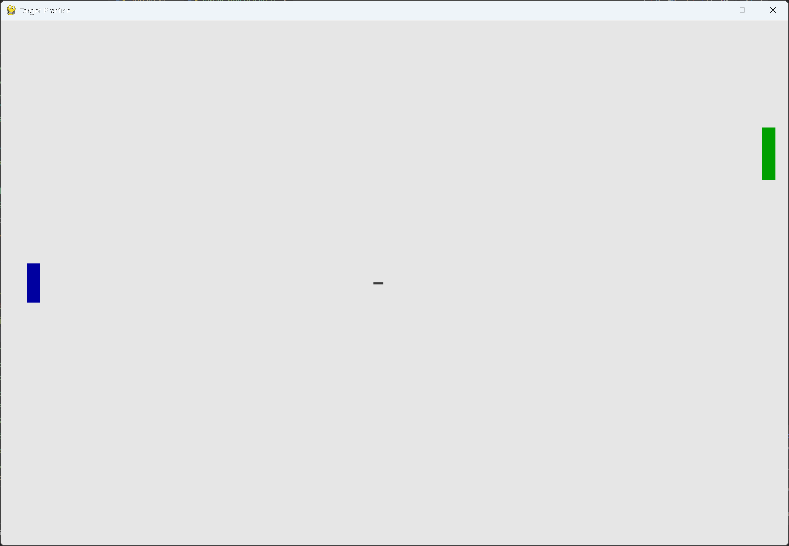

# Exercise 14-2: Target Practice

## The exercise

Create a rectangle at the right edge of the screen that moves up and down at a steady rate. Then on the left
side of the screen, create a ship that the player can move up and down while firing bullets at the rectangular
target. Add a Play button that starts the game, and when the player misses the target three times, end the
game and make the Play button reappear. Let the player restart the game with this Play button.

## Running this exercise

From this folder, run:

```pwsh
python target_practice.py
```

Click Play to start. Move the ship with the up and down arrow keys, and fire with the space bar. A miss is a
bullet that gets past the target. Three misses end the game. Press Q or Escape to quit.

## Solution

The program is made of a few small classes, each in its own file. `Target` moves up and down and bounces off
the top and bottom edges. It's placed on the right edge of the screen, and it moves at a steady rate:

```python
class Target(Sprite):
    --snip--

    def update(self) -> None:
        """Move the target up or down, and bounce it off the top and bottom edges."""
        self.y += self.settings.target_speed * self.vertical_direction
        self.rect.y = int(self.y)

        if self.rect.top <= 0:
            self.vertical_direction = 1
            self.rect.top = 0
        elif self.rect.bottom >= self.screen_rect.bottom:
            self.vertical_direction = -1
            self.rect.bottom = self.screen_rect.bottom

        self.y = float(self.rect.y)
```

`Ship` is a rectangle on the left side. The player moves it up and down, and it uses the same decimal
position as the other moving objects, so it moves at its exact speed.

Bullets are counted in `_update_bullets()`. A bullet that touches the target is removed. A bullet that reaches
the right edge without touching the target is a miss, and the game ends at three misses:

```python
class TargetPractice:
    --snip--

    def _update_bullets(self) -> None:
        """Update the bullets, count the misses, and remove bullets that hit the target."""
        self.bullets.update()

        for bullet in self.bullets.copy():
            if bullet.rect.colliderect(self.target.rect):
                # The bullet hits the target, so the bullet is removed.
                self.bullets.remove(bullet)
            elif bullet.rect.left >= self.settings.screen_width:
                # The bullet has reached the right edge, so it's a miss.
                self.bullets.remove(bullet)
                self.stats.misses += 1
                if self.stats.misses >= self.settings.misses_allowed:
                    self._end_game()
                    return

    def _end_game(self) -> None:
        """End the game, and show the Play button again."""
        self.stats.game_active = False
        pygame.mouse.set_visible(True)
```

The Play button starts a new game. It resets the miss count, centres the ship, puts the target back at the top,
and clears any bullets left from the last game:

```python
    def _check_play_button(self, mouse_pos: tuple[int, int]) -> None:
        """Start a new game when the player clicks Play."""
        button_clicked = self.play_button.rect.collidepoint(mouse_pos)
        if button_clicked and not self.stats.game_active:
            self.stats.reset_stats()
            self.stats.game_active = True
            self.ship.center_ship()
            self.target.reset()
            self.bullets.empty()
            pygame.mouse.set_visible(False)
```

## Walkthrough

**A moving target.** The target is a rectangle that bounces between the top and bottom of the screen. It keeps a
decimal position, and it's drawn from its rect, the same as the aliens in Alien Invasion.

**What counts as a miss.** A miss is a bullet that gets all the way to the right edge. A bullet that hits the
target is removed, and it isn't counted as a miss.

**Ending the game.** When the third miss happens, `game_active` is set to `False`. The ship and target stop, and
the Play button is drawn again. Clicking it starts a new game with the miss count reset.

**Restarting cleanly.** `target.reset()` puts the target back at the top, moving down at its original speed. This
is the starting point for exercise 14-3, which changes the target's speed during play.

## Output

The target moves on the right, and the ship sits on the left. Bullets fly to the right, and the misses are counted
until the game ends.



## Changed files

- `target_practice.py`: the main game loop, the Play button, and miss counting
- `settings.py`: the sizes, speeds and miss limit
- `ship.py`, `bullet.py`, `target.py`: the three moving objects
- `game_stats.py`: the miss count and whether the game is active
- `button.py`: the Play button
