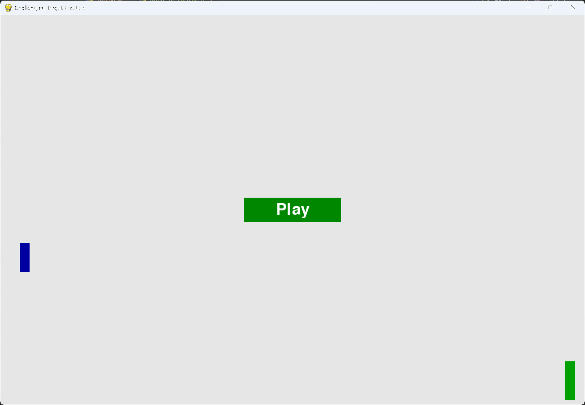

# Exercise 14-3: Challenging Target Practice

## The exercise

Start with your work from exercise 14-2 (page 283). Make the target move faster as the game progresses, and
restart the target at the original speed when the player clicks Play.

## Running this exercise

From this folder, run:

```pwsh
python target_practice.py
```

Click Play to start. Each time you hit the target, it moves a little faster. Click Play again after a game
ends, and the target starts back at its original speed. Press Q or Escape to quit.

## Solution

The target's speed is a dynamic setting, so it's reset each time a game starts. `settings.py` keeps the
starting speed in `initialize_dynamic_settings()`, and the speed-up factor is static:

```python
class Settings:
    --snip--

    def __init__(self) -> None:
        """Initialize the game's static settings."""
        --snip--
        # How much the target speeds up each time it's hit.
        self.target_speedup_scale = 1.1
        --snip--
        self.initialize_dynamic_settings()

    def initialize_dynamic_settings(self) -> None:
        """Set the settings that change during the game, back to their starting values."""
        self.target_speed = 1.5

    def increase_speed(self) -> None:
        """Make the target faster. Called each time the target is hit."""
        self.target_speed *= self.target_speedup_scale
```

Each hit speeds up the target. A bullet that hits the target counts as a hit, and calls `increase_speed()`:

```python
class TargetPractice:
    --snip--

    def _update_bullets(self) -> None:
        """Update the bullets, count hits and misses, and remove bullets that reach the target or the edge."""
        self.bullets.update()

        for bullet in self.bullets.copy():
            if bullet.rect.colliderect(self.target.rect):
                # A hit: remove the bullet, count it, and speed the target up.
                self.bullets.remove(bullet)
                self.stats.hits += 1
                self.settings.increase_speed()
            elif bullet.rect.left >= self.settings.screen_width:
                --snip--
```

Clicking Play resets the speed before anything else. The target then goes back to its original speed, along with
the rest of the game:

```python
    def _check_play_button(self, mouse_pos: tuple[int, int]) -> None:
        """Start a new game when the player clicks Play."""
        button_clicked = self.play_button.rect.collidepoint(mouse_pos)
        if button_clicked and not self.stats.game_active:
            # Reset the target speed to its original value, then the other game parts.
            self.settings.initialize_dynamic_settings()
            self.stats.reset_stats()
            self.stats.game_active = True
            self.ship.center_ship()
            self.target.reset()
            self.bullets.empty()
            pygame.mouse.set_visible(False)
```

## Walkthrough

**Speeding up with progress.** The target gets faster with every hit, so a player who is doing well meets a
harder target. The speed-up factor is in the settings, so it's easy to tune.

**Reset on Play.** `initialize_dynamic_settings()` sets the target speed back to 1.5. The reset happens before
the target is put back at the top, so the new game always starts at the original speed.

**Static and dynamic.** The speed-up factor never changes, so it's static. The target's speed changes during
play, so it's dynamic. This is the same split as in Alien Invasion's leveling-up step.

## Output

The target starts slowly. After each hit it moves a little faster, and when a new game starts it slows back down
to the original speed.



## Changed files

- `settings.py`: splits the static and dynamic settings, and adds the target speed-up
- `game_stats.py`: counts hits as well as misses
- `target_practice.py`: speeds the target up on each hit, and resets it on Play
- `ship.py`, `bullet.py`, `target.py`, `button.py`: the same as exercise 14-2
