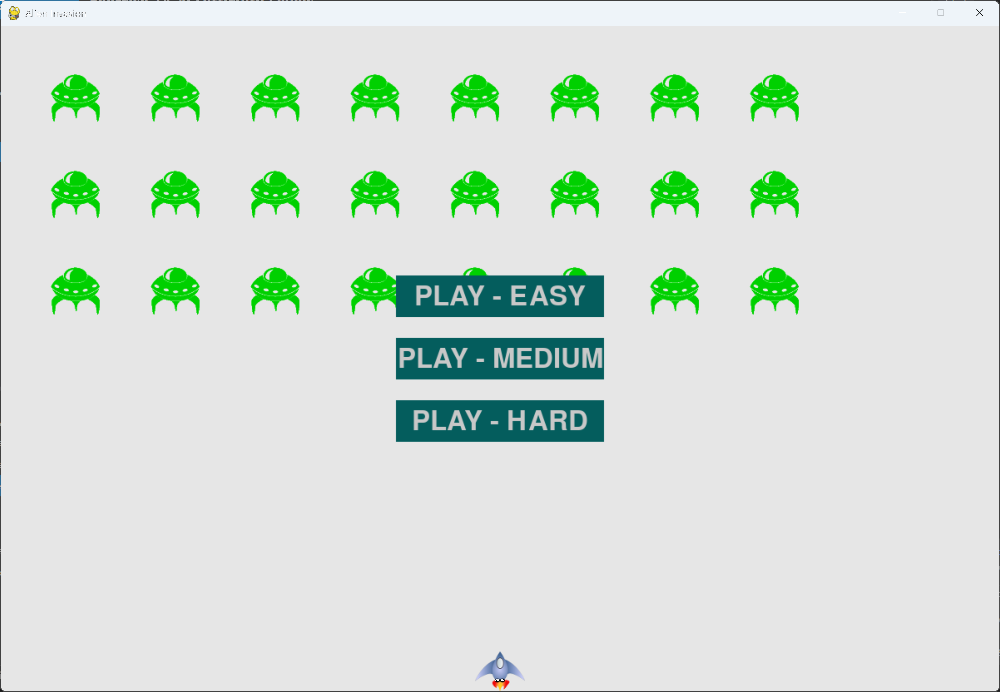

# Exercise 14-4: Difficulty Levels

## The exercise

Make a set of buttons for Alien Invasion that allows the player to select an appropriate starting difficulty
level for the game. Each button should assign the appropriate values for the attributes in `Settings` needed
to create different difficulty levels.

## Running this exercise

From this folder, run:

```pwsh
python alien_invasion.py
```

Click Easy, Medium or Hard to start. Press Q or Escape to quit.

## Solution

There are three Play buttons, one for each level. Each one is moved up or down from the centre, so they
don't overlap:

```python
class AlienInvasion:
    --snip--

    def __init__(self) -> None:
        """Initialize the game, and create game resources."""
        --snip--
        # Make the Play buttons.
        self.play_button_easy = Button(self, "PLAY - EASY", -75)
        self.play_button_medium = Button(self, "PLAY - MEDIUM")
        self.play_button_hard = Button(self, "PLAY - HARD", 75)
```

The difficulty is 0.5 for Easy, 1.0 for Medium and 1.5 for Hard. The button that's clicked sets the
difficulty, and the settings are rebuilt for it before the game starts:

```python
    def _check_play_buttons(self, mouse_pos: tuple[int, int]) -> None:
        """Start a new game at the difficulty level of the Play button that was clicked."""
        easy_button_clicked = self.play_button_easy.rect.collidepoint(mouse_pos)
        medium_button_clicked = self.play_button_medium.rect.collidepoint(mouse_pos)
        hard_button_clicked = self.play_button_hard.rect.collidepoint(mouse_pos)

        difficulty_level = 1.0
        if easy_button_clicked:
            difficulty_level -= self.settings.difficulty_modifier
        if hard_button_clicked:
            difficulty_level += self.settings.difficulty_modifier

        go_play = easy_button_clicked or medium_button_clicked or hard_button_clicked
        if go_play and not self.stats.game_active:
            self.settings.initialize_dynamic_settings(difficulty_level)
            self._start_game()
```

`settings.py` uses the difficulty to set the speeds. A harder game has faster aliens and slower bullets:

```python
    def initialize_dynamic_settings(self, difficulty_level: float = 1.0) -> None:
        """Set the settings that change during the game, for the chosen difficulty level."""
        self.difficulty_level = difficulty_level

        self.ship_speed = 1.0
        if self.difficulty_level < 1:
            self.ship_speed /= self.difficulty_level
        self.bullet_speed = 3.0 / self.difficulty_level
        self.alien_speed = 0.5 * self.difficulty_level
        --snip--
```

The speed-up runs on every level, so each new fleet is faster than the last:

```python
    def increase_speed(self) -> None:
        """Make the game faster each time a new fleet is created."""
        self.ship_speed *= self.speedup_scale
        self.bullet_speed *= self.speedup_scale
        self.alien_speed *= self.speedup_scale
```

Two fixes were made while cleaning up this exercise. `increase_speed()` used to multiply by the difficulty
too, which made the game slower on Easy after each fleet. The ship also had the same whole-pixel movement
problem as in exercise 14-1, and it's fixed the same way.

## Walkthrough

**Buttons that are moved.** `offset` moves a button up or down from the centre. The three buttons share the
same width and height, and they're stacked with the offsets.

**One number for the difficulty.** The three levels are one value, centred on 1.0. Easy takes away half, and
Hard adds half. Each setting is then scaled from that one value, so changing one number changes all the levels.

**Speed on every level.** The speed-up factor is the same on every level. That keeps the difficulty curve
steady, so Easy also gets harder with each fleet.

## Output

The game opens with three green Play buttons, one for each difficulty level. Clicking one starts a game at that
level.



## Changed files

- `alien_invasion.py`: three Play buttons, and the difficulty choice
- `settings.py`: the speeds for each level, and the speed-up on every level
- `ship.py`: keeps the decimal position for smooth movement

---
