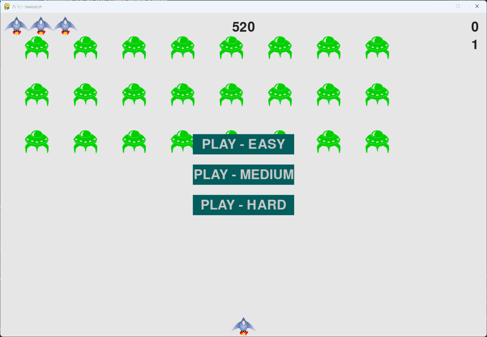

# Exercise 14-6: Refactoring

## The exercise

Look for methods that are doing more than one task, and refactor them to organize your code and make it
efficient. For example, move some of the code in `_check_bullet_alien_collisions()`, which starts a new level
when the fleet of aliens has been destroyed, to a function called `start_new_level()`. Also, move the four
separate method calls in the `__init__()` method in `Scoreboard` to a method called `prep_images()` to shorten
`__init__()`. The `prep_images()` method could also help simplify `_check_play_button()` or `start_game()` if
you've already refactored `_check_play_button()`.

Before attempting to refactor the project, see Appendix D to learn how to restore the project to a working
state if you introduce bugs while refactoring.

## Running this exercise

From this folder, run:

```pwsh
python alien_invasion.py
```

The game should play exactly as it did in exercise 14-5. Refactoring changes how the code is organized, not
what it does.

## Solution

The new-level code moves into `start_new_level()`. The collision method only decides when a new level starts:

```python
class AlienInvasion:
    --snip--

    def _check_bullet_alien_collisions(self) -> None:
        """Respond to collisions between bullets and aliens."""
        --snip--
        # Start a new level when the fleet has been destroyed.
        if not self.aliens:
            self.start_new_level()

    def start_new_level(self) -> None:
        """Clear the bullets, make a faster fleet, and show the new level."""
        self.bullets.empty()
        self._create_fleet()
        self.settings.increase_speed()

        # Increase the level.
        self.stats.level += 1
        self.sb.prep_level()
```

The four preparation calls in `Scoreboard.__init__()` move into `prep_images()`. `__init__()` calls that one
method, and the game can call it again to refresh every image:

```python
class Scoreboard:
    --snip--

    def __init__(self, ai_game) -> None:
        """Initialize scorekeeping attributes."""
        --snip--
        # Prepare the initial score images.
        self.prep_images()

    def prep_images(self) -> None:
        """Prepare all the score images, so the scoreboard is ready to draw."""
        self.prep_score()
        self.prep_high_score()
        self.prep_level()
        self.prep_ships()
```

`_start_game()` uses `prep_images()` after the statistics are reset, so every image is refreshed in one call:

```python
    def _start_game(self) -> None:
        """Reset the game and start a new one."""
        # Reset the game statistics, and mark the game as active.
        self.stats.reset_stats()
        self.stats.game_active = True

        # Refresh every score image now that the statistics have been reset.
        self.sb.prep_images()
        --snip--
```

The same fixes as in exercise 14-5 are included in this version: the ship's decimal position, the speed-up
and points that don't depend on difficulty, the fleet drop speed of 10, saving the high score on every exit,
and no fullscreen.

## Walkthrough

**One task per method.** `_check_bullet_alien_collisions()` used to do two jobs: scoring hits, and starting a
new level. Moving the level code out means each method has one job, and the level code can be called from
anywhere.

**Grouping the setup.** `prep_images()` gives the four setup steps a name. The name says what the method is
for, and calling one method is easier to keep right than four.

**Behaviour stays the same.** Refactoring should never change what the game does. Playing the game before and
after a refactor is the way to check that nothing has broken.

## Output

The game looks and plays exactly as it did in exercise 14-5.



## Changed files

- `alien_invasion.py`: adds `start_new_level()`, and uses `prep_images()` when a game starts
- `scoreboard.py`: adds `prep_images()`, and calls it from `__init__()`
- `settings.py`, `game_stats.py`, `ship.py`, `alien.py`, `bullet.py`, `button.py`: the fixes from exercise 14-5
