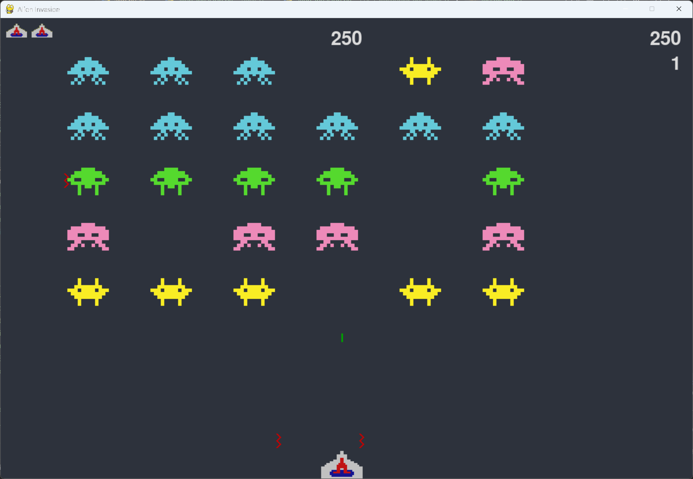

# Exercise 14-7: Expanding the Game

## The exercise

Think of a way to expand Alien Invasion. For example, you could program the aliens to shoot bullets down at the
ship, or add shields for the ship to hide behind, which can be destroyed by bullets from either side. Or use
something like the `pygame.mixer` module to add sound effects, such as explosions and shooting sounds.

## What this version adds

This exercise brings together three expansions:

- **Animation.** The aliens, the ship and the explosions are drawn from frame files. The aliens loop, and the ship
  and explosions play once.
- **Alien bullets.** The aliens fire red zigzag bullets down at the ship. At most three are on screen at once, and
  each alien can have only one bullet of its own.
- **The earlier final version's features.** There are Easy, Medium and Hard buttons, a high score saved to a file,
  levels, and the ships left on the scoreboard. Fullscreen has been removed.

The game plays the same way as Alien Invasion, with these additions. The rest of this page explains each piece of
code that goes beyond the book.

## Setup

The animation frames are in the `images` folder, one folder for each animation:

- `blue-anim`, `green-anim`, `pink-anim` and `yellow-anim`: the aliens, looping
- `blue-boom`, `green-boom`, `pink-boom` and `yellow-boom`: an alien exploding when it's hit
- `ship-anim`: the ship. Frame 0 is the resting ship, and frames 1 to 3 play when the ship fires
- `kaboom`: the ship exploding when it's hit

Each frame is a separate file named like `frame_3_delay-0.08s.gif`. Every frame is shown for 0.08 seconds.

## Running this exercise

From this folder, run:

```pwsh
python alien_invasion.py
```

Click a Play button, or press P to start at the last difficulty. Use the left and right arrow keys to move, and the
space bar to fire. Press R or Enter (including the numpad Enter) to return to the start screen, and Q or Escape to quit.

## Animation: `animation.py` (new)

This file loads the frames and plays them. It's new code, not from the book.

The frames are loaded once and kept in a cache, so each animation is only read from disk the first time it's used:

```python
_frame_cache: dict[str, list[pygame.Surface]] = {}

def load_frames(folder_name: str) -> list[pygame.Surface]:
    """Load the frames of one animation folder, in frame order."""
    if folder_name not in _frame_cache:
        folder = os.path.join(IMAGES_FOLDER, folder_name)
        numbered_files = []
        for file_name in os.listdir(folder):
            match = _FRAME_NAME.match(file_name)
            if match:
                numbered_files.append((int(match.group(1)), file_name))
        numbered_files.sort()

        _frame_cache[folder_name] = [
            pygame.image.load(os.path.join(folder, file_name)).convert_alpha()
            for _, file_name in numbered_files
        ]
    return _frame_cache[folder_name]
```

The frame order comes from the number in each file name. `_FRAME_NAME` is a pattern that matches `frame_3_`, and the
number is read from it. Sorting the numbers, not the names, keeps frame 10 after frame 9.

An `Animation` loops forever. The frame is worked out from the current time, so every object using the same
animation is on the same frame:

```python
class Animation:
    def frame_at(self, now: int) -> pygame.Surface:
        """Return the frame to show at the given time, in milliseconds."""
        index = (now // FRAME_DELAY) % len(self.frames)
        return self.frames[index]
```

`now // FRAME_DELAY` counts how many frame-lengths have passed. The `%` wraps it back to the start, so the
animation loops. Because the time is shared, the aliens of one color never drift out of step.

An `Explosion` plays once and then removes itself:

```python
class Explosion(Sprite):
    def __init__(self, screen, folder_name, center) -> None:
        super().__init__()
        self.screen = screen
        self.frames = load_frames(folder_name)
        self.start_time = pygame.time.get_ticks()
        self.rect = self.frames[0].get_rect(center=center)

    def update(self) -> None:
        """Remove the explosion once every frame has been shown."""
        elapsed = pygame.time.get_ticks() - self.start_time
        if elapsed >= len(self.frames) * FRAME_DELAY:
            self.kill()

    def blitme(self) -> None:
        """Draw the frame that's due to be shown now."""
        elapsed = pygame.time.get_ticks() - self.start_time
        index = min(elapsed // FRAME_DELAY, len(self.frames) - 1)
        self.screen.blit(self.frames[index], self.rect)
```

`start_time` is set when the explosion is made. `update()` removes it after all its frames have been shown.
`blitme()` picks the frame from the elapsed time. The `min()` stops it going past the last frame.

## The ship: `ship.py`

The ship is drawn from the `ship-anim` frames. Frame 0 is shown at rest, and frames 1 to 3 play when it fires:

```python
    def fire(self) -> None:
        """Start the shooting animation."""
        self.shot_time = pygame.time.get_ticks()

    def _current_frame(self) -> pygame.Surface:
        """Return the frame to show: the shooting frames while firing, otherwise the resting frame."""
        if self.shot_time is not None:
            elapsed = pygame.time.get_ticks() - self.shot_time
            shooting_frames = len(self.frames) - 1
            if elapsed < shooting_frames * FRAME_DELAY:
                return self.frames[1 + elapsed // FRAME_DELAY]
        return self.frames[0]
```

`fire()` records when the shot happened. `_current_frame()` then works out which shooting frame is due. Once the
three shooting frames have played, it returns to frame 0.

The ship also has an `image` property:

```python
    @property
    def image(self) -> pygame.Surface:
        """The frame to draw now. Sprite groups read this when they draw the ship."""
        return self._current_frame()
```

Pygame's sprite groups draw each sprite by reading its `image` attribute. A property makes `image` return the current
frame each time it's read. Without it, the scoreboard's ship group raised an `AttributeError`.

## The aliens: `alien.py`

Each alien knows its color, and loops that color's animation:

```python
class Alien(Sprite):
    def __init__(self, ai_game, color: str) -> None:
        super().__init__()
        self.screen = ai_game.screen
        self.settings = ai_game.settings
        self.color = color

        self.animation = Animation(f"{color}-anim")
        self.rect = self.animation.frames[0].get_rect()
        --snip--

    def blitme(self) -> None:
        """Draw the alien's frame that's due to be shown now."""
        self.screen.blit(self.animation.frame_at(pygame.time.get_ticks()), self.rect)
```

The rect takes its size from the first frame. The color is stored, so the game knows which boom to play when the alien
is hit.

## Alien bullets: `alien_bullet.py` (new)

The alien bullets are red zigzags that fall straight down, toward the ship:

```python
class AlienBullet(Sprite):
    def __init__(self, ai_game, source) -> None:
        super().__init__()
        --snip--
        self.source = source
        self.rect = pygame.Rect(0, 0, self.settings.alien_bullet_width,
                                self.settings.alien_bullet_height)
        self.rect.midtop = source.rect.midbottom
        self.y = float(self.rect.y)

    def update(self) -> None:
        """Move the bullet down the screen."""
        self.y += self.settings.alien_bullet_speed
        self.rect.y = self.y

    def has_passed_bottom(self) -> bool:
        """Return True once the bullet has moved past the bottom of the screen."""
        return self.rect.top >= self.settings.screen_height

    def draw_bullet(self) -> None:
        """Draw the zigzag bullet to the screen, as a line that swings from side to side as it falls."""
        step = self.rect.height // 4
        points = [
            (self.rect.left if i % 2 == 0 else self.rect.right, self.rect.top + i * step)
            for i in range(5)
        ]
        pygame.draw.lines(self.screen, self.color, False, points, max(2, self.rect.width // 2))
```

The bullet starts just below the alien that fired it. The rect is tall and thin, so the zigzag runs downward. The
points alternate between the left and right edges, and step down the height of the rect, which makes the zigzag.

## Ship bullets: `bullet.py`

Ship bullets are green rectangles. Only the color is changed, from the book version. The bullet's color is set in
`settings.py`:

```python
        self.bullet_color = (0, 160, 0)
```

## Settings: `settings.py`

Several settings are new. Some have their own sections.

**colors.** The background is a dark cool grey, and the text is a light grey so the scoreboard stays readable on it:

```python
        self.bg_color = (45, 50, 60)
        self.text_color = (220, 220, 220)
```

**Aliens and alien bullets.** The list of colors, the chance of a shot, the shot interval, and the bullet size and
color are all settings:

```python
        self.alien_colors = ["blue", "green", "pink", "yellow"]
        self.alien_shoot_interval = 1000
        self.alien_shoot_chance = 0.05
        self.alien_bullet_width = 6
        self.alien_bullet_height = 24
        self.alien_bullet_color = (200, 0, 0)
        self.alien_bullets_allowed = 3
```

**The fleet size by difficulty.** The fleet's rows and columns are set from the difficulty level, in
`initialize_dynamic_settings()`:

```python
        if self.difficulty_level < 1:
            self.fleet_rows, self.fleet_columns = 4, 6
        elif self.difficulty_level > 1:
            self.fleet_rows, self.fleet_columns = 6, 7
        else:
            self.fleet_rows, self.fleet_columns = 5, 6
```

Easy has 4 rows of 6, Medium has 5 rows of 6, and Hard has 6 rows of 7.

**The speed-up.** `increase_speed()` only uses the speed-up scale, so every new fleet is faster on every level. The
earlier final version multiplied by the difficulty as well, which slowed the game down on Easy:

```python
    def increase_speed(self) -> None:
        self.ship_speed *= self.speedup_scale
        self.bullet_speed *= self.speedup_scale
        self.alien_speed *= self.speedup_scale
        self.alien_bullet_speed *= self.speedup_scale
        self.alien_points = int(self.alien_points * self.score_scale)
```

## The fleet: `alien_invasion.py`

The fleet is built from the rows and columns in the settings:

```python
    def _create_fleet(self) -> None:
        """Create the fleet, with the number of rows and columns for the difficulty level."""
        for row_number in range(self.settings.fleet_rows):
            for alien_number in range(self.settings.fleet_columns):
                self._create_alien(alien_number, row_number)
```

Each row's color is chosen in `_create_alien()`. The rows at the bottom of the fleet are one of each color. Any
extra rows are at the top, and are a random mix:

```python
    def _create_alien(self, alien_number: int, row_number: int) -> None:
        colors = self.settings.alien_colors
        mixed_rows = max(0, self.settings.fleet_rows - len(colors))
        if row_number < mixed_rows:
            color = random.choice(colors)
        else:
            color = colors[row_number - mixed_rows]
        --snip--
```

On Easy there are four rows, so there are no mixed rows. On Medium there is one mixed row at the top. On Hard there are
two. `row_number` starts at 0 for the top row, so the first `mixed_rows` rows are the random ones.

## Alien shooting: `alien_invasion.py`

Every second, each alien without a bullet of its own rolls a 5% chance to fire. At most three alien bullets can be on
screen at once:

```python
    def _alien_shoot(self) -> None:
        """Every second, give each alien a chance to fire. There are at most three alien bullets at once."""
        now = pygame.time.get_ticks()
        if now - self.last_shot_roll < self.settings.alien_shoot_interval:
            return
        self.last_shot_roll = now

        for alien in self.aliens.sprites():
            if len(self.alien_bullets) >= self.settings.alien_bullets_allowed:
                break
            fires = random.random() < self.settings.alien_shoot_chance
            if fires and not self._alien_has_bullet(alien):
                self.alien_bullets.add(AlienBullet(self, alien))
```

`last_shot_roll` is the time of the last round of rolls, and the check returns early until a second has passed.
`break` stops the loop once the limit is reached. `_alien_has_bullet()` checks whether this alien already has a bullet
on screen:

```python
    def _alien_has_bullet(self, alien: Alien) -> bool:
        return any(bullet.source is alien for bullet in self.alien_bullets)
```

Each bullet remembers its `source`, so the game knows which alien fired it.

`_update_alien_bullets()` moves the bullets, removes those that fall past the bottom, and checks whether a bullet hits
the ship:

```python
            elif not self._ship_is_down() and bullet.rect.colliderect(self.ship.rect):
                # A bullet hit keeps the existing fleet going.
                self.alien_bullets.remove(bullet)
                self._ship_hit(new_fleet=False)
```

## Explosions: `alien_invasion.py`

When an alien is hit, an explosion of its color is added at its centre. The alien is removed straight away, so the
explosion is only drawn and can't be hit:

```python
        if collisions:
            for hit_aliens in collisions.values():
                for alien in hit_aliens:
                    self.explosions.add(Explosion(self.screen, f"{alien.color}-boom",
                                                  alien.rect.center))
```

`groupcollide()` returns a dictionary, with each bullet as a key and the list of aliens it hit as the value. The loops
make an explosion for every alien hit, even when one bullet hits more than one.

## The ship's kaboom: `alien_invasion.py`

When the ship is hit, the kaboom plays where the ship was, and the game keeps running. The ship is hidden and can't
move, fire or be hit until the kaboom has finished:

```python
    def _ship_hit(self, new_fleet: bool) -> None:
        """Start the kaboom, and lose a ship, without pausing the game."""
        self.explosions.add(Explosion(self.screen, "kaboom", self.ship.rect.center))
        kaboom_duration = len(load_frames("kaboom")) * FRAME_DELAY
        self.ship_down_until = pygame.time.get_ticks() + kaboom_duration

        self.stats.ships_left -= 1
        self.sb.prep_ships()

        self.bullets.empty()
        self.alien_bullets.empty()
        self.ship.center_ship()

        if self.stats.ships_left > 0:
            if new_fleet:
                self.aliens.empty()
                self._create_fleet()
        else:
            self._end_game()
```

The kaboom is an `Explosion`, the same as an alien's boom. It's added to the explosions group, so the main loop
updates and draws it while the game carries on. Nothing waits for it to finish.

`ship_down_until` is the time the kaboom ends. The ship is down until then, so its movement, its shooting and its
collisions are all skipped. `_ship_is_down()` checks it:

```python
    def _ship_is_down(self) -> bool:
        """Return True while the ship is showing its kaboom, and can't move, fire or be hit."""
        return pygame.time.get_ticks() < self.ship_down_until
```

`new_fleet` decides what happens to the aliens. An alien touching the ship, or reaching the bottom, passes
`new_fleet=True`, and the fleet is replaced. A bullet hit passes `new_fleet=False`, so the existing fleet carries on.
In both cases the ship is moved back to the centre, and the bullets are cleared.

The ship is drawn only when it isn't down, so the kaboom is the only thing shown in its place:

```python
    def _update_screen(self) -> None:
        self.screen.fill(self.settings.bg_color)
        if not self._ship_is_down():
            self.ship.blitme()
        --snip--
```

The earlier version paused the whole game while the kaboom played, using a loop with `pygame.time.delay()`. That's
no longer needed, because the kaboom is now drawn by the main loop like everything else.

## The high score file: `game_stats.py`

The high score is read from `hi_score.json` when the game starts, and written back when the game ends or closes:

```python
        root_dir = os.path.dirname(os.path.abspath(__file__))
        self.hi_score_file = os.path.join(root_dir, "hi_score.json")
        self.high_score = self.get_high_score()
```

`get_high_score()` returns 0 if the file is missing, which is the case the first time the game runs. `set_high_score()`
writes the value. The game calls it in `_end_game()` and in `_quit_game()`, so the score is kept however the game ends.

## The scoreboard: `scoreboard.py`

The ships left are shown as half-size copies of the resting ship, with a small gap between them:

```python
        resting = load_frames("ship-anim")[0]
        icon_size = (resting.get_width() // 2, resting.get_height() // 2)
        icon_image = pygame.transform.smoothscale(resting, icon_size)

        gap = 8
        self.ships = Group()
        for ship_number in range(self.stats.ships_left):
            icon = Sprite()
            icon.image = icon_image
            icon.rect = icon_image.get_rect()
            icon.rect.x = 10 + ship_number * (icon.rect.width + gap)
            icon.rect.y = 10
            self.ships.add(icon)
```

`smoothscale()` shrinks the image to half its size. Each icon is a plain `Sprite` with that image, so it doesn't need the
full ship. The `gap` is added between icons when each one's position is set.

## The difficulty buttons: `button.py` and `alien_invasion.py`

There are three Play buttons. The `offset` moves the Easy button up and the Hard button down, so they don't overlap.
Clicking one sets the difficulty, and the settings for that difficulty are made before the game starts:

```python
        difficulty_level = 1.0
        if easy_button_clicked:
            difficulty_level -= self.settings.difficulty_modifier
        if hard_button_clicked:
            difficulty_level += self.settings.difficulty_modifier
        --snip--
            self.settings.initialize_dynamic_settings(difficulty_level)
            self._start_game()
```

## Starting and quitting: `alien_invasion.py`

`_start_game()` resets the game, and `_quit_game()` saves the high score before closing:

```python
    def _quit_game(self) -> None:
        """Save the high score, then close the game."""
        self.stats.set_high_score()
        pygame.quit()
        sys.exit()
```

## Returning to the start screen: `alien_invasion.py`

Pressing R or Enter during a game stops it and brings back the start screen, without closing the program. The game stops,
the high score is saved, and the field is cleared:

```python
        elif event.key in (pygame.K_r, pygame.K_RETURN, pygame.K_KP_ENTER) and self.stats.game_active:
            self._return_to_start_screen()
```

The `in` check accepts any of the three keys. `K_r` is the R key, `K_RETURN` is the main Enter key, and
`K_KP_ENTER` is the Enter key on the numpad. All three call the same method:

```python
    def _return_to_start_screen(self) -> None:
        """Stop the current game, clear the field, and show the start screen. The game doesn't quit."""
        self._end_game()
        self.bullets.empty()
        self.alien_bullets.empty()
        self.aliens.empty()
        self.explosions.empty()
```

`_end_game()` is the same method the game uses when the last ship is lost, so the high score is saved in both cases.
The check on `game_active` means R does nothing on the start screen. Q and Escape still close the program.

## Sounds: `sounds.py` (new)

The sounds are in the `sounds` folder, as WAV files: `background.wav`, `explosion.wav` and `womp.wav`. The module
that plays them is new code, and it has three jobs.

The background music is started once, when the game starts, and loops forever, with `-1` as the loop count. It's
paused straight away, because the start screen should be quiet. It resumes when a game starts, and pauses again when
the game ends or the player returns to the start screen:

```python
def pause_music() -> None:
    """Pause the background music, for example on the start screen."""
    pygame.mixer.music.pause()


def resume_music() -> None:
    """Carry on with the background music from where it was paused."""
    pygame.mixer.music.unpause()
```

The music is streamed from the file, and set to 40% volume so the sound effects stand out:

```python
def start_background_music() -> None:
    """Start the background music, looping for as long as the game is running."""
    pygame.mixer.music.load(os.path.join(SOUNDS_FOLDER, "background.wav"))
    pygame.mixer.music.set_volume(0.4)
    pygame.mixer.music.play(-1)
```

Sound effects are loaded the first time they're played, and then kept in a dictionary. That's the same idea as the
animation frame cache:

```python
_effects: dict[str, pygame.mixer.Sound] = {}

def _effect(name: str) -> pygame.mixer.Sound:
    if name not in _effects:
        _effects[name] = pygame.mixer.Sound(os.path.join(SOUNDS_FOLDER, f"{name}.wav"))
    return _effects[name]

def play_explosion() -> None:
    _effect("explosion").play()

def play_womp() -> None:
    _effect("womp").play()
```

In `alien_invasion.py`, the sounds are called from three places:

```python
        pygame.init()
        start_background_music()
        pause_music()
```

```python
    def _start_game(self) -> None:
        self.stats.game_active = True
        resume_music()
```

```python
    def _end_game(self) -> None:
        self.stats.game_active = False
        self.stats.set_high_score()
        pause_music()
```

```python
        if collisions:
            play_explosion()
```

```python
        self.explosions.add(Explosion(self.screen, "kaboom", self.ship.rect.center))
        play_explosion()
        --snip--
        else:
            play_womp()
            self._end_game()
```

The womp is only played when the last ship is lost. It isn't played when the player presses R or Enter to return to
the start screen, because that isn't a game over.

To use the sounds, copy the `sounds` folder into the `14-7-expanding-the-game` folder, next to `alien_invasion.py`.

## Output

Four rows of colored aliens loop their animations, with mixed rows at the top on Medium and Hard. The ship plays its
shooting frames when you fire. Hit aliens explode, a hit on the ship plays the kaboom, and red zigzags fall toward you.



## Changed files

- `alien_invasion.py`: the game loop, the fleet by difficulty, the alien shooting, the explosions, the kaboom and the buttons
- `animation.py` (new): loads the frames, the looping `Animation`, and the one-off `Explosion`
- `ship.py`: the shooting animation and the `image` property
- `alien.py`: each alien loops its color's animation
- `alien_bullet.py` (new): the red zigzag bullets that fall toward the ship
- `bullet.py`: green ship bullets
- `settings.py`: the colors, the animation, alien, bullet and difficulty settings, and the fleet size by difficulty
- `game_stats.py`: the high score saved to a file
- `scoreboard.py`: the half-size ship icons, and the text color
- `sounds.py` (new): the background music, and the explosion and womp sound effects
- `button.py`: the three difficulty buttons
