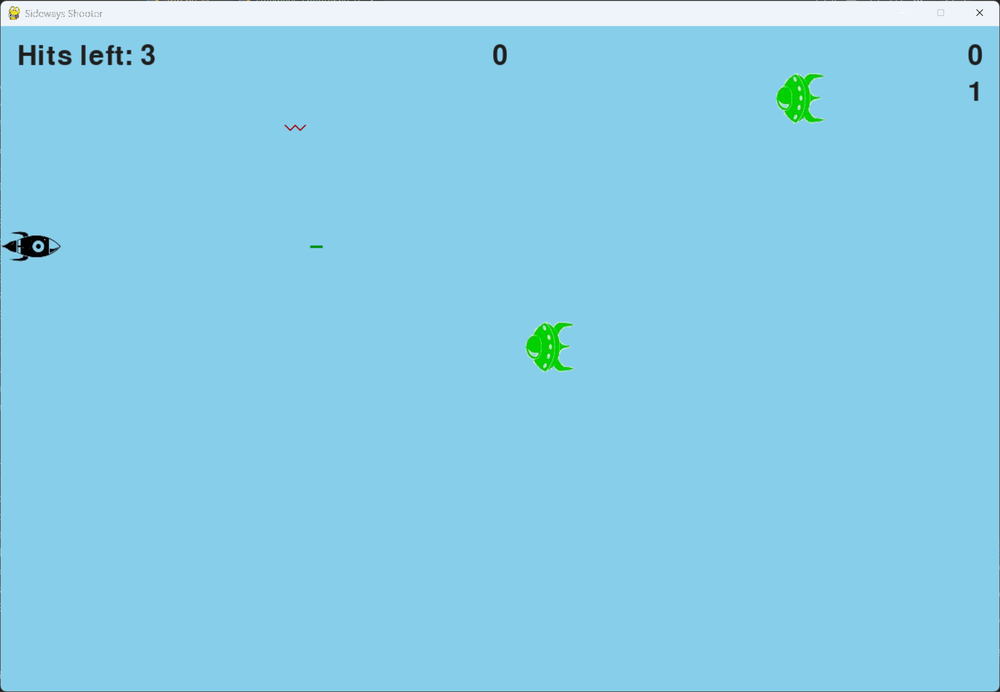

# Exercise 14-8: Sideways Shooter, Final Version

## The exercise

Continue developing Sideways Shooter, using everything we've done in this project. Add a Play button, make the
game speed up at appropriate points, and develop a scoring system. Be sure to refactor your code as you work,
and look for opportunities to customize the game beyond what was shown in this chapter.

## Setup

The images are in this exercise's `images` folder:

- `rocket.bmp`, the rocket from exercise 12-6
- `alien.bmp`, the alien from Alien Invasion

## Running this exercise

From this folder, run:

```pwsh
python sideways_shooter.py
```

Click Play, or press P, to start. Use the up and down arrow keys to move the rocket, and the space bar to fire.
Three alien hits on the rocket end the game. Press Q or Escape to quit.

## Solution

The game follows the same parts as the earlier versions, with the chapter 14 features added.

**Static and dynamic settings.** The screen, the rocket limit and the spawn time are static. The speeds and the
points for each alien are dynamic, so they're reset at the start of each game:

```python
class Settings:
    --snip--

    def initialize_dynamic_settings(self) -> None:
        """Set the settings that change during the game, back to their starting values."""
        self.rocket_speed = 2.5
        self.missile_speed = 3.0
        self.alien_speed = 1.0
        self.alien_vertical_speed = 1.0
        self.alien_points = 10

    def increase_speed(self) -> None:
        """Speed up the aliens, and make them worth more, when the player reaches a new level."""
        self.alien_speed *= self.speedup_scale
        self.alien_vertical_speed *= self.speedup_scale
        self.alien_points = int(self.alien_points * self.score_scale)
```

**Scoring and levels.** Each alien shot down adds points to the score. The level is worked out from the number of
aliens destroyed, so every ten aliens starts a new level, and the aliens speed up:

```python
class SidewaysShooter:
    --snip--

    def _score_aliens(self, number_of_aliens: int) -> None:
        """Add the points for the aliens destroyed, and check for a new level or high score."""
        self.stats.aliens_destroyed += number_of_aliens
        self.stats.score += self.settings.alien_points * number_of_aliens
        self.sb.prep_score()
        self.sb.check_high_score()
        self._check_level()

    def _check_level(self) -> None:
        """Start a new level after every fixed number of aliens destroyed."""
        new_level = 1 + self.stats.aliens_destroyed // self.settings.aliens_per_level
        if new_level > self.stats.level:
            self.stats.level = new_level
            self.settings.increase_speed()
            self.sb.prep_level()
```

**The Play button.** Starting a game resets every part of the game in one method, so a new game plays the same way
each time:

```python
    def _start_game(self) -> None:
        """Reset the settings, statistics and objects, and start a new game."""
        self.settings.initialize_dynamic_settings()
        self.stats.reset_stats()
        self.sb.prep_images()
        self.rocket.center_rocket()
        self.missiles.empty()
        self.aliens.empty()
        self.last_alien_time = pygame.time.get_ticks()
        self.stats.game_active = True
        pygame.mouse.set_visible(False)
```

**Game over.** Each alien that hits the rocket counts as a hit. When the hits reach the limit, the game ends, the
Play button returns, and the message is shown:

```python
    def _rocket_hit(self) -> None:
        """Count a hit on the rocket, and end the game when there are none left."""
        self.stats.rocket_hits += 1
        self.sb.prep_hits_left()
        if self.stats.rocket_hits >= self.settings.rocket_limit:
            self._end_game()
```

**Aliens shoot back.** Every second, each alien without a bullet on screen has a 5% chance of firing one. An
alien that already has a bullet in the air can't fire again until that bullet has left the screen or hit the
rocket. On average, each alien fires once every 20 seconds:

```python
    def _alien_shoot(self) -> None:
        """Every second, give each alien a chance to fire, if it has no bullet on screen."""
        now = pygame.time.get_ticks()
        if now - self.last_shot_roll < self.settings.alien_shoot_interval:
            return
        self.last_shot_roll = now

        for alien in self.aliens.sprites():
            fires = random.random() < self.settings.alien_shoot_chance
            if fires and not self._alien_has_bullet(alien):
                self.alien_bullets.add(AlienBullet(self, alien))
```

The timer uses `pygame.time.get_ticks()`, the same as the alien spawns, so the rolls happen at the same pace
whatever the frame rate.

The alien bullets are zig-zag lines. They're drawn as a line through five points, which go up and down as
the bullet moves left. The zig-zag is shallow, because the bullet is only six pixels tall. A bullet that hits the rocket counts as a rocket hit, the same as an alien touching it.

**A limit on aliens.** Only five aliens can be on screen at once. A new alien is only added when there's room under
the limit, and the limit goes up by one each time the aliens level up. Later levels bring more aliens, as well as
faster ones:

```python
    def _spawn_alien(self) -> None:
        """Add a new alien once the spawn interval has passed."""
        now = pygame.time.get_ticks()
        if now - self.last_alien_time >= self.settings.alien_spawn_interval:
            if len(self.aliens) < self.settings.max_aliens:
                self.aliens.add(Alien(self))
                self.last_alien_time = now
```

**The scoreboard.** It shows the score in the top right, the high score in the top centre, the level under the score,
and the hits left in the top left. Each value is rendered as an image only when it changes.

## Walkthrough

**Speeding up with progress.** The speed-up happens once per level, not every time an alien is hit. That gives the
player a clear point at which the game gets harder.

**Points grow with speed.** Aliens are worth more at each new level, so the score rewards the player for reaching
harder fleets.

**One reset.** `_start_game()` does everything a new game needs, in one place. Both the Play button and the P key
use it.

**Refactored parts.** The scoring, levelling and game-over code each have their own methods. Each method does one
job, which makes the code easy to change as you customize the game.

## Output

The rocket is on the left, with aliens moving toward it from the right. The score, the high score, the level and the
hits left are shown at the top of the window. The game ends with a message after three hits.



## Changed files

- `sideways_shooter.py`: the main game, with the Play button, the scoring, the levels, the game over, and the alien bullets
- `alien_bullet.py`: the zig-zag bullets the aliens fire
- `settings.py`: static and dynamic settings, the speed-up, the points, and the alien shooting chance
- `game_stats.py`: the score, the level, the hits and the high score
- `scoreboard.py`: the score, high score, level and hits left
- `rocket.py`, `missile.py`, `alien.py`, `button.py`: the moving parts and the Play button
