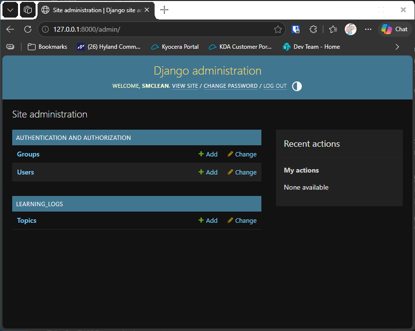

# Starting an App

## What this step does

This step adds the first part of the Learning Log itself. An app is one part of a Django project that does one job. The
Learning Log's app is called `learning_logs`, and its first job is to store **topics**: the subjects a person is learning
about, such as Chess or Rock Climbing.

A topic has two pieces of information: the text of its name, and the date it was added. Django saves these in a database
table, and you can add and view topics through the admin site you met in step 1.

## If you're using the lesson runner

You don't need the setup steps below. The runner builds the step, creates your admin account if you haven't already this session, and loads any example data this step needs.

1. In the steps list on the left, choose **Ch18 · Getting started with django**, then **Starting an App**.
2. Click **Run**.
3. The browser opens at `http://127.0.0.1:8000/admin/`. Sign in with the username and password you chose.
4. Under **Learning_logs** you should see **Topics**. The list is empty, because this step doesn't add any topics yet.
5. Press **Escape** to stop the server when you're done. Moving to another step also stops it.

## For dummies: the quick version

Do these in order. The build does the app work for you, and then you add some topics by hand.

1. In PowerShell, go to the `web-applications` folder, and make sure `(.venv)` is at the start of the line. If it isn't,
   run `.venv\Scripts\Activate.ps1`.
2. Type `python build_stage.py ch18 2 --run` and press Enter. This builds step 2, checks it, creates the database, runs
   the tests, and starts the server. You should see `Ran 5 tests` and `OK`.
3. In a second PowerShell window, go to the build folder and make yourself an admin account:

   ```pwsh
   cd build\ch18-getting-started-with-django-step-02
   python manage.py createsuperuser
   ```

   Type a username, an email address (you can leave it blank), and a password. Type the password twice. Nothing appears
   on the screen while you type the password, which is normal.
4. In the browser, go to `http://127.0.0.1:8000/admin/` and sign in with the account you just made.
5. Click **Topics**, then **Add topic**. Type `Chess` and click **Save**. Add a second topic, such as `Rock Climbing`.
6. You should see both topics in the list.
7. Back in the first PowerShell window, press Ctrl+C to stop the server.

**Warning:** rebuilding a step makes a new, empty database. Any accounts and topics you made are lost. If you want to
keep them, leave the server running and don't rebuild until you've finished.

### Words you'll see

- **App:** one part of a Django project. Here, `learning_logs`.
- **Model:** a Python class that describes the data an app stores. Each model becomes a table in the database.
- **Migration:** a file that tells the database how to create or change a table. Django writes these for you with
  `makemigrations`, and applies them with `migrate`.
- **Superuser:** an account with full rights to the admin site. You make one with `createsuperuser`.

## The code

Django made the app's folder with `python manage.py startapp learning_logs`. The folder holds these files, which are
shown here with the parts that matter.

`learning_logs/models.py` defines the topic. Each line describes one column in the table:

```python
class Topic(models.Model):
    """A topic the user is learning about."""

    text = models.CharField(max_length=200)
    date_added = models.DateTimeField(auto_now_add=True)

    def __str__(self) -> str:
        """Return a string representation of the topic."""
        return self.text
```

- `text` holds up to 200 characters.
- `date_added` is filled in automatically when the topic is saved. `auto_now_add=True` is what does that.
- `__str__` tells Django what to show when it displays a topic. It shows the text.

`learning_logs/admin.py` shows topics on the admin site:

```python
from .models import Topic

admin.site.register(Topic)
```

`learning_logs/migrations/0001_initial.py` is the file that creates the topic table. Django writes this file when you run
`makemigrations`, so you don't need to write it yourself. It's included here so the build can create the table.

`ll_project/settings.py` has one new line, which tells Django the app exists:

```python
INSTALLED_APPS = [
    --snip--
    "learning_logs",
]
```

If you leave out this line, Django ignores the app, and the topics never appear on the admin site.

## Testing this step

The tests in `learning_logs/tests.py` check three things:

- A topic shows its text when you print it.
- The date a topic was added is filled in automatically.
- The admin page for topics loads, and shows the topic text for a signed-in superuser.

The build runs them. You can also run them in the build folder with `python manage.py test`.

## Output

The topic list on the admin site, with the two topics you added.



## Changed files

- `learning_logs/__init__.py`, `apps.py`, `models.py`, `admin.py`: the new app
- `learning_logs/migrations/__init__.py`, `0001_initial.py`: the table for topics
- `learning_logs/tests.py`: the tests for this step
- `ll_project/settings.py`: adds `learning_logs` to the installed apps
