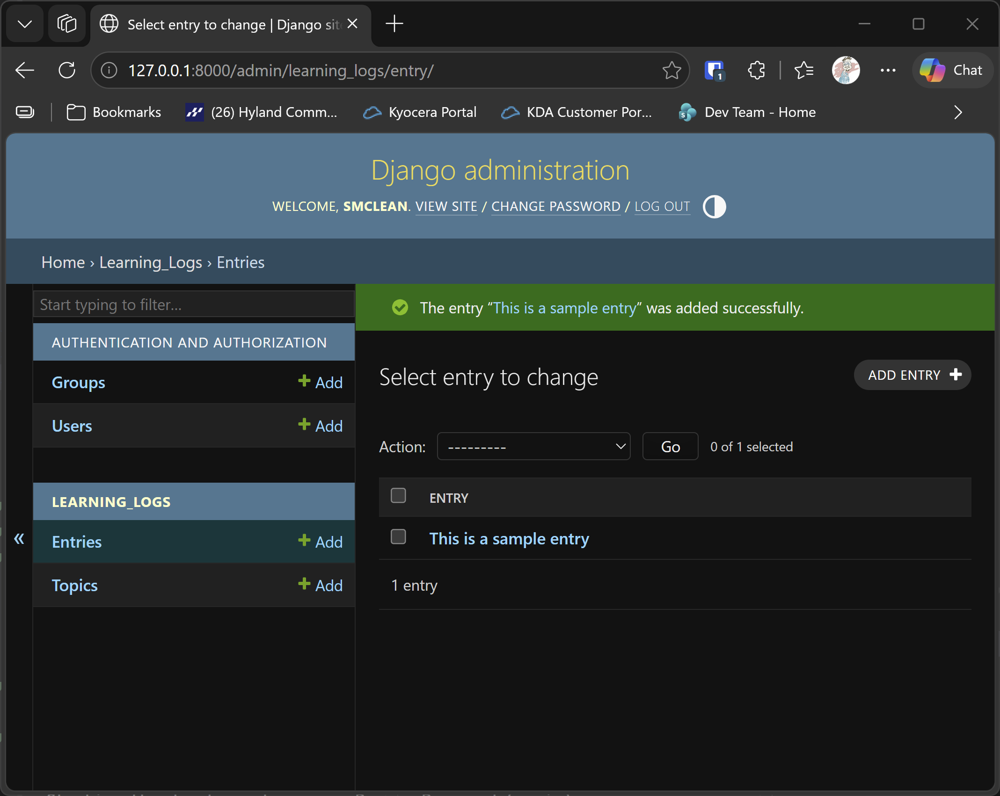

# Defining Entries

## What this step does

Topics are the subjects, and entries are the notes you make about them. A topic such as Chess might have entries like
"Knights move in an L shape." Each entry belongs to exactly one topic.

This step adds the `Entry` model, which records the text of each note and the date it was added. It also registers
entries with the admin site, and shows how to look at the data with the Django shell.

## If you're using the lesson runner

You don't need the setup steps below. The runner builds the step, creates your admin account if you haven't already this session, and loads any example data this step needs.

1. In the steps list on the left, choose **Ch18 · Getting started with django**, then **Defining Entries**.
2. Click **Run**.
3. The browser opens at `http://127.0.0.1:8000/admin/`. Sign in with the username and password you chose.
4. Under **Learning_logs** you should see **Entries** as well as **Topics**. Both lists are empty, because this step doesn't add any data yet.
5. Press **Escape** to stop the server when you're done. Moving to another step also stops it.

## For dummies: the quick version

1. In PowerShell, go to the `web-applications` folder, and make sure `(.venv)` is at the start of the line.
2. Type `python build_stage.py ch18 3 --run` and press Enter. You should see `Ran 9 tests` and `OK`.
3. In a second PowerShell window, make an admin account in the new build. Each build starts a new database, so the account
   from step 2 doesn't exist here:

   ```pwsh
   cd build\ch18-getting-started-with-django-step-03
   python manage.py createsuperuser
   ```

4. In the browser, go to `http://127.0.0.1:8000/admin/` and sign in.
5. Click **Entries**, then **Add entry**. Choose a topic from the list, type a note in the text box, and click **Save**.
6. You should see the entry in the list. It shows the first 50 characters of its text.
7. Back in the first PowerShell window, press Ctrl+C to stop the server.

### Looking at the data with the Django shell

The shell lets you ask the database questions by typing Python. It's a good way to check your work. In the build folder,
type:

```pwsh
python manage.py shell
```

You'll see a `>>>` prompt. Type these lines, pressing Enter after each one:

```python
from learning_logs.models import Topic, Entry
Topic.objects.all()
topic = Topic.objects.get(text="Chess")
topic.entry_set.all()
```

`Topic.objects.all()` lists every topic. `Topic.objects.get(text="Chess")` finds one topic by its text. `topic.entry_set.all()`
lists the entries that belong to it. Type `exit()` and press Enter to leave the shell.

### Words you'll see

- **Entry:** one note about a topic.
- **Foreign key:** a link from one table to another. Here, each entry links to its topic.
- **Shell:** a prompt where you type Python and see the result straight away. `python manage.py shell` opens it.
- **`objects`:** the way Django asks the database questions, such as `.all()` for every row.

## The code

`learning_logs/models.py` now has two models. The `Entry` model is shown below:

```python
class Entry(models.Model):
    """Something specific the user has learned about a topic."""

    topic = models.ForeignKey(Topic, on_delete=models.CASCADE)
    text = models.TextField()
    date_added = models.DateTimeField(auto_now_add=True)

    class Meta:
        """Settings for the Entry model."""

        verbose_name_plural = "entries"

    def __str__(self) -> str:
        """Return a short preview of the entry's text."""
        if len(self.text) > 50:
            return f"{self.text[:50]}..."
        return self.text
```

- `topic = models.ForeignKey(Topic, on_delete=models.CASCADE)` links each entry to one topic. `CASCADE` means that if a
  topic is deleted, its entries are deleted too.
- `text = models.TextField()` holds a note of any length. `TextField` is for longer text than `CharField`.
- `verbose_name_plural = "entries"` makes the admin site say "Entries" rather than "Entrys".
- `__str__` shows the first 50 characters, followed by three dots if the note is longer.

`learning_logs/admin.py` registers both models, so you can add and view them in the browser:

```python
admin.site.register(Topic)
admin.site.register(Entry)
```

`learning_logs/migrations/0002_entry.py` creates the entries table. It depends on the topics migration from step 2, which is
why it's listed as `0002`. Django wrote it when you ran `makemigrations`.

## Testing this step

The tests in `learning_logs/tests.py` now check four more things:

- A long note is shortened to 50 characters, followed by three dots.
- A short note is shown in full.
- Deleting a topic also deletes its entries.
- The admin page for entries loads, and shows the note text.

The build runs all nine tests, and you should see `Ran 9 tests` and `OK`.

## Output

The entry list on the admin site, showing the notes you added.



## Changed files

- `learning_logs/models.py`: adds the `Entry` model
- `learning_logs/admin.py`: registers `Entry` with the admin site
- `learning_logs/migrations/0002_entry.py`: the table for entries
- `learning_logs/tests.py`: the tests for entries, and the admin page for them
